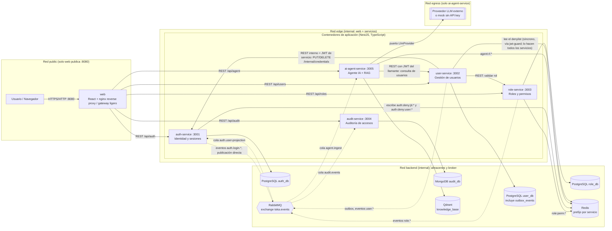
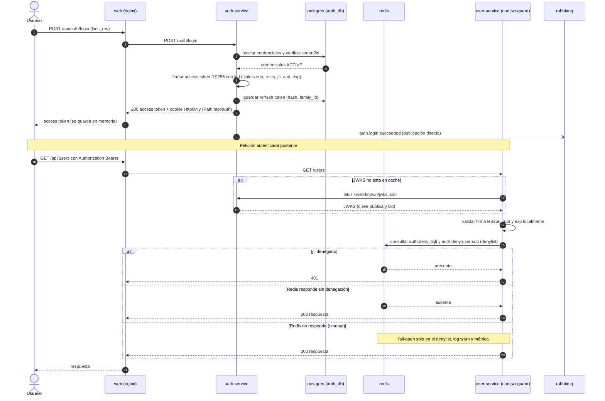
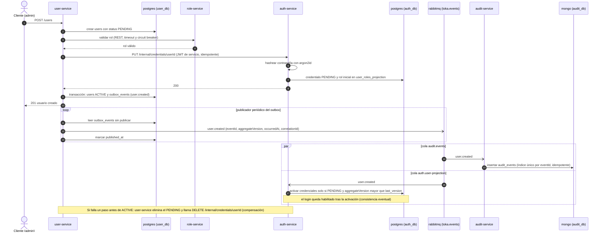
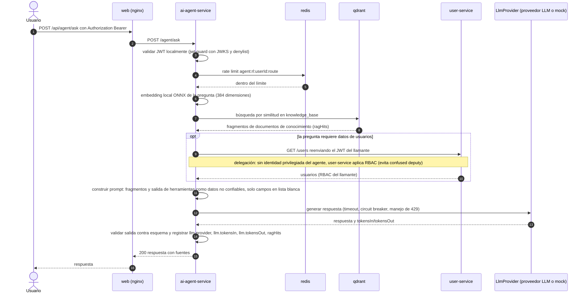

# 01 — Diagramas de arquitectura

Este documento reúne el diagrama C4 de contenedores y tres secuencias Mermaid de los flujos críticos. El contrato (nombres, puertos, eventos, bindings, claves Redis) está fijado en `openspec/changes/design-architecture-docs/design.md`; las decisiones están en `docs/adrs/` (ADR-001 a ADR-010).

Convenciones de lectura:

- **Flecha continua** = comunicación síncrona (REST) o acceso directo a un almacén.
- **Flecha punteada** = comunicación asíncrona (eventos AMQP sobre RabbitMQ, exchange `toka.events`).
- `jwt-guard` es una librería compartida (no un contenedor): en cada servicio valida el JWT localmente y consulta el denylist de Redis.
- `web` es un reverse proxy / gateway ligero (nginx + SPA React). No enruta `/internal/*` ni `/oauth/*`, que solo existen en la red interna de Docker.

## 1. C4 — Contenedores

**Redes (lectura del diagrama).** `public` solo une a `web`, que publica `8080` (una red `internal` no puede publicar puertos). `edge` es `internal` y comparte `web` con los servicios de aplicación. `backend` es `internal` y aloja almacenes y broker. `egress` es la única con salida a Internet y solo se une a `ai-agent-service` (hacia el proveedor LLM). Detalle normativo en [04-docker-compose-diseno.md](04-docker-compose-diseno.md).

**Explicación.** Los seis contenedores de aplicación (`web`, `auth-service`, `user-service`, `role-service`, `audit-service`, `ai-agent-service`) se comunican por REST cuando necesitan respuesta inmediata (validar rol, aprovisionar credenciales, consultar usuarios) y por eventos cuando basta consistencia eventual (auditoría, proyección de usuarios en auth, ingesta del agente). Cada servicio posee su almacén; la única lectura cruzada es el denylist (`auth:deny:jti:*` y `auth:deny:user:*`) en Redis (escribe auth-service, leen todos vía `jwt-guard`).

Colas y bindings (en topic, `*` casa una palabra y `#` cero o más; por eso se usa `#`):

| Cola | Bindings sobre `toka.events` | Consumidor |
|---|---|---|
| `audit.events` | `user.#`, `auth.#`, `role.#` | audit-service (escribe en Mongo) |
| `auth.user-projection` | `user.#`, `role.updated` | auth-service (activa credenciales y mantiene `user_roles_projection`) |
| `agent.ingest` | `role.#` | ai-agent-service (regenera documentos del catálogo de roles) |

Cada cola tiene cola de reintento con retardo (`<cola>.retry`) y DLQ (`<cola>.dlq`). Las denegaciones 403 no viajan por AMQP: se registran en el log con `event=access.denied` (su publicación por AMQP es Evolución).

Referencias: ADR-001 (monorepo), ADR-002 (límites de servicio y BD por servicio), ADR-004 (mensajería RabbitMQ), ADR-005 (REST y resiliencia), ADR-010 (reverse proxy).

## 2. Secuencia — Login y validación local de JWT con JWKS

**Explicación.** auth-service es el único que hashea (argon2id) y emite tokens. Los demás servicios no llaman a auth por petición: validan la firma localmente con la clave pública del JWKS (cacheada, identificada por `kid`) y consultan solo el denylist de Redis para soportar revocación. Si Redis no responde, `jwt-guard` falla abierto únicamente en el denylist (firma, `aud` y `exp` se siguen validando), con log `warn` y métrica; el riesgo queda acotado por la vida corta del access token. El refresh usa un único camino, `POST /auth/refresh`, con rotación por `family_id`. El evento `auth.login.succeeded` se publica directo (sin outbox; riesgo aceptado, respaldo `audit.fallback` en log estructurado).

Referencias: ADR-003 (JWT RS256, JWKS, RBAC, denylist), ADR-004 (eventos de auth publicados directo), ADR-010 (`limit_req`, tokens en memoria y cookie HttpOnly).

## 3. Secuencia — Alta de usuario: `user.created` vía outbox hasta auditoría

**Explicación.** El alta es una saga cerrada. user-service crea el usuario `PENDING`, valida el rol con role-service y aprovisiona credenciales en auth-service por un canal REST interno (no enrutado por nginx; exige JWT de servicio con `aud: auth-service` y `scope: svc:internal`). Luego marca `ACTIVE` y escribe `user.created` en `outbox_events` en la misma transacción; un publicador periódico lo emite a RabbitMQ (outbox transaccional solo en user-service). La entrega es at-least-once: audit-service deduplica por `eventId` y auth-service ignora eventos con `aggregateVersion` menor o igual a `last_version`, de modo que un `user.created` reintentado nunca reactiva a un usuario `DISABLED`. La reconciliación de usuarios `PENDING` huérfanos con período de gracia vive solo en user-service; auth-service nunca borra credenciales automáticamente.

Referencias: ADR-002 (saga y límites), ADR-004 (outbox, at-least-once, orden), ADR-005 (timeouts y circuit breaker user→role y user→auth), ADR-003 (argon2id solo en auth).

## 4. Secuencia — Consulta RAG del agente con reenvío del JWT

**Explicación.** La recuperación usa embeddings locales ONNX (funcionan sin API key) sobre documentos de conocimiento, no sobre PII de usuarios. Los datos de usuarios llegan solo por la herramienta REST hacia user-service, que reenvía el JWT del llamante para que user-service aplique RBAC con la identidad real. Al LLM solo se envía una lista blanca de campos (`id`, `name`, `role`, `status`). Sin `ANTHROPIC_API_KEY` el puerto `LlmProvider` selecciona el proveedor `mock` determinista; la recuperación RAG sigue siendo real. Los fragmentos recuperados y la salida de herramientas se tratan como datos no confiables (mitigación de prompt injection). El circuit breaker protege las aristas agent→user y agent→LLM; si el LLM falla, el agente degrada a una respuesta sin generación.

Referencias: ADR-008 (puerto LlmProvider, prompt injection, lista blanca), ADR-009 (RAG, ONNX, Qdrant), ADR-005 (resiliencia agent→user y agent→LLM), ADR-003 (JWT).
