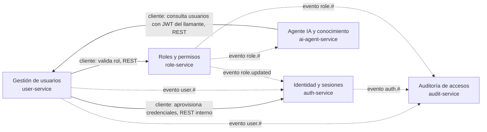

# 05 — DDD, Clean Architecture y CQRS

Este documento explica cómo se aplican Domain-Driven Design, Clean Architecture y CQRS ligero en los cinco servicios de aplicación. Decisión formal: [ADR-006](../adrs/ADR-006-clean-architecture-ddd.md). Límites de servicio y BD por servicio: [ADR-002](../adrs/ADR-002-service-boundaries-db-per-service.md). Eventos: [ADR-004](../adrs/ADR-004-async-rabbitmq-events.md).

## Contextos delimitados

Cada servicio es la implementación de un contexto delimitado con su propio modelo y su propio almacén. No existe dominio compartido: los paquetes compartidos son solo transversales (`logger`, `jwt-guard`, `contracts`; ADR-001).

| Contexto | Servicio | Lenguaje ubicuo principal | Almacén |
|---|---|---|---|
| Identidad y sesiones | `auth-service` | credencial, sesión de refresh, token, denylist | Postgres `auth_db`, Redis `auth:*` |
| Gestión de usuarios | `user-service` | usuario, estado, rol asignado, alta | Postgres `user_db` (con `outbox_events`) |
| Roles y permisos | `role-service` | rol, permiso, asignación de permisos | Postgres `role_db`, Redis `role:*` |
| Auditoría de accesos | `audit-service` | evento de auditoría, actor, recurso | MongoDB `audit_db` |
| Agente IA y conocimiento | `ai-agent-service` | documento de conocimiento, fragmento, consulta | Qdrant, Redis `agent:*` |

### Mapa de contextos



Relaciones entre contextos:

- **Cliente/proveedor síncrono** (flecha continua): `user-service` consulta a `role-service` y a `auth-service`; `ai-agent-service` consulta a `user-service`. Cada cliente traduce la respuesta a su propio modelo mediante un puerto y un adaptador (capa anticorrupción mínima); no importa tipos del otro dominio.
- **Publicador/suscriptor asíncrono** (flecha punteada): los eventos de integración llevan solo datos de contrato (`packages/contracts`). `auth-service` mantiene su propia proyección `user_roles_projection` en lugar de consultar a `user-service`.
- **Conformista en un solo punto**: todos los servicios aceptan el contrato de claims del JWT que define auth-service (ADR-003).

## Agregados

Un agregado por contexto como raíz de consistencia; las invariantes viven en la entidad, no en el caso de uso (evita dominio anémico).

### Gestión de usuarios — `user-service`

- **Agregado `User`** (entidad raíz). Atributos: `id`, `email` (único; user-service es la fuente de verdad), `name`, `status` (`PENDING` | `ACTIVE` | `DISABLED`), `roleId`, marcas de tiempo.
- **Invariantes**: el email es único y con formato válido; un usuario nace `PENDING` y solo pasa a `ACTIVE` cuando el rol fue validado y las credenciales fueron aprovisionadas; `DISABLED` no vuelve a `ACTIVE` por un evento atrasado; la contraseña inicial nunca forma parte del agregado (no se persiste ni se loguea).
- **Objetos de valor**: `Email`, `UserStatus`, `RoleRef` (solo el identificador del rol).
- **Eventos de dominio** (se traducen a eventos de integración vía outbox): `user.created`, `user.updated`, `user.deleted`, `user.role.assigned`.
- **Puertos**: `UserRepository` (persistencia), `RoleGateway` (valida el rol por REST), `CredentialGateway` (`PUT`/`DELETE /internal/credentials/{userId}`), `OutboxPublisher`.
- **Caso de uso central**: `CreateUser` orquesta la saga de alta con compensación (ADR-002) y escribe el estado `ACTIVE` y `outbox_events(user.created)` en la misma transacción.

### Identidad y sesiones — `auth-service`

- **Agregado `Credential`**. Atributos: `userId`, `email`, `passwordHash` (argon2id; solo auth hashea), `status` (`PENDING` | `ACTIVE` | `DISABLED`), `lastVersion`. Entidad subordinada: **`RefreshSession`** (familia `family_id`, hash del token, expiración, revocación) como agregado separado de ciclo de vida corto.
- **Invariantes**: login rechazado mientras la credencial esté `PENDING` o `DISABLED`; activación solo desde `PENDING` y solo con `aggregateVersion` mayor que `lastVersion`; rotación de refresh con detección de reutilización (reutilizar un token de una familia revoca la familia).
- **Eventos de dominio**: `auth.login.succeeded`, `auth.login.failed`.
- **Puertos**: `CredentialRepository`, `RefreshSessionRepository`, `PasswordHasher`, `TokenSigner`, `DenylistStore` (Redis), `UserRolesProjection`, `EventPublisher`.

### Roles y permisos — `role-service`

- **Agregado `Role`** con la colección de permisos como parte del agregado (`permissions` se modifican solo a través de `Role`). `Permission` es un objeto de valor identificado por su código.
- **Invariantes**: nombre de rol único; un rol asignado a usuarios no se elimina; el conjunto de permisos no contiene códigos duplicados.
- **Eventos de dominio**: `role.created`, `role.updated`, `role.permissions.changed`.
- **Puertos**: `RoleRepository`, `PermissionCache` (Redis `role:perm:{roleId}`), `EventPublisher`.
- Es un CRUD con caché: no lleva CQRS (ver más abajo).

### Auditoría de accesos — `audit-service`

- **Agregado `AuditEvent`**, inmutable y append-only. Atributos: `eventId` (único), `type`, `actor`, `resource`, `payload`, `correlationId`, `occurredAt`, `receivedAt`.
- **Invariantes**: nunca se actualiza ni se borra; `eventId` único garantiza idempotencia ante entregas repetidas (at-least-once).
- **Puertos**: `AuditEventWriter` (escritura idempotente), `AuditEventReader` (consulta filtrada y paginada).

### Agente IA y conocimiento — `ai-agent-service`

- **Agregado `KnowledgeDocument`** (documento de conocimiento con `docId` estable, `source`, `roleScope` y la lista de fragmentos derivados). La reingesta de un mismo `docId` reemplaza sus fragmentos (upsert idempotente).
- **Invariantes**: solo se indexan documentos de conocimiento, nunca PII de usuarios; cada fragmento respeta el límite de tokens del modelo de embeddings.
- **Puertos**: `LlmProvider`, `EmbeddingProvider`, `KnowledgeStore` (Qdrant), `UserDirectoryGateway` (REST hacia user-service reenviando el JWT del llamante), `RateLimiter`.
- Detalle de IA y RAG: [08-integracion-ia-rag.md](08-integracion-ia-rag.md).

## Regla de dependencia

Cada servicio se organiza en cuatro capas con dependencias que apuntan solo hacia adentro:

```
interfaces ──▶ application ──▶ domain
infrastructure ──▶ application ──▶ domain      (infrastructure implementa los puertos)
```

| Capa | Contenido | Puede importar de |
|---|---|---|
| `domain` | Entidades, agregados, objetos de valor, eventos de dominio, interfaces de puertos | nada (ni NestJS, ni Prisma, ni Mongoose, ni SDKs) |
| `application` | Casos de uso, orquestación, transacciones lógicas, DTO internos | `domain` |
| `infrastructure` | Adaptadores: Prisma, Mongoose, Redis, RabbitMQ, clientes HTTP, proveedor LLM, ONNX, Qdrant | `domain`, `application` |
| `interfaces` | Controladores REST, consumidores de mensajes, guards, validación de entrada | `application` (y tipos de `domain` para mapear) |

Reglas operativas:

1. `domain` no conoce el framework: se prueba con pruebas unitarias sin infraestructura (apoya el umbral de cobertura de [ADR-007](../adrs/ADR-007-observability-quality-testing.md)).
2. Los puertos se declaran en `domain` o `application` y se implementan en `infrastructure`; la composición se hace en el módulo de NestJS mediante inyección de dependencias.
3. Los controladores y consumidores no contienen reglas de negocio: validan el formato, invocan un caso de uso y mapean el resultado.
4. Los eventos de dominio se emiten desde el agregado; es `infrastructure` quien los traduce a eventos de integración (outbox en user-service).
5. Verificación de la regla: revisión de código y pruebas; una regla de lint automática sobre imports entre capas es Evolución (ADR-006).

## CQRS

CQRS ligero significa: mismo almacén, sin event sourcing, manejadores de comando y de consulta separados y, donde aporta, un modelo de lectura propio.

### Dónde se aplica

- **`audit-service`**: el lado de escritura es el consumidor idempotente que inserta en `audit_events`; el lado de lectura es `GET /audit/events` con filtros (actor, tipo, rango de fechas) y paginación sobre índices dedicados (`occurredAt`, `actor.userId`, `type`). Hay una asimetría real: escritura masiva, simple y append-only frente a lectura filtrada.
- **Consulta del agente** (`POST /agent/ask`): el flujo recuperación RAG, herramienta REST de solo lectura y generación se modela como una consulta sin efectos sobre el dominio. Es el único camino de lectura del agente; la ingesta (`POST /agent/ingest`, cola `agent.ingest`) es el lado de comando y está separada.

### Dónde NO se aplica

- **`role-service`**: CRUD con caché de permisos; no hay asimetría que justifique modelos separados.
- **`user-service` y `auth-service`**: sus lecturas y escrituras operan sobre el mismo agregado y requieren consistencia inmediata; separar modelos añadiría proyecciones sin beneficio. (`auth-service` mantiene `user_roles_projection` por autonomía de datos entre contextos, no como CQRS.)

Se descartó CQRS completo con event sourcing en todos los servicios por la complejidad desproporcionada (ADR-006, Alternativa 2).
