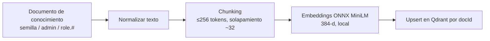

# 08 — Integración de IA y RAG

Describe el módulo `ai-agent-service` (puerto 3005): agente de consulta con recuperación aumentada (RAG) sobre documentos de conocimiento. Decisiones formales: [ADR-008](../adrs/ADR-008-llm-provider-port.md) (puerto `LlmProvider`), [ADR-009](../adrs/ADR-009-rag-onnx-embeddings-qdrant.md) (RAG local y Qdrant), [ADR-005](../adrs/ADR-005-sync-rest-resilience.md) (resiliencia) y [ADR-006](../adrs/ADR-006-clean-architecture-ddd.md) (capas). Los valores sensibles al tiempo (modelo, precios) no se fijan aquí: son configurables vía variables de entorno y se verifican contra la documentación del proveedor en el cambio `build-ai-agent-rag-service`.

## Componentes

| Componente | Responsabilidad | Implementación |
|---|---|---|
| Puerto `LlmProvider` | Generación de texto; el dominio no conoce SDKs | Adaptador Anthropic (por defecto) y adaptador `mock`; ranura OpenAI/Azure OpenAI = Evolución |
| Puerto `EmbeddingProvider` | Vectores de 384 dimensiones | ONNX MiniLM local; `hash` solo en tests unitarios |
| `KnowledgeStore` | Búsqueda por similitud | Qdrant, colección `knowledge_base` (coseno) |
| `UserDirectoryGateway` | Herramienta REST de solo lectura hacia user-service | HTTP con circuit breaker, reenvía el JWT del llamante |
| `RateLimiter` | Rate limit por usuario | Redis `agent:rl:{userId}:{route}` |

Flujo de consulta (`POST /agent/ask`, requiere JWT): validar JWT con `jwt-guard`, aplicar rate limit, recuperar fragmentos en Qdrant, invocar si procede la herramienta REST hacia user-service con el JWT del llamante, construir el prompt con el contenido delimitado y generar con `LlmProvider`. La respuesta incluye las fuentes (`docId`) usadas. Cada llamada registra `llm.provider`, `llm.tokensIn`, `llm.tokensOut` y `ragHits` (ADR-007), nunca el contenido del prompt.

## Pipeline de ingesta

Qué se indexa: **documentos de conocimiento** (políticas, catálogo de roles y permisos, guías de uso). **No se ingiere PII de usuarios**: los datos de usuarios llegan solo por la herramienta REST (frescos y sujetos a RBAC), nunca por el vector store.

Orígenes de ingesta:

1. **Semilla**: documentos de conocimiento versionados en el repositorio, cargados al arrancar de forma idempotente.
2. **Administración**: `POST /agent/ingest` (solo rol admin) para añadir o actualizar documentos.
3. **Eventos `role.#`**: la cola `agent.ingest` (binding `role.#` sobre `toka.events`) regenera los documentos del catálogo de roles cuando cambian roles o permisos. El consumidor es idempotente por `eventId` y tolera reordenamientos (ADR-004).

Etapas:

- **Chunking**: fragmentos de **≤256 tokens con solapamiento de ~32**, que respeta el límite de entrada de MiniLM. El solapamiento mitiga cortes de contexto en los límites.
- **Embeddings**: modelo **ONNX MiniLM de 384 dimensiones**, ejecutado localmente, sin llamadas externas. El modelo se **hornea en la imagen** (base Debian-slim, no Alpine, por compatibilidad con ONNX Runtime), de modo que el arranque no requiere descargas ni red.
- **`hash` solo en tests**: el embedding determinista por hash existe únicamente para pruebas unitarias; nunca se usa en ejecución normal.
- **Qdrant**: colección `knowledge_base` (384-d, distancia coseno), payload `{source, docId, chunkIdx, roleScope}`. **Upsert por `docId` estable**: reingestar un documento reemplaza sus fragmentos y es idempotente.
- **`roleScope`**: el filtro por `roleScope` es **obligatorio** en la recuperación y usa el rol del JWT del llamante, para no devolver fragmentos destinados a otro rol.
- Cambiar de modelo de embeddings exige reindexar la colección (la dimensión forma parte del contrato).

## Proveedor mock

La selección del proveedor es automática al arrancar:

| Condición | Proveedor de generación | Embeddings y RAG |
|---|---|---|
| Hay `ANTHROPIC_API_KEY` | Adaptador Anthropic | ONNX local + Qdrant |
| No hay `ANTHROPIC_API_KEY` | `mock` determinista | ONNX local + Qdrant (RAG real) |

Impacto:

- **Evaluación**: el sistema arranca y responde sin credenciales; el evaluador puede ejecutar el flujo completo con `docker compose up`.
- **Pruebas**: las pruebas de integración usan `mock` sin red ni coste; las unitarias pueden usar además embeddings `hash`.
- **Alcance del `mock`**: solo la generación es simulada. La recuperación es real con embeddings locales, de modo que `ragHits` y las fuentes devueltas reflejan el comportamiento verdadero. Las respuestas son deterministas y no reflejan la calidad de un LLM real.
- El `mock` **no** se usa como degradación ante fallos del proveedor: servir texto simulado a usuarios reales confunde. Cuando el circuit breaker agent→LLM está abierto, el proveedor no responde o se agota el presupuesto, el agente responde **solo con los fragmentos recuperados, marcando que no hay generación** (ver [07-resiliencia.md](07-resiliencia.md)).

## Identidad y datos

- **Identidad delegada**: `POST /agent/ask` exige JWT. La herramienta REST hacia user-service **reenvía el JWT del llamante**; user-service aplica RBAC sobre ese token. El agente no tiene identidad privilegiada propia, lo que evita el problema del confused deputy: un usuario sin permiso para listar usuarios no puede obtenerlos preguntándole al agente.
- **Lista blanca de campos al LLM**: de los datos de usuario solo se envían `id`, `name`, `role` y `status`. Nunca se envían hash de contraseña, email completo ni otros datos sensibles, salvo decisión explícita documentada. El filtrado ocurre en el adaptador de la herramienta, antes de construir el prompt.
- **Sin PII en el vector store**: ver `## Pipeline de ingesta`.
- **Logs**: se registran proveedor, tokens y aciertos de RAG, pero no el contenido del prompt ni de la respuesta.

## Prompt injection

Riesgo cubierto: OWASP LLM01. Documentos recuperados y salidas de herramientas pueden contener instrucciones maliciosas. Controles de diseño:

| Control | Detalle |
|---|---|
| Datos no confiables | El contenido recuperado de Qdrant y la salida de herramientas se delimitan en el prompt y se declaran como datos, no como instrucciones |
| Herramientas de solo lectura | El agente solo consulta; no puede crear, modificar ni borrar usuarios |
| Autorización delegada | Cualquier acción de la herramienta pasa por el RBAC de user-service con el JWT del llamante |
| Validación de salida | La respuesta se valida contra un esquema y se acota con `max_tokens` |
| Lista blanca de campos | Limita qué datos pueden filtrarse hacia el modelo |
| Sin PII indexada | Un documento malicioso no puede exfiltrar datos de usuarios que no estén en el almacén |
| Ingesta restringida | Solo admin ingesta documentos (`POST /agent/ingest`); los de `role.#` se generan internamente |

La mitigación reduce, no elimina, el riesgo: por eso las herramientas son de solo lectura y el RBAC es el control de último recurso.

## Rate limit y manejo de 429

- **Rate limit por usuario** en Redis (`agent:rl:{userId}:{route}`) para proteger costo y disponibilidad; al excederse responde `429` con cabecera `Retry-After`.
- **429 del proveedor**: limitador de concurrencia hacia el LLM y circuit breaker agent→LLM (ADR-005). Con `retry-after` solo se espera si cabe en el presupuesto restante. Con el circuito abierto, el agente degrada a una respuesta sin generación que devuelve solo los fragmentos recuperados, indicándolo.
- **Presupuesto de tiempo extremo a extremo** (coherente con 07 y ADR-008): *deadline* del agente de **30 s**; llamada al LLM 20 s; como máximo 1 reintento y solo si queda presupuesto; herramienta hacia user-service 3 s. nginx usa `proxy_read_timeout` de **40 s** en `/api/agent/`, de modo que el agente degrada antes de que nginx corte (nginx > agente > LLM).
- **Agotamiento**: respuesta degradada (solo fragmentos) y cancelación de la petición en curso con `AbortController`: se deja de esperar, pero el consumo ya iniciado en el proveedor puede facturarse; `max_tokens` acota el coste (el streaming sería la evolución para cortar la generación).
- `x-correlation-id` propagado en todas las llamadas.

## Costo de tokens

El costo se estima a partir de los tokens de entrada y salida que reporta el proveedor y se registra en los logs (`llm.tokensIn`, `llm.tokensOut`). Los precios por millón de tokens se leen de las variables de entorno `LLM_PRICE_INPUT_PER_MTOK` y `LLM_PRICE_OUTPUT_PER_MTOK`; este repositorio no documenta sus valores. El modelo también se selecciona por variable de entorno. Si las variables de precio no están definidas, el servicio registra tokens sin estimar costo.

## Qué es Implementado y qué es Evolución

- **Implementado en `build-ai-agent-rag-service`**: puerto `LlmProvider`, adaptadores Anthropic y `mock`, embeddings ONNX, ingesta, consulta con herramienta REST, lista blanca, defensas de prompt injection y rate limit.
- **Evolución**: adaptador OpenAI/Azure OpenAI, modelos de embeddings multilingües mayores y reindexado versionado.
