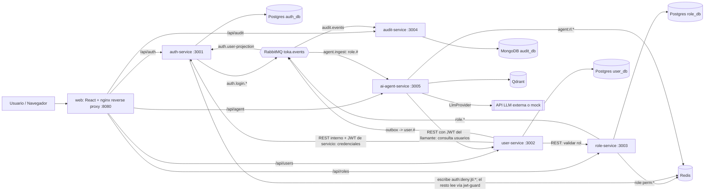

# Design — design-architecture-docs

Este documento fija las decisiones de arquitectura de alto nivel y el **contrato documental** que los 8 documentos de `docs/architecture/`, los 10 ADRs y los 8 cambios de implementación posteriores deben respetar. Versiones mayores del stack (Node 22, NestJS 11, React 18) provienen de `AGENTS.md`; versiones de imágenes y librerías no listadas allí quedan `needs-verification` (context7 no disponible para este agente). Revisado tras la auditoría externa `docs/audit/design-architecture-docs-audit.md` (hallazgos H1–H20 mapeados en el resumen de cambios del handback).

## Architecture decisions

Cada decisión se desarrolla como ADR en `docs/adrs/` (tareas 1.1–1.3). Cada ADR incluye una sección `## Implementación` que marca qué es **Implementado en `<cambio>`** y qué es **Evolución** (no implementado, riesgo aceptado), para que el evaluador no penalice ausencias declaradas.

| ADR | Decisión | Alternativa principal descartada | Implementación |
|---|---|---|---|
| ADR-001 | Monorepo pnpm, TypeScript + NestJS en todos los servicios; paquetes compartidos solo transversales (`logger`, `jwt-guard`, `contracts`), nunca dominio compartido; `contracts` versionado con compatibilidad hacia atrás | Poliglota (Python FastAPI para IA); repos separados | Implementado en `bootstrap-monorepo-platform` |
| ADR-002 | Límites de servicio por contexto delimitado; BD por servicio (Postgres: auth/user/role con un rol de BD por base; Mongo: audit; Qdrant: agent; Redis con prefijo por servicio por convención). Única excepción de lectura cruzada: `auth:deny:jti:*` (ver ADR-003) | BD compartida única | Implementado en `bootstrap-monorepo-platform` (init de Postgres con rol por base; prefijos Redis) y `build-*`; usuarios ACL de Redis = Evolución (los prefijos son convención, no frontera) |
| ADR-003 | JWT RS256 autoemitido por auth-service + JWKS con una sola clave y cabecera `kid`; claims `aud`; validación local; RBAC por rol; refresh con rotación en cookie HttpOnly (único camino: `POST /auth/refresh`); denylist `auth:deny:jti:*` (escribe auth, leen todos vía `jwt-guard`; si Redis no responde, `jwt-guard` falla abierto solo en el denylist, con log de advertencia y métrica, acotado por access token ≤5–15 min; firma y `exp` siguen validándose); `/oauth/token` (`client_credentials`, solo red interna) para tokens de servicio; cita la cláusula del PDF "puede usar JWT con validación distribuida" | Keycloak/OIDC completo; sesiones opacas con introspección; revocación solo por vida corta; fallo cerrado ante caída de Redis (tumba los 5 servicios) | Implementado en `build-auth-role-services`; rotación de claves con JWKS actual+previa y discovery `/.well-known/openid-configuration` = Evolución |
| ADR-004 | RabbitMQ (exchange topic, bindings con `#`), contratos versionados, at-least-once + consumidores idempotentes, reintentos con colas de retardo antes de DLQ, orden por `occurredAt` + `aggregateVersion` (los consumidores ignoran eventos viejos), **outbox transaccional solo en user-service** (alimenta auditoría); eventos de auth publicados directo con respaldo `audit.fallback` en log estructurado si se agotan los reintentos (outbox de auth y `access.denied` por AMQP = Evolución, riesgo aceptado) | Kafka (KRaft); CDC (Debezium) | Implementado en `build-user-audit-services` |
| ADR-005 | REST + OpenAPI por servicio, timeouts por arista, reintentos con backoff, circuit breaker solo en user→role, user→auth, agent→user y agent→LLM, `x-correlation-id` | gRPC; service mesh; circuit breaker en todas las aristas | Implementado en `build-user-audit-services` y `harden-compose-resilience-security` |
| ADR-006 | Clean Architecture (`domain/application/infrastructure/interfaces`) + DDD (agregados por contexto) + CQRS ligero solo en audit-service (modelo de lectura) y en el flujo de consulta del agente; no en role-service | Capas tradicionales (controller/service/repo) | Implementado en `build-auth-role-services`, `build-user-audit-services`, `build-ai-agent-rag-service` |
| ADR-007 | Logs JSON con pino y campos estándar (ver "Campos de log"); Jest con `coverageThreshold` 70 por servicio (líneas; ramas informativas); `## Testing strategy` obligatorio; perfil compose opcional `observability` para logs centralizados | Logging de texto; sin umbral por servicio | `packages/logger` en `bootstrap-monorepo-platform`; perfil `observability` Evolución opcional en `harden-compose-resilience-security` |
| ADR-008 | Puerto `LlmProvider`: Anthropic por defecto (permitido por el PDF, Ex5), ranura de adaptador OpenAI/Azure OpenAI (Ex1 los nombra), `mock` determinista sin API key, manejo de 429 (reintentos del SDK + limitador de concurrencia + rate limit por usuario en Redis); modelo y precios por env (`LLM_PRICE_INPUT_PER_MTOK`, `LLM_PRICE_OUTPUT_PER_MTOK`, sin valores en docs); sección de **prompt injection**; lista blanca de campos enviados al LLM | OpenAI/Azure OpenAI como único proveedor; llamada directa sin puerto | Anthropic + mock: `build-ai-agent-rag-service`; adaptador OpenAI/Azure: Evolución |
| ADR-009 | RAG sobre **documentos de conocimiento** (políticas, catálogo de roles/permisos, guías), no sobre PII de usuarios; embeddings locales ONNX MiniLM (384-d); chunks ≤256 tokens con solapamiento ~32; modelo horneado en imagen Debian-slim; `hash` solo para tests unitarios; Qdrant | Embeddings por API externa; Chroma; ingesta de usuarios al vector store | Implementado en `build-ai-agent-rag-service` |
| ADR-010 | Frontend React 18 + Vite + TS, Redux Toolkit + RTK Query, Jest + RTL (no Vitest) con `config.ts` que envuelve `import.meta.env` (mock en Jest); nginx como **reverse proxy / gateway ligero**; access token en memoria, refresh en cookie HttpOnly (`Secure` configurable por env para desarrollo; documentar acceso por `localhost`); rate limit en `/api/auth/login` | Zustand; gateway NestJS como 5.º servicio; tokens en localStorage | Implementado en `build-frontend-user-console` |

Decisiones de documentación de este cambio:

- **D1 — Documentos temáticos numerados** (`01-` … `08-`) en lugar de un único archivo.
- **D2 — Mermaid como formato de diagramas** (el PDF acepta "formato visual o Mermaid").
- **D3 — ADRs: encabezados estructurales en inglés (los de `forge:adr`), contenido en español**.
- **D4 — `status: proposed`** en el frontmatter de los ADRs hasta que el usuario apruebe el 📋; luego el orquestador los pasa a `accepted`.
- **D5 — Valores sensibles al tiempo** (modelo LLM, precios, versiones exactas de imágenes) no se fijan en docs: "configurable vía env; verificado contra documentación de Anthropic en `build-ai-agent-rag-service`".
- **D6 — Terminología**: nginx es "reverse proxy / gateway ligero"; cubre el "servicio de agregación simple o BFF básico si es necesario" del PDF sin mediar tokens.

## Component diagram



El C4 formal (contenedores + secuencias) lo produce la tarea 2.1 en `docs/architecture/01-diagramas.md` a partir de este esquema. `jwt-guard` es una librería (no un contenedor) que en cada servicio lee el denylist de Redis.

## Data model

### Catálogo de servicios (contrato)

| Servicio | Contexto delimitado | Puerto | Almacenes | Publica | Consume (cola) |
|---|---|---|---|---|---|
| `auth-service` | Identidad y sesiones | 3001 | Postgres `auth_db`, Redis (`auth:*`) | `auth.login.succeeded`, `auth.login.failed` | `user.#` y `role.updated` (cola `auth.user-projection`) |
| `user-service` | Gestión de usuarios | 3002 | Postgres `user_db` (incl. tabla `outbox_events`) | `user.created`, `user.updated`, `user.deleted`, `user.role.assigned` (vía outbox) | — |
| `role-service` | Roles y permisos | 3003 | Postgres `role_db`, Redis (`role:*`) | `role.created`, `role.updated`, `role.permissions.changed` | — |
| `audit-service` | Auditoría de accesos | 3004 | MongoDB `audit_db` | — | `user.#`, `auth.#`, `role.#` (cola `audit.events`) |
| `ai-agent-service` | Agente IA + RAG | 3005 | Qdrant, Redis (`agent:*`) | — | `role.#` (cola `agent.ingest`; regenera documentos de catálogo de roles) |
| `web` | Presentación + reverse proxy | 8080 | — | — | — |

Las denegaciones (403) se registran en el log de cada servicio con pino (`statusCode=403`, `event=access.denied`); su publicación por AMQP hacia `audit.events` (binding `access.#`) es **Evolución** (evita credenciales de broker en todos los servicios y amplificación de escrituras en Mongo). Los puertos son parte del contrato. Infra: Postgres 17 (una instancia, tres bases lógicas con un rol de BD por base sin permisos cruzados — trade-off en ADR-002), MongoDB 7, Redis 7 (prefijos por convención; usuarios ACL = Evolución), RabbitMQ 3.13 (AMQP 5672, gestión 15672), Qdrant (6333). `needs-verification` en etiquetas exactas de imagen.

Redes de compose (contrato, R4-1): `public` (solo `web`; publica `8080`), `edge` (`internal: true`; `web` y los 5 servicios), `backend` (`internal: true`; servicios e infraestructura de datos), `egress` (única con salida a Internet; solo `ai-agent-service`) y `grafana-ui` (solo perfil `observability`; publica Grafana en loopback). Así solo `web` (vía `public`) y `ai-agent-service` (vía `egress`) tienen salida; `harden-compose-resilience-security` verifica que `user-service` no pueda hacer `fetch` a Internet.

### Eventos (RabbitMQ)

- Exchange `toka.events` (topic, durable); exchange de mensajes muertos `toka.events.dlx`.
- Colas y bindings (en topic `*` casa UNA palabra y `#` cero o más; por eso las claves de 3 segmentos exigen `#`):
  - `audit.events`: `user.#`, `auth.#`, `role.#` (`access.#` reservado para Evolución)
  - `auth.user-projection`: `user.#`, `role.updated`
  - `agent.ingest`: `role.#`
  - cada cola tiene cola de reintento con retardo (`<cola>.retry`) y DLQ `<cola>.dlq`.
- Política de consumidor: ante error transitorio, reintento hasta N veces (configurable, por defecto 3) con retardos crecientes mediante colas de retardo (TTL + DLX; valores configurables, p. ej. 5 s / 30 s / 2 min), contador en cabecera `x-retry-count`; agotados los reintentos, mensaje a `<cola>.dlq`. Procedimiento de re-drive de la DLQ (mover de vuelta a la cola principal tras corregir la causa) documentado en 07-resiliencia.
- Sobre del evento: `eventId` (UUID), `type` (routing key), `version` (entero, versión del esquema del evento), `aggregateVersion` (entero monotónico por agregado), `occurredAt` (ISO-8601 UTC), `correlationId`, `actor` (`{userId, roles}` o `system`), `payload`.
- Payload de `user.role.assigned` (contrato): `userId`, `roleId`, `roleName`, `roleVersion` (versión del rol que user-service obtiene de `GET /roles/{id}` al validarlo), más `aggregateVersion` (del usuario) y `occurredAt` del sobre. auth-service usa `roleId`/`roleName`/`roleVersion` para sembrar `role_names_projection` (solo si `roleVersion` es mayor que `last_version`) y `aggregateVersion` para `user_roles_projection`.
- Semántica: at-least-once; consumidores idempotentes por `eventId` (índice único en Mongo; tabla/clave de dedupe en proyecciones y en ingesta del agente).
- Orden: las colas de retardo rompen el orden, así que los consumidores de proyección aplican un evento solo si su `aggregateVersion` es mayor que la última almacenada del mismo agregado (`user_last_version` en las proyecciones de usuario, `last_version` en `role_names_projection`) e ignoran los viejos/duplicados. Un `user.created` reintentado nunca reactiva a un usuario `DISABLED`.
- Garantía de publicación: **user-service** usa outbox transaccional (`outbox_events` escrito en la misma transacción que el cambio; publicador periódico marca como enviado). **auth-service y role-service publican directo** con reintento en memoria (role-service: riesgo aceptado, se re-sincroniza al arrancar republicando el estado vigente de roles y permisos; esos eventos de re-sincronización llevan `actor=system` y `reason=resync` en el sobre/payload, para distinguirlos de cambios reales en la auditoría, y usan `eventId` determinista —hash de `roleId` + `aggregateVersion`— para que audit los deduplique). Riesgo aceptado: un fallo del proceso, o una caída de RabbitMQ más larga que la ventana de reintento, pierde eventos `auth.login.*` (escenario relevante para Ex4). Mitigación: al agotar reintentos se escribe el sobre completo como línea de log estructurada `event="audit.fallback"`, recuperable con la receta `jq` (ADR-007). Outbox de auth y `access.denied` por AMQP = Evolución.

### APIs (nivel de diseño)

| Servicio | Endpoints principales |
|---|---|
| auth | `POST /auth/login`, `POST /auth/refresh`, `POST /auth/logout`, `GET /.well-known/jwks.json`; el único camino de refresco es `POST /auth/refresh` (cookie con `Path=/api/auth`). Internos (NO enrutados por nginx, solo red interna de Docker): `POST /oauth/token` (`grant_type=client_credentials`, para tokens de servicio); discovery `/.well-known/openid-configuration` = Evolución. Internos con JWT de servicio (NO enrutados por nginx; exigen JWT de servicio con `aud: auth-service` y `scope: svc:internal`): `PUT /internal/credentials/{userId}` (idempotente por `user_id`; recibe email, contraseña inicial en claro solo por este canal interno —nunca se loguea ni se persiste fuera de auth— y rol inicial) y `DELETE /internal/credentials/{userId}` (compensación) |
| user | `GET/POST /users`, `GET/PATCH/DELETE /users/{id}`, `PUT /users/{id}/role` |
| role | `GET/POST /roles`, `GET/PATCH/DELETE /roles/{id}`, `PUT /roles/{id}/permissions` |
| audit | `GET /audit/events` (filtros: actor, tipo, rango de fechas, paginación) |
| agent | `POST /agent/ask`, `POST /agent/ingest` (admin; documentos de conocimiento) |
| todos | `GET /health` (liveness) y `GET /ready` (readiness) |

nginx enruta `/api/{auth,users,roles,audit,agent}` al servicio correspondiente (reverse proxy / gateway ligero, ADR-010) y aplica `limit_req` a `/api/auth/login`; no enruta `/internal/*` ni `/oauth/*`.

### Modelo de datos (entidades principales)

- **auth_db**: `credentials(id, user_id unique, email unique, password_hash, status[PENDING|ACTIVE|DISABLED], created_at)`, `user_roles_projection(user_id, role_id, user_last_version, updated_at)` (asignación usuario→rol; se siembra con el rol inicial en `PUT /internal/credentials` y se mantiene con `user.role.assigned` y `user.updated`, ignorando eventos con `aggregateVersion` <= `user_last_version`), `role_names_projection(role_id, role_name, last_version)` (se actualiza solo con `role.updated`, y solo si su `aggregateVersion` es mayor que `last_version`; el nombre se resuelve por join al emitir el token, de modo que reasignar un rol nunca reinicia ni hereda versiones de otro agregado; evolución: claim con un `code` de rol inmutable en lugar del nombre editable); `credentials` guarda `user_last_version`, `refresh_tokens(id, user_id, family_id, token_hash, expires_at, revoked_at)`, `processed_events(event_id)` para idempotencia.
- **user_db**: `users(id, email unique, name, status[PENDING|ACTIVE|DISABLED], role_id, created_at, updated_at)` (user-service es la fuente de verdad del email), `outbox_events(id, type, payload, created_at, published_at)`.
- **role_db**: `roles(id, name, description)`, `permissions(id, code)`, `role_permissions(role_id, permission_id)`.
- **audit_db (Mongo)**: colección `audit_events {eventId(unique), type, actor, resource, payload, correlationId, occurredAt, receivedAt}`; append-only, índices por `occurredAt`, `actor.userId`, `type`.
- **Redis** — todas las claves con prefijo del servicio propietario por convención (usuarios ACL por prefijo = Evolución; ADR-002). Escribe solo el propietario; **única excepción de lectura cruzada y justificada**: `auth:deny:jti:{jti}` (denylist con TTL = vida restante del access token) escrita por auth-service y leída por todos los servicios a través de `jwt-guard` en modo solo lectura, porque la validación local de JWT es inútil para revocar sin consultarla. La excepción de lectura cruzada cubre exactamente `auth:deny:jti:*` y `auth:deny:user:*`: `auth:deny:user:{userId}` (valor = timestamp de revocación; TTL = vida máxima del access token): al deshabilitar/borrar un usuario o cambiar su rol, auth escribe la clave y `jwt-guard` rechaza todo token con `iat` < timestamp; el denylist por `jti` se mantiene para logout. Redis se protege con `requirepass ${REDIS_PASSWORD}` (secreto en el env de cada servicio que lo usa). Claves: `auth:deny:jti:{jti}`, `auth:deny:user:{userId}`, `auth:rl:login:{ip}`, `role:perm:{roleId}` (caché de permisos; propietario role-service), `<svc>:jwks` (caché JWKS por servicio), `agent:rl:{userId}:{route}` (rate limit del agente). **Redis caído** (política de `jwt-guard`, ADR-003 y matriz de fallos de 07): timeout corto en la consulta del denylist; si falla, la petición continúa validando firma, `aud` y `exp` (fail-open solo en el denylist), con log `warn` y métrica; el riesgo queda acotado por el access token de vida corta (≤5–15 min). Se descartó fallar cerrado porque una caída de Redis tumbaría los 5 servicios y contradice la validación local.
- **Qdrant**: colección `knowledge_base` (384 dimensiones, distancia coseno); payload `{source, docId, chunkIdx, roleScope}`; upsert por `docId` estable.
- **JWT**: RS256, cabecera con `kid`; claims `sub`, `roles[]` (un solo rol por usuario en este alcance; array por compatibilidad futura), `jti`, `iat`, `exp`, `iss`, `aud` (`toka-api` para tokens de usuario; nombre del servicio destino para tokens de servicio), vida corta del access token (configurable, ≤15 min). Generación de la clave RSA al arrancar el entorno (script de bootstrap, secreto montado, nunca en git); una sola clave activa identificada por `kid` en el JWKS (rotación con clave actual + previa = Evolución). Refresh opaco con rotación por `family_id`, entregado en cookie `HttpOnly; SameSite=Strict; Path=/api/auth` con `Secure` configurable por env (activo por defecto; desactivable para desarrollo en HTTP; el README de ejecución indica acceder por `localhost`); el access token vive solo en memoria del cliente.
- **Autorización**: RBAC por rol (claim). Los permisos de role-service son la fuente de verdad para consulta/UI y para una evolución a claim `permissions[]`; en este alcance no se consulta role-service por petición.
- **Configuración y secretos**: un archivo de entorno por servicio, `infra/env/<service>.env` (con su `.env.example` versionado; los `.env` reales fuera de git), sin `env_file` compartido: cada servicio recibe solo sus secretos (menor privilegio). Mongo se inicializa con un script que crea `audit_user` (rol `readWrite` sobre `audit_db`), análogo al rol por base de Postgres.
- **Servicio-a-servicio**: cada servicio tiene `client_id/client_secret` en su `infra/env/<service>.env` y obtiene tokens con `client_credentials` (cache hasta `exp`), `aud` = servicio destino.

### Alta de usuario (decisión cerrada; se formaliza en ADR-002/003/004/005)

1. `POST /users` → user-service valida entrada y crea `users(status=PENDING)` (la contraseña no se persiste en user-service ni se loguea).
2. user-service valida el rol con role-service (REST, circuit breaker).
3. user-service llama `PUT /internal/credentials/{userId}` (REST interno, JWT de servicio, idempotente). **auth-service es el único que hashea contraseñas, con argon2id**; crea `credentials(status=PENDING)`: el login está rechazado mientras esté PENDING. La llamada es síncrona porque el alta no debe confirmarse sin credenciales aprovisionadas (consistencia inmediata en este paso; el requisito de REST síncrono del PDF ya queda cubierto por user→role y agent→user).
4. user-service marca `ACTIVE` y escribe `outbox_events(user.created)` en la misma transacción. El publicador emite `user.created`; auth-service la consume y activa las credenciales (`ACTIVE`) solo si el estado actual es `PENDING` y el `aggregateVersion` es mayor que `user_last_version` (nunca reactiva desde `DISABLED`). El login queda habilitado tras esta activación (consistencia eventual, normalmente segundos).
5. `DISABLED`: `user.updated` con `status=DISABLED` hace que auth-service marque las credenciales `DISABLED` y revoque refresh tokens; `user.deleted` borra credenciales. Los eventos se aplican solo si son más nuevos (`aggregateVersion`).
6. Compensación (presupuesto total del alta ≤10 s antes de compensar; timeouts por arista: user→role 2 s, user→auth 3 s; los valores viven en `docs/architecture/07-resiliencia.md`): si falla el paso 2, 3 o 4, user-service llama PRIMERO `DELETE /internal/credentials/{userId}` (idempotente, con reintento y backoff) y SOLO DESPUÉS elimina el usuario `PENDING`, y responde error. Si el `DELETE` falla, el usuario permanece `PENDING` (no se pierde la referencia) y la reconciliación de user-service reintenta. Reconciliación con período de gracia (configurable, mayor al timeout total del alta): **solo user-service** (fuente de verdad) barre usuarios `PENDING` más antiguos que la gracia: llama `DELETE /internal/credentials/{userId}` y, solo cuando se confirma, elimina el usuario `PENDING` (si el `DELETE` falla, el usuario permanece y se reintenta en el siguiente barrido). En este alcance auth-service **nunca borra credenciales automáticamente**: las credenciales `PENDING` solo se activan con `user.created` y solo se eliminan por el `DELETE` de compensación de user-service (o por `user.deleted`); un barrido propio de auth por antigüedad = Evolución, porque podría borrar credenciales de un usuario ya `ACTIVE` si el evento se demora (broker caído o DLQ) y la contraseña inicial no se guarda en otro sitio. Sin dependencia inversa auth→user y sin carrera con altas en vuelo.
7. Unicidad de email: user-service manda (`users.email unique`); un `409` de auth por email duplicado dispara compensación.

### Agente de IA: identidad, datos y prompt injection

- Presupuesto de tiempo de `POST /agent/ask`: 30 s extremo a extremo (llamada al LLM con timeout de 20 s y ≤1 reintento dentro del presupuesto; herramienta a user-service 3 s). nginx `/api/agent/` usa `proxy_read_timeout 40 s`. Al agotarse el presupuesto el agente responde en modo degradado (sin generación, con fuentes recuperadas) y cancela el trabajo pendiente con `AbortController`.
- `POST /agent/ask` exige JWT. La herramienta REST del agente hacia user-service **reenvía el JWT del llamante** (delegación; sin identidad privilegiada del agente); user-service aplica RBAC sobre ese token, evitando el confused deputy.
- Solo se envía al LLM una **lista blanca de campos** de usuario (`id`, `name`, `role`, `status`); nunca hash, email completo ni datos sensibles salvo decisión explícita documentada.
- RAG sobre documentos de conocimiento (políticas, catálogo de roles/permisos, guías de uso); los datos de usuarios solo llegan por la herramienta REST (frescos y autorizados), nunca por ingesta al vector store.
- Prompt injection (OWASP LLM01): contenido recuperado y salida de herramientas se tratan como datos no confiables (delimitados, sin instrucciones ejecutables), salida validada contra esquema, herramientas de solo lectura, límites de `max_tokens`. Se documenta en ADR-008 y en `08-integracion-ia-rag.md`.
- RAG real sin API key: embeddings locales ONNX funcionan sin clave; solo la generación cae a `mock`. Embeddings `hash` únicamente en tests unitarios.

### Campos de log estándar (ADR-007)

JSON por línea con: `timestamp`, `level`, `service`, `correlationId`, `userId` (si hay), `route`, `statusCode`, `latencyMs`; en el agente además `llm.provider`, `llm.tokensIn`, `llm.tokensOut`, `ragHits`; eventos de seguridad con `event` (`access.denied` para 403, `audit.fallback` con el sobre completo del evento no publicado). Receta mínima para Ex4: `docker compose logs <servicio> | jq 'select(.correlationId=="<id>")'`. Perfil compose opcional `observability` (Loki + Grafana Alloy como colector, en lugar de Promtail, + Grafana; imágenes `needs-verification`) para logs centralizados; Evolución opcional.

## Documentation contract (estructura de entregables)

```
docs/
  architecture/
    README.md                     (índice; tarea 2.5)
    01-diagramas.md               (tarea 2.1)
    02-justificacion-tecnica.md   (tarea 2.2; incluye "## Estrategia multi-DB")
    03-flujo-de-datos.md          (tarea 2.3)
    04-docker-compose-diseno.md   (tarea 2.4)
    05-ddd-clean-cqrs.md          (tarea 2.5)
    06-seguridad-escalabilidad.md (tarea 2.4)
    07-resiliencia.md             (tarea 2.3)
    08-integracion-ia-rag.md      (tarea 2.5)
  adrs/ADR-001-monorepo-typescript-nestjs.md
        ADR-002-service-boundaries-db-per-service.md
        ADR-003-auth-jwt-rs256-jwks-rbac.md
        ADR-004-async-rabbitmq-events.md
        ADR-005-sync-rest-resilience.md
        ADR-006-clean-architecture-ddd.md
        ADR-007-observability-quality-testing.md
        ADR-008-llm-provider-port.md
        ADR-009-rag-onnx-embeddings-qdrant.md
        ADR-010-frontend-react-rtk-nginx-gateway.md
  traceability.md                 (tarea 1.4)
```

Convención de ADR (verificable por `grep`): frontmatter `id/title/status/date/tier: 0/tags`; secciones `## Context`, `## Decision`, `## Consequences` (con `### Positivas` y `### Negativas y riesgos`), `## Alternatives considered` (≥2 entradas `### Alternativa N — <nombre>` con "Por qué se descartó") y `## Implementación` (con "Implementado en" y/o "Evolución").

## Testing strategy

No aplica código ni pruebas unitarias (cambio solo de documentación). La verificación es estructural y de contenido: existencia de archivos, encabezados y términos requeridos, conteo de bloques Mermaid, ausencia de IDs de modelo/precios (`grep`), y revisión por el validador + auditor externo. No se usan umbrales de líneas (miden volumen, no calidad). Presupuesto de tests: 0.

## Plan metadata (planner contract: V3–V5)

- **Waves**: Wave 0 (specs `architecture-decision-records`, `requirements-traceability`; tareas 1.1–1.4), Wave 1 (spec `architecture-documentation`; tareas 2.1–2.5). Numeración desde 0 conforme a la regla del planner; `schemas/plan.schema.json` declara `wave >= 1` — discrepancia a resolver por el orquestador si se serializa el plan en JSON.
- **required_tools.per_agent** (tareas docs-only; el orquestador despacha `backend` acotado a `docs/**` porque el planner no puede ejecutar gates `cmd:`): `backend` — mcp: `[engram]`, skills: `[forge-implement]`; `validator` — mcp: `[engram]`, skills: `[forge-verify]`. `planner` solo genera artefactos (`forge-propose`). Pin de ADRs vía `forge-adr` omitido (namespace `adr/` ausente; `[MEMORY] WARNING`). No se requieren MCP de figma ni context7.
- **contracts_review**: `stable_list: []` (greenfield), `reviewed_at: 2026-10-20T00:00:00Z`.
- **Desviaciones declaradas**: (a) CLI `opsx` y `scripts/validate-topic-key.sh` no ejecutados (sin Bash en el sub-agente); (b) no existe `openspec/config.yaml` (el orquestador corre `openspec init`); (c) no hay change brief `forge:change-brief`; (d) Owner profile `fullstack` como valor más cercano del schema para tareas docs-only; el orquestador despacha `backend` acotado a `docs/**`.

## Risks

1. **Deriva entre documentos y contrato** — mitigación: gates con `grep` de nombres/claves del contrato; la tarea 1.4 usa rutas fijas.
2. **ADRs superficiales** — mitigación: gate exige ≥2 alternativas, `### Negativas y riesgos` y `## Implementación`.
3. **Sobre-ingeniería frente a los tiempos del PDF** (Ex1 = 90 min, Ex2 = 120 min) — mitigación: cada ADR marca Implementado vs Evolución; outbox solo en user-service; circuit breaker en 4 aristas; adaptador OpenAI, outbox de auth, `access.denied` por AMQP, rotación de claves JWKS, discovery OIDC, ACL de Redis, barrido de auth y perfil `observability` son Evolución.
4. **Afirmaciones de versión/modelo desactualizadas** — mitigación: D5; sin IDs de modelo ni precios; `needs-verification`.
5. **Compose diseñado no coincide con el implementado** — mitigación: el documento 04 declara qué es normativo (servicios, puertos, healthchecks, dependencias) y qué ilustrativo; el cambio 5 lo reconcilia.
