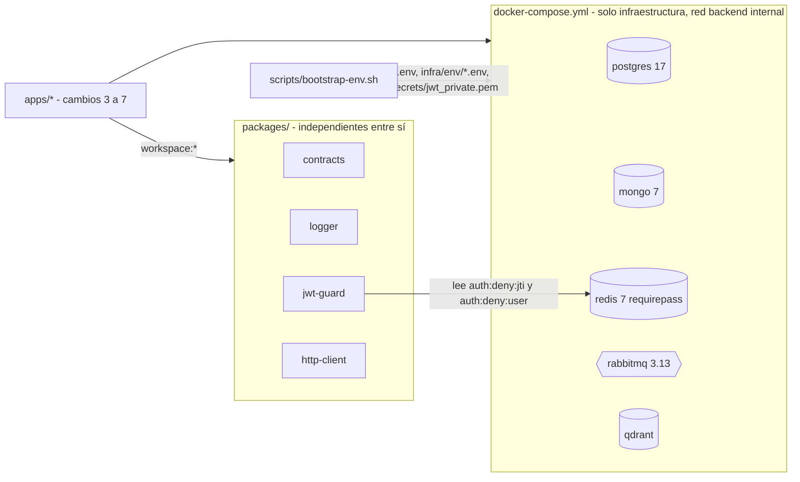

# Design — bootstrap-monorepo-platform

Contrato de arquitectura: `openspec/changes/archive/2026-10-20-design-architecture-docs/design.md` + ADR-001..010 (accepted) + `docs/architecture/04-docker-compose-diseno.md` y `07-resiliencia.md`. Este documento solo fija lo que este cambio decide o concreta. **Versiones**: Node 22, NestJS 11, TypeScript 5.x y Postgres 17/Mongo 7/Redis 7/RabbitMQ 3.13 vienen de `AGENTS.md`; todo lo demás (pino, jose, ioredis, ts-jest, eslint, prettier, tags exactos de imagen, `packageManager` de pnpm) queda **`needs-verification` — fijar al instalar** (context7 no disponible para este agente; no se inventan números de versión).

## Architecture decisions

| ID | Decisión | Justificación | Alternativa descartada |
|---|---|---|---|
| D1 | **`packages/http-client` compartido** (`@toka/http-client`): mecanismo (timeout, backoff con jitter, circuit breaker, propagación de `x-correlation-id`); cada servicio configura sus aristas con los valores de 07-resiliencia | Un cliente HTTP es transversal (ADR-001 permite paquetes transversales; no contiene dominio). `user-service` (user→role, user→auth) y `ai-agent-service` (agent→user, agent→LLM) necesitan el mismo comportamiento; duplicar 2 implementaciones de un breaker duplica también sus pruebas y sus fallos | Duplicar en `apps/*/src/infrastructure/http/` (dos copias divergentes; doble presupuesto de pruebas) |
| D2 | **No se crean `apps/*` aquí**; ADR-001 se enmienda en la tarea 3.3 | 5 esqueletos NestJS vacíos agotan el presupuesto de tareas (≤15) y no aportan verificación; cada `build-*` crea el suyo con su primera prueba | Esqueletos vacíos ahora (ruido; tareas sin gate útil) |
| D3 | **Alcance de paquetes `@toka/*`** (coherente con `name: toka`, exchange `toka.events`); dependencias entre paquetes **prohibidas** (independientes); los servicios los consumen con `workspace:*` | Evita ciclos y permite desarrollar los 4 paquetes en paralelo (Wave 1) | `@platform/*` (inconsistente con el resto de nombres) |
| D4 | **Cobertura en la config base**: `jest.config.base.js` activa `collectCoverage` y `coverageThreshold.global.lines: 70` (ramas informativas, sin umbral; reporters `text`, `json-summary`, `lcov`); excluye `index.ts` y `*.spec.ts` | ADR-007: 70 por servicio/paquete en líneas. Así `pnpm --filter <pkg> test` falla por sí solo bajo el umbral y el gate es solo el código de salida | Umbral global en la raíz (oculta paquetes sin pruebas) |
| D5 | **Observabilidad diferida** (sin Loki/Alloy/Grafana, sin red `grafana-ui`) | Ya decidido en ADR-007 / design del cambio 1: Evolución opcional en el cambio 5 | Incluirla ahora (fuera de alcance y ahorra tareas) |
| D6 | **RabbitMQ sin `load_definitions`**: el contenedor arranca solo con `RABBITMQ_DEFAULT_USER/PASS`. Publicadores y consumidores hacen `assertExchange` idempotente de `toka.events` (topic, durable) y `toka.events.dlx` (durable) con las constantes `EVENTS_EXCHANGE`/`DLX_EXCHANGE` de `@toka/contracts`; colas, `.retry` y `.dlq` las declaran los consumidores (TTL por env, 04/07) | `load_definitions` omite la siembra del vhost/usuario por defecto, de modo que `RABBITMQ_DEFAULT_USER/PASS` se ignorarían; además los retardos y bindings son configuración por consumidor (07) | `definitions.json` + `rabbitmq.conf` (rompe credenciales por defecto; topología estática con TTL fijos) |
| D7 | **Logger: middleware + interceptor** en vez de solo interceptor: `correlationIdMiddleware` abre el contexto (`AsyncLocalStorage`) y fija `x-correlation-id` antes de los guards (así los `warn` de `jwt-guard` también llevan `correlationId`); `RequestLoggingInterceptor` emite el log de petición (`route`, `statusCode`, `latencyMs`, `userId`) y `event=access.denied` en 403 | Un interceptor corre después de los guards y perdería el `correlationId` de los logs del guard | Solo interceptor (logs de guard sin correlación; rompe la receta `jq` de Ex4) |
| D8 | **`jwt-guard` independiente de `logger` e `ioredis` concreto**: recibe un `DenylistReader` (puerto) y un logger con forma pino (`warn(obj, msg)`); se entrega un adaptador `RedisDenylistReader` sobre un cliente con método `get`/`exists` (ioredis) | Mantiene D3 y permite pruebas con dobles sin Redis | Acoplar `jwt-guard` a `@toka/logger` |
| D9 | **Caché de JWKS en memoria** (el `createRemoteJWKSet` de la librería JOSE, con cooldown) y no en Redis `<svc>:jwks` | Menos piezas y sin dependencia de Redis para el camino de firma (la firma debe validarse aunque Redis caiga, ADR-003). La clave `<svc>:jwks` de 04/ADR-002 queda sin usar; se reconcilia en el cambio 5 | Caché en Redis (acopla firma a Redis) |
| D10 | **Circuit breaker propio y pequeño** (estados cerrado/abierto/semiabierto; umbral de fallos consecutivos y `resetTimeoutMs`) sin dependencia externa | 07 define "5 fallos consecutivos **o** 50 % en ventana (configurable)"; se implementa solo el umbral consecutivo (simplificación declarada, el porcentaje por ventana = Evolución) | `opossum` (dependencia y tipos extra para un uso mínimo) |

### Ambigüedades de contrato que este cambio cierra

- `auth:deny:user:{userId}`: el valor es **epoch en segundos** (misma unidad que `iat`); `jwt-guard` rechaza si `iat < valor`. `auth-service` (cambio 3) escribe en esa unidad.
- `auth:deny:jti:{jti}`: basta con que la clave exista.
- Timeout de consulta al denylist: configurable, por defecto 200 ms (`needs-verification` frente a la latencia real de Redis en compose).
- `aud` aceptado: `string | string[]` configurable por servicio (p. ej. `toka-api`); rechazo si no coincide. Solo se acepta `alg=RS256` y se exige `kid` en la cabecera.

## Component diagram



## Data model

### Estructura de archivos

```
pnpm-workspace.yaml  package.json  tsconfig.base.json  jest.config.base.js
eslint config + prettier config  .env.example  .gitignore (adiciones)
docker-compose.yml
scripts/bootstrap-env.sh
infra/postgres/init/01-roles-and-databases.sh
infra/mongo/init/01-audit-user.js
infra/env/{auth,user,role,audit,ai-agent}-service.env.example
packages/contracts   src/{envelope.ts,routing.ts,payloads.ts,index.ts}
packages/logger      src/{logger.ts,correlation.ts,interceptor.ts,index.ts}
packages/jwt-guard   src/{guard.ts,denylist.ts,options.ts,index.ts}
packages/http-client src/{client.ts,breaker.ts,errors.ts,index.ts}
```

Cada paquete: `package.json` (`name: @toka/<x>`, `main`/`types` → `dist`, scripts `build`, `test`, `lint`), `tsconfig.json` que extiende la base, `jest.config.js` que extiende la base. `tsconfig.base.json`: `strict`, `target` ES2022, `module` commonjs, `experimentalDecorators` + `emitDecoratorMetadata` (NestJS), `declaration`.

### `@toka/contracts` (sin dependencias de runtime)

- Constantes: `EVENTS_EXCHANGE='toka.events'`, `DLX_EXCHANGE='toka.events.dlx'`, `RoutingKeys` (`user.created|updated|deleted|role.assigned`, `role.created|updated|permissions.changed`, `auth.login.succeeded|failed`), `QueueBindings` (`audit.events`: `user.#`,`auth.#`,`role.#`; `auth.user-projection`: `user.#`,`role.updated`; `agent.ingest`: `role.#`), cabeceras `x-correlation-id` y `x-retry-count`.
- Tipo `EventEnvelope<T>`: `eventId`, `type`, `version`, `aggregateVersion`, `occurredAt` (ISO-8601 UTC), `correlationId`, `actor` (`{userId, roles}` | `'system'`), `reason?` (`'resync'` para re-sincronizaciones de role-service), `payload: T`.
- `UserRoleAssignedPayload`: `userId`, `roleId`, `roleName`, `roleVersion`. Los demás payloads quedan como `Record<string, unknown>` hasta `build-user-audit-services` (ADR-001: esquemas se completan allí; cambios solo aditivos).
- Funciones: `createEnvelope(...)`, `isEventEnvelope(x)` (guard de esquema para mandar mensajes inválidos a DLQ) y `deterministicEventId(roleId, aggregateVersion)` (hash estable para re-sync, sin dominio).

### `@toka/logger`

`createLogger({service, level?})` sobre pino: JSON por línea con `timestamp` (ISO), `level` (etiqueta), `service`, y `correlationId` (mixin desde `AsyncLocalStorage`); `userId`, `route`, `statusCode`, `latencyMs` por petición; `event` para seguridad. `redact` de `password`, `*.password`, `authorization`, `*.token`, `refreshToken` (ADR-007 #7). Extras de agente (`llm.*`, `ragHits`) son campos libres que el agente añade (no se tipan aquí).

### `@toka/jwt-guard`

`JwtAuthGuard` (NestJS `CanActivate`): extrae `Bearer`; `jwtVerify` con `RS256`, `issuer`, `audience`, `kid` obligatorio y JWKS remoto; consulta `auth:deny:jti:{jti}` y `auth:deny:user:{sub}` mediante `DenylistReader`; si el lector lanza o supera el timeout → continúa, `logger.warn({event:'denylist.unavailable'})` y `metrics.increment('jwt_guard_denylist_unavailable')` (hook opcional, no-op por defecto). Expone `request.user = {sub, roles, jti, iat, exp, aud}`. Errores → `UnauthorizedException`.

### `@toka/http-client`

`createHttpClient({baseUrl, timeoutMs, retry:{retries, backoffMs[], jitter, budgetMs?}, breaker:{failureThreshold, resetTimeoutMs}, fetchImpl?})` sobre `fetch` global de Node 22 y `AbortController`. Reintenta solo `GET/HEAD/PUT/DELETE` (o llamada marcada `idempotent: true`) ante error de red, timeout, 5xx y 429; nunca en `POST` sin la marca; nunca en 4xx. Los reintentos respetan `budgetMs` (07: alta ≤10 s). El breaker cuenta timeouts, errores de red y 5xx (no 4xx); abierto → `CircuitOpenError` inmediato; semiabierto tras `resetTimeoutMs` con una petición de prueba. Propaga `x-correlation-id` y cabeceras dadas (p. ej. `Authorization` reenviado por el agente). Errores tipados: `HttpTimeoutError`, `CircuitOpenError`, `HttpStatusError`.

### Infra

- **Compose** (`name: toka`): `postgres`, `mongo`, `redis`, `rabbitmq`, `qdrant`; sin `ports:` publicados; redes `public`, `edge` (internal), `backend` (internal), `egress` declaradas según 04 (las usarán los servicios del cambio 5; todos los contenedores de infra van solo en `backend`). Healthchecks como en 04 (`pg_isready`; `mongosh ping`; `redis-cli ping` con `REDISCLI_AUTH`; `rabbitmq-diagnostics -q ping`; sonda TCP a 6333 para Qdrant, `needs-verification` si la imagen no trae `bash`). Imágenes: `postgres:17`, `mongo:7`, `redis:7`, `rabbitmq:3.13-management`, `qdrant/qdrant:<tag fijado al instalar>`. Volúmenes `pg_data`, `mongo_data`, `redis_data`, `rabbitmq_data`, `qdrant_data`. Solo marcadores `${VAR}` desde `.env`.
- **Postgres init**: `01-roles-and-databases.sh` como en 04 (rol y BD por servicio, `REVOKE ALL ... FROM PUBLIC`). **Mongo init**: `01-audit-user.js` (`audit_user`, `readWrite` en `audit_db`). **RabbitMQ**: sin init (D6); solo credenciales por defecto desde `.env`.
- **Entorno**: `.env.example` con las variables de infra de 04 (sin `GRAFANA_ADMIN_PASSWORD`, perfil diferido); `infra/env/<servicio>.env.example` con marcadores `<NOMBRE_VAR>` / `change-me` según 04. `scripts/bootstrap-env.sh` (bash; usa `openssl`, incluido en Git Bash): copia plantillas si falta el `.env` real, sustituye marcadores por valores `openssl rand -hex 16` coherentes entre `.env` e `infra/env/*.env`, genera `secrets/jwt_private.pem` (RSA 2048, solo si no existe). Idempotente: no pisa archivos existentes. `.gitignore` (ya ignora `.env`, `.env.*` y exceptúa `.env.example`) añade `infra/env/*.env`, `secrets/` y `!infra/env/*.env.example`.

## Testing strategy

Presupuesto declarado (tope por tarea 6, por archivo 8, por cambio 30; este cambio planea **18**):

| Paquete | Pruebas | Casos |
|---|---|---|
| `@toka/contracts` | 3 | `createEnvelope` rellena `eventId`/`occurredAt`/`version` y `isEventEnvelope` rechaza sobres incompletos; `RoutingKeys`/`QueueBindings` coinciden con 04 (bindings con `#`); `deterministicEventId` estable y distinto por `aggregateVersion` |
| `@toka/logger` | 4 | línea JSON con `timestamp`/`level`/`service`; `correlationId` propagado desde cabecera y generado si falta; redacción de secretos; interceptor emite `route`/`statusCode`/`latencyMs` y `event=access.denied` en 403 |
| `@toka/jwt-guard` | 6 (**en el tope por tarea, presupuestado**: es el control de seguridad central) | token válido pasa; `aud` incorrecto rechazado; `kid`/alg inválido rechazado; `jti` denegado rechazado; `iat < auth:deny:user` rechazado; Redis caído/timeout → pasa con `warn` + métrica |
| `@toka/http-client` | 5 | timeout aborta; `GET` reintenta en 503 y tiene éxito; `POST` no se reintenta; breaker abre tras N fallos y falla rápido; semiabierto cierra tras éxito |
| Infra y raíz | 0 | verificación por gates `cmd:` (compose, scripts, roles) |

Reglas: sin snapshots; `fetch`, Redis y reloj con dobles/`fake timers`; sin red ni contenedores en pruebas unitarias. El umbral de 70 líneas lo exige `jest.config.base.js` (D4): `index.ts` se excluye de la medición; el adaptador `RedisDenylistReader` se ejerce con un doble de cliente en las pruebas de `jwt-guard`.

## Plan metadata (planner contract: V3–V5)

- **Waves**: Wave 0 (infra y raíz, 4 tareas: 1.1–1.4), Wave 1 (paquetes, 4 tareas: 2.1–2.4, mutuamente independientes), Wave 2 (integración y cierre, 3 tareas: 3.1–3.3). 11 tareas, 4 specs (`monorepo-workspace`, `infra-compose`, `shared-packages`, `jwt-guard`), ≤3 specs por wave.
- **required_tools.per_agent**: `backend` — mcp: `[engram]`, skills: `[forge-implement, test-driven-development]` (raíz, paquetes, compose, bootstrap, docs acotado a `docs/**` en 3.3); `database` — mcp: `[engram]`, skills: `[forge-implement]` (init de Postgres/Mongo/RabbitMQ); `validator` — mcp: `[engram]`, skills: `[forge-verify]`. Sin figma ni context7 (librerías `needs-verification`).
- **contracts_review**: `stable_list: []`, `reviewed_at: 2026-10-20T00:00:00Z`. Los nombres de exchange, routing keys, claves Redis y puertos de `design-architecture-docs` se tratan como contrato estable y no se modifican aquí.
- **Desviaciones declaradas**: (a) CLI `opsx` y `scripts/validate-topic-key.sh` no ejecutados (sin Bash en el sub-agente); (b) no existe `openspec/config.yaml` → repo único, sin `Repo:` en tareas; (c) sin `forge:change-brief`; (d) el planner no puede ejecutar los gates `cmd:` (se ejecutan en implementación/validación); (f) **V1 `max_files_modified: 25` excedido por naturaleza**: el cambio crea unos 60 archivos nuevos (4 paquetes x ~10, infra ~10, raíz ~10) por ser andamiaje greenfield; dividirlo contradice "todas las dependencias se instalan una vez aquí" y el plan de 9 cambios; el orquestador decide si lo acepta; (g) **dominios del Domain Map**: `infra/**` y la config raíz están en `config_paths`, no en `backend_paths`/`database_paths`; el orquestador debe acotar explícitamente los envelopes: `database` → `infra/{postgres,mongo,rabbitmq}/**`; `backend` → config raíz, `packages/**`, `infra/env/**`, `docker-compose.yml`, `scripts/bootstrap-env.sh` y (tarea 3.3) `docs/**`; (e) ADR-001 y `docs/traceability.md` se editan en la tarea 3.3 por el implementador, tras aprobar el 📋 (el planner no los toca).

## Decisiones de implementación

| Decisión | Motivo | Evidencia |
|---|---|---|
| Los scripts `test` de cada paquete invocan el wrapper raíz `jest.run.js`, que descarta el `--` literal | `pnpm -r test -- --coverage` reenvía `--` y Jest lo interpretaría como inicio de patrones de ruta; así el comando canónico de `AGENTS.md` funciona sin cambios | `jest.run.js`; `packages/*/package.json` (`"test": "node ../../jest.run.js"`) |
| `jwt-guard` usa `jose` 5.10.0 y acepta un `keyResolver` inyectable además de `jwksUri` | `jose` 5 es dual CJS/ESM y funciona con la cadena Jest/CommonJS; el resolvedor inyectable permite que auth valide sus propios tokens en proceso y que las pruebas usen un JWKS local | `packages/jwt-guard/package.json`; `src/options.ts:16-28` |
| `jwt-guard` conserva la última clave válida por `kid` si falla el refresco del JWKS | Una caída momentánea de auth-service no invalida tokens ya firmados con una clave conocida | `packages/jwt-guard/src/guard.ts:34-47`; prueba "sigue verificando con la clave cacheada si falla el refresco del JWKS" |
| Autorización por permisos: `PermissionsGuard`, `@RequirePermissions` y `@AllowServiceToken` en `jwt-guard`; catálogo `PERMISSIONS` en `contracts` | Sustituye los guards por rol de cada servicio por un control fino por permiso, leído del claim `permissions` del JWT | `packages/jwt-guard/src/permissions.ts`; `packages/contracts/src/permissions.ts`; `permissions.spec.ts` en ambos paquetes |
| `jwt-guard` mantiene una copia local de `hasPermission` | La regla de este cambio prohíbe imports entre paquetes `@toka/*` | `packages/jwt-guard/src/permissions.ts:16-20` |
| `contracts` crece solo de forma aditiva (`PERMISSIONS`, `rolePermissions` en `UserRoleAssignedPayload`) | Regla de compatibilidad hacia atrás de ADR-001 | `packages/contracts/src/{permissions,payloads}.ts` |
| `@toka/logger` añade `AccessDeniedFilter`, que registra 401 y 403 como `event=access.denied` | Las denegaciones quedan trazadas aunque las lance un guard antes del interceptor | `packages/logger/src/access-denied.filter.ts:15-35`; `access-denied.filter.spec.ts` |
| `docker-compose.yml` se amplió después con los cinco servicios de aplicación y `web` (healthchecks con `node -e fetch(...)`, `depends_on` por salud) | Las imágenes `node:22-slim` no traen `curl`/`wget`; la infraestructura, redes y volúmenes de este cambio no cambiaron | `docker-compose.yml:15-45,124-208` |
| `pnpm-workspace.yaml` incluye `e2e` y una lista `allowBuilds` | pnpm 12 aborta la instalación con scripts de build sin decidir; `e2e/` aloja la suite Playwright | `pnpm-workspace.yaml` |
| Las sondas de aislamiento de la tarea 3.2 no tienen script versionado | El aislamiento queda definido en los scripts de init y en `--requirepass`; ver `tasks.md` → `## Evolución` | `infra/postgres/init/01-roles-and-databases.sh`; `infra/mongo/init/01-audit-user.js`; `docker-compose.yml:86` |

## Risks

1. **Credenciales de RabbitMQ**: resuelto eliminando `load_definitions` (D6). El gate 3.2 comprueba `rabbitmqctl authenticate_user` con `RABBITMQ_USER/PASSWORD`. Riesgo residual: los exchanges no existen hasta que un servicio los afirma; los cambios 3–7 deben llamar `assertExchange` al arrancar.
2. **Sondas de salud**: `bash` puede no existir en la imagen de Qdrant; `mongosh` y `rabbitmq-diagnostics` dependen de la imagen. Mitigación: ajustar la sonda (ilustrativa en 04) sin tocar el contrato "todo contenedor con healthcheck".
3. **Windows / Git Bash**: `openssl` y rutas en `bootstrap-env.sh`; saltos de línea CRLF en scripts montados en contenedores (`.sh` de init). El repo usa `core.autocrlf=true`, que añadiría `\r` a plantillas, `.gitignore` y scripts. Mitigación: `.gitattributes` con `* text=auto eol=lf` (tarea 1.2) y gates con `docker compose exec -T`.
4. **Umbral de 70 % en paquetes pequeños**: un archivo sin cubrir (p. ej. el adaptador Redis) puede hundir el porcentaje. Mitigación: pruebas pensadas para recorrer cada archivo y exclusión explícita de `index.ts`.
5. **ESM/CJS de la librería JOSE**: se fija la versión mayor 5 (dual CJS/ESM) desde el inicio (la v6 es solo ESM); el número menor se fija al instalar.
7. **pnpm y lockfile**: pnpm no está instalado (corepack sí): 1.1 ejecuta `corepack enable && corepack prepare pnpm@<versión fijada al instalar> --activate` y fija `packageManager`. Para evitar carreras sobre `pnpm-lock.yaml` en Wave 1 paralela, 1.1 crea los 4 `package.json` con todas sus dependencias y hace una única instalación; las tareas 2.x no ejecutan `pnpm add`. `@nestjs/common`, `rxjs` y `reflect-metadata` se declaran `peerDependencies` (y `devDependencies` para pruebas) en logger y jwt-guard.
6. **Alcance de la dependencia "una sola instalación"**: aquí se instalan herramientas raíz y dependencias de los 4 paquetes; las de servicios (Nest completo, Prisma, etc.) se agregan en cada `build-*` (declarado, vetable en el 📋).
