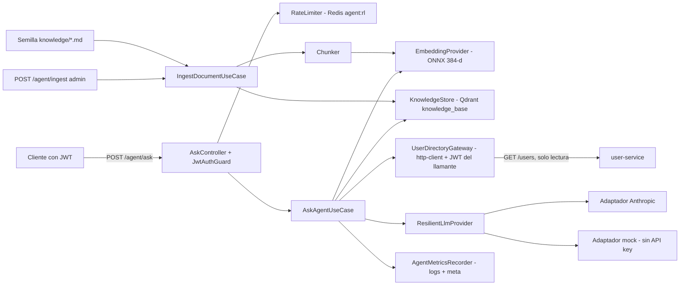

# Design — build-ai-agent-rag-service

Contrato de arquitectura: ADR-005/006/007/008/009 (accepted), `docs/architecture/07-resiliencia.md` y `08-integracion-ia-rag.md`, y `openspec/changes/bootstrap-monorepo-platform/design.md` (paquetes `@toka/*`). Este documento solo fija lo que este cambio decide o concreta. **Versiones**: Node 22, NestJS 11 y TypeScript 5.x vienen de `AGENTS.md`; SDK de Anthropic, librería ONNX/tokenizer, cliente Qdrant, amqplib, validador de esquemas, tag de Qdrant y URL/hash del modelo quedan **`needs-verification` — fijar al instalar** (no se inventan números). **Prohibido** escribir identificadores de modelo o precios en código, pruebas, docs o estos artefactos: `LLM_MODEL`, `LLM_PRICE_INPUT_PER_MTOK` y `LLM_PRICE_OUTPUT_PER_MTOK` vienen del entorno.

## Architecture decisions

| ID | Decisión | Justificación | Alternativa descartada |
|---|---|---|---|
| D1 | **Capas ADR-006** dentro de `apps/ai-agent-service/src/`: `domain/` (tipos puros: `Fragment`, `AgentAnswer`, reglas de chunking), `application/` (puertos `*.port.ts` y casos de uso `ask`, `ingest`), `infrastructure/` (adaptadores `llm/`, `embeddings/`, `qdrant/`, `user-client/`, `redis/`), `interface/` (controladores, DTO) | El dominio no conoce SDKs; permite `mock`, `hash` y Qdrant en memoria sin red | Servicio plano por módulos Nest (acopla casos de uso al SDK) |
| D2 | **Todos los puertos se crean en 1.1** (`LlmProvider`, `EmbeddingProvider`, `KnowledgeStore`, `UserDirectoryGateway`, `RateLimiter`, `AgentMetricsRecorder`) más el esquema de respuesta `src/domain/agent-answer.ts` | Las tareas de la Wave 0 y 1 trabajan en directorios disjuntos sin editar el mismo archivo; contratos fijos desde el primer commit | Definir cada puerto en su tarea (conflictos entre tareas paralelas) |
| D3 | **Puerto `LlmProvider.generate(req)`** → `{text, toolCalls[], usage:{tokensIn, tokensOut}, provider}`; `req` = `{system, messages, tools?, maxTokens, timeoutMs, signal}`. Adaptador Anthropic y `mock`. Selección en una factory: `ANTHROPIC_API_KEY` presente → Anthropic (exige `LLM_MODEL`, falla al arrancar si falta); ausente → `mock` | ADR-008 #2–#4. Fallar rápido sin `LLM_MODEL` evita un modelo implícito en código | Modelo por defecto en código (viola "sin identificadores de modelo") |
| D4 | **Verificación obligatoria contra documentación de Anthropic** en la tarea 1.3 antes de escribir el adaptador: constructor del SDK (`maxRetries`/`timeout`), llamada de mensajes con herramientas, marcado de caché de prompt, campos de `usage`, paso de `AbortSignal` y modelo vigente que el operador debe poner en `LLM_MODEL`. Se usa como referencia la skill `claude-api` del harness (SDK, prompt caching, `maxRetries`/`timeout`), complementada con context7 o la documentación oficial. Evidencia (fecha, versión del SDK, fuente) se anota en el encabezado del adaptador (sin identificadores de modelo ni en comentarios) y se copia a `08-integracion-ia-rag.md` en 3.4. Si ninguna fuente está disponible: marcar `needs-verification` y no declarar la tarea completa | Los valores sensibles al tiempo (modelos, API) cambian; ADR-008 #6 lo exige | Confiar en memoria del implementador |
| D5 | **`ResilientLlmProvider`** (decorador en 1.2, agnóstico del proveedor): semáforo de concurrencia (`LLM_MAX_CONCURRENCY`) y circuit breaker local por fallos consecutivos (`LLM_BREAKER_THRESHOLD`, `LLM_BREAKER_RESET_MS`). Rechaza con `LlmUnavailableError` si el circuito está abierto | `@toka/http-client` solo exporta `createHttpClient` y errores; el SDK de Anthropic hace su propio HTTP, así que el breaker de ese paquete no aplica. ~40 líneas, mismas semánticas que D10 del cambio 2 (consecutivos; 4xx de cliente no cuentan) | Reutilizar breaker del paquete (no exportado; si el cambio 2 lo exporta, el implementador lo reutiliza y lo anota) |
| D6 | **Presupuesto de tiempo** (ADR-008 #5, 07): el caso de uso `ask` crea un `AbortController` con `AGENT_DEADLINE_MS` (30 000 por defecto) y pasa `signal` y `timeoutMs = min(LLM_TIMEOUT_MS (20 000), restante)` al proveedor; SDK con `maxRetries: 1` **explícito** (máximo 1 reintento; el `signal` impide pasarse del presupuesto); herramienta hacia user-service con `USER_TOOL_TIMEOUT_MS` (3 000). Al agotarse: `degraded=true` con solo fragmentos y aborta la petición en curso | Coherente con nginx 40 s > agente 30 s > LLM 20 s / tool 3 s | Reintentos sin tope global |
| D7 | **Bucle de herramienta acotado**: como máximo **2 llamadas** al LLM por consulta (1 generación + 1 tras resultado de herramienta) y 1 ronda de herramienta. Herramienta única `lookup_users` (solo lectura; entrada `{query?: string, role?: string}`) → `UserDirectoryGateway.lookup` → `GET` a user-service con el `Authorization` del llamante y `x-correlation-id`; respuesta filtrada a `id,name,role,status` **en el adaptador**, antes de construir el prompt. **`lookup_users` solo funciona con un JWT con permiso para listar usuarios (en la práctica, admin)**: con otro JWT user-service responde 403 y el agente continúa sin la herramienta (se refleja en 3.1/3.3 y en la doc) | ADR-008 #7–#9; acota coste y superficie de inyección | Agente con bucle abierto (coste impredecible) |
| D8 | **`mock` determinista**: texto = **JSON** `{answer, sources:[{docId,...}]}` compuesto solo de los fragmentos recibidos (primeras frases + `docId`), conforme a `domain/agent-answer.ts`; `usage` calculado por conteo de palabras; si la pregunta coincide con `/usuari|user/i` y hay herramienta disponible, emite un `toolCall lookup_users` en la primera llamada. El `mock` **no** se usa como degradación ante fallos del proveedor (08 `## Proveedor mock`) | Permite demostrar la integración con user-service sin clave de API | `mock` como fallback silencioso (confunde a usuarios reales) |
| D9 | **Embeddings**: `EmbeddingProvider.embed(texts) → number[384][]` + `countTokens(text)`. Adaptador ONNX (MiniLM, 384-d) sobre la librería ONNX/tokenizer elegida al instalar (preferencia: una librería que aporte tokenizador + mean pooling + normalización desde un directorio local con red remota deshabilitada; `needs-verification`). Adaptador `hash` (determinista, 384-d, solo `NODE_ENV=test`: el selector lo rechaza fuera de tests). Modelo en `apps/ai-agent-service/models/` (no versionado), obtenido por `scripts/fetch-model.sh` con **pin TOFU**: la primera descarga escribe `apps/ai-agent-service/models.sha256` (versionado) y las siguientes verifican con `sha256sum -c` | ADR-009 #2–#5; el arranque no descarga nada | Embeddings por API (descartado en ADR-009) |
| D10 | **Chunker puro** en dominio: recibe `countTokens` inyectado, divide por frases/palabras en fragmentos ≤256 tokens (`CHUNK_MAX_TOKENS`) con solape ~32 (`CHUNK_OVERLAP_TOKENS`); con `hash` cuenta palabras | Testeable sin ONNX; el tamaño real lo mide el tokenizador real en producción | Contar caracteres (no respeta el límite de MiniLM) |
| D11 | **`KnowledgeStore` Qdrant**: `ensureCollection()` al arrancar (`knowledge_base`, 384, coseno, índice de payload en `roleScope`), `upsertDocument(docId, chunks)` = borrar por filtro `docId` y luego `upsert` con ids deterministas (hash de `docId#chunkIdx`) → idempotente; `search(vector, {roleScopes, limit, minScore?})` con filtro `roleScope` **obligatorio** (el puerto no permite omitirlo). Payload `{source, docId, chunkIdx, roleScope, text}`. Un `InMemoryKnowledgeStore` (coseno en memoria) implementa el mismo puerto para pruebas | ADR-009 #6; `text` en payload evita una segunda fuente de verdad | Filtro opcional en el puerto (riesgo de fuga entre roles) |
| D12 | **`roleScope`**: lista de strings en el payload (`['all']` o roles concretos). Búsqueda con `roleScopes = [...roles del JWT, 'all']` (coincidencia con cualquiera). Los documentos semilla declaran su `roleScope` en el front-matter del archivo | Cumple "filtro obligatorio con el rol del JWT" y permite documentos públicos | Un solo rol por documento (no cubre `all`) |
| D13 | **Semilla**: `apps/ai-agent-service/knowledge/*.md` con front-matter `docId`, `source`, `roleScope`; el cargador la ingesta al arrancar si `AGENT_SEED_ON_START=true` (por defecto `true`); idempotente por `docId`. Contenido: políticas, catálogo de roles/permisos y guía de uso (3–4 documentos cortos, sin PII) | ADR-009 y 08 (origen 1) | Ingesta solo manual (el evaluador vería un RAG vacío) |
| D14 | **`POST /agent/ingest`**: `JwtAuthGuard` + comprobación mínima `request.user.roles` incluye `AGENT_ADMIN_ROLE` (por defecto `admin`) → 403 si no; cuerpo `{docId, source, roleScope[], text}`; límite de tamaño por `INGEST_MAX_CHARS`. Sustituible por `@Roles` cuando exista (cambio 3) | Alcance mínimo sin duplicar el guard de roles | Implementar `@Roles` aquí (fuera de alcance) |
| D15 | **Consumidor `agent.ingest` DIFERIDO a Evolución** (decisión de alcance): este cambio ingesta por semilla y `POST /agent/ingest`; no hay cliente AMQP, cola ni claves `agent:evt:*`/`agent:rolever:*`. El diseño futuro se conserva como referencia: cola `agent.ingest` con binding `role.#` (`QueueBindings`), idempotencia por `eventId`, tolerancia a reordenamiento por `aggregateVersion`, regeneración de `role-catalog-{roleId}`. Consecuencia: ADR-009 #7 y 08 (origen 3) quedan como Evolución; 3.4 lo documenta y el orquestador decide si enmendar el ADR | Ahorra una tarea y una dependencia (broker) con el plazo ajustado; el catálogo de roles se mantiene por semilla/admin | Implementarlo ahora (más superficie y dependencia del esquema de eventos `role.*` del cambio 3) |
| D16 | **Rate limit** `agent:rl:{userId}:{route}`: ventana fija con `INCR` + `EXPIRE` (`AGENT_RL_MAX` por defecto 20, `AGENT_RL_WINDOW_S` 60); exceso → 429 con `Retry-After` (segundos restantes). Redis caído → **fail-open con `warn`** (coherente con denylist de ADR-003; suposición declarada) | ADR-008 #5 | Fail-closed (el agente caería con Redis) |
| D17 | **Contrato de `POST /agent/ask`**: entrada `{question}` (1–2000 caracteres, validada) → salida `{answer, sources:[{docId, source, score}], degraded, meta:{provider, latencyMs, tokensIn, tokensOut, costEstimate, ragHits, toolCalls}}`. `costEstimate` es `null` si faltan las variables de precio. Errores: 400 validación, 401 JWT, 429 rate limit. Nunca 5xx por fallo del LLM (degrada) | Estructura estable para que el cambio 8 evalúe latencia/tokens/coste sin tocar el servicio | Métricas solo en logs (el evaluador tendría que parsear logs) |
| D18 | **Prompt**: constante `SYSTEM_PROMPT` y `buildPrompt()` en `application/ask/prompt-builder.ts`; el contenido recuperado y la salida de herramientas van en bloques delimitados (`<datos_no_confiables>…</datos_no_confiables>`) con instrucción de tratarlos como datos; el cambio 8 mueve/versiona el prompt a `src/prompts/` y documenta la estrategia | Cumple ADR-008 #9 sin invadir el alcance del cambio 8 | Crear `src/prompts/` aquí (colisión con el cambio 8) |
| D19 | **Validación de salida**: `validateAgentOutput` (función pura) intenta `JSON.parse` del texto del LLM y valida contra el esquema de `src/domain/agent-answer.ts` (`{answer: string no vacío ≤ límite, sources: [{docId,...}]}`); **fallback**: si no es JSON válido, trata el texto como `answer` con `sources` = fragmentos usados; elimina `docId` no recuperados; texto vacío → degradada. `domain/agent-answer.ts` es el **esquema exportado que el cambio 8 importa** (tipos `AgentAnswer`, `Source`, `AgentMeta`). Los validadores de calidad (`src/evaluation/validators/`) son del cambio 8 | EX5-R07/R25 parcial: validación básica de esquema | Evaluación de calidad semántica aquí (alcance del cambio 8) |
| D20 | **Métricas**: puerto `AgentMetricsRecorder` con implementación que loguea con `@toka/logger` los campos `llm.provider`, `llm.tokensIn`, `llm.tokensOut`, `llm.costEstimate`, `latencyMs`, `ragHits`, `degraded`, `toolCalls`; nunca contenido de prompt ni de respuesta. Coste = `tokensIn/1e6*PRICE_IN + tokensOut/1e6*PRICE_OUT` solo si ambas variables son números válidos, implementada como utilidad **exportada** `estimateCost` en `infrastructure/llm/cost.ts` (el cambio 8 la reutiliza) | ADR-008 #6/#10; el cambio 8 puede añadir otra implementación del puerto | Calcular el coste en el evaluador (duplica la fórmula) |
| D21 | **Dockerfile** en `apps/ai-agent-service/Dockerfile`: multi-etapa, base Debian-slim (`node:22-bookworm-slim`, tag exacto `needs-verification`), build desde la raíz del monorepo (contexto `.`), `pnpm deploy`/copia de `dist`, ejecuta `fetch-model.sh` en build, usuario no root, `CMD node dist/main.js`. Sin servicio en compose (cambio 5, `harden-compose-resilience-security`) | ADR-009 #4 | Alpine (incompatibilidad con ONNX Runtime) |

## Component diagram



## Data model

### Estructura de archivos

```
apps/ai-agent-service/
  package.json  tsconfig.json  jest.config.js  Dockerfile  .dockerignore
  scripts/fetch-model.sh            models/ (no versionado)
  knowledge/*.md                    (semilla; front-matter docId/source/roleScope)
  src/
    main.ts  app.module.ts  config/{config.ts,config.spec.ts}
    domain/{fragment.ts,chunker.ts,agent-answer.ts}
    application/
      ports/{llm-provider,embedding-provider,knowledge-store,user-directory-gateway,rate-limiter,agent-metrics-recorder}.port.ts
      ask/{ask-agent.use-case.ts,prompt-builder.ts,validate-output.ts}
      ingest/{ingest-document.use-case.ts,seed-loader.ts}
    infrastructure/
      llm/{mock.provider.ts,anthropic.provider.ts,resilient.provider.ts,provider.factory.ts,cost.ts}
      embeddings/{onnx-embedding.provider.ts,hash-embedding.provider.ts,embedding.factory.ts}
      qdrant/{qdrant.knowledge-store.ts,in-memory.knowledge-store.ts}
      user-client/user-directory.gateway.ts
      redis/redis-rate-limiter.ts
      metrics/logger-metrics.recorder.ts
    interface/{ask.controller.ts,ingest.controller.ts,health.controller.ts,dto.ts}
  test/ask.e2e.spec.ts
```

### Variables de entorno (`infra/env/ai-agent-service.env.example`)

`PORT=3005`, `JWT_ISSUER`, `JWT_AUDIENCE`, `JWKS_URI`, `REDIS_URL`, `QDRANT_URL`, `USER_SERVICE_URL`, `ANTHROPIC_API_KEY` (vacío ⇒ `mock`), `LLM_MODEL` (obligatorio si hay clave), `LLM_MAX_TOKENS`, `LLM_TIMEOUT_MS`, `LLM_MAX_CONCURRENCY`, `LLM_BREAKER_THRESHOLD`, `LLM_BREAKER_RESET_MS`, `LLM_PRICE_INPUT_PER_MTOK`, `LLM_PRICE_OUTPUT_PER_MTOK` (vacíos en la plantilla), `AGENT_DEADLINE_MS`, `USER_TOOL_TIMEOUT_MS`, `AGENT_RL_MAX`, `AGENT_RL_WINDOW_S`, `AGENT_ADMIN_ROLE`, `AGENT_SEED_ON_START`, `CHUNK_MAX_TOKENS`, `CHUNK_OVERLAP_TOKENS`, `RAG_TOP_K`, `INGEST_MAX_CHARS`, `EMBEDDING_MODEL_DIR`. Valores por defecto en `config.ts` salvo secretos y URLs; validación al arrancar (falla rápido).

### Colección Qdrant `knowledge_base`

Vector 384-d coseno; payload `{source: string, docId: string, chunkIdx: number, roleScope: string[], text: string}`; índice de payload en `roleScope` y `docId`; id de punto = UUID determinista derivado de `docId#chunkIdx`.

### Redis (claves del servicio)

`agent:rl:{userId}:{route}` (contador con TTL de ventana). (`agent:evt:*` y `agent:rolever:*` pertenecen al consumidor diferido.)

## Testing strategy

Presupuesto declarado (tope por tarea 6, por archivo 8, por cambio 30; este cambio planea **26**). Cobertura objetivo ≥70 % de líneas (`jest.config.base.js` del cambio 2 lo exige). Sin snapshots, sin red, sin contenedores en pruebas unitarias: proveedor `mock` o doble del SDK, embeddings `hash`, `InMemoryKnowledgeStore` y dobles de Redis/`fetch`.

| Tarea | Pruebas | Casos |
|---|---|---|
| 1.1 config/arranque | 1 | `loadConfig` falla con `LLM_MODEL` ausente si hay `ANTHROPIC_API_KEY` y aplica defaults de presupuesto |
| 1.2 mock + factory + resiliente | 3 | `mock` determinista con `usage` y `toolCall` ante pregunta de usuarios; factory elige `mock` sin clave y Anthropic con clave; breaker abre tras N fallos y el semáforo limita concurrencia |
| 1.3 Anthropic + coste | 3 | mapeo petición/respuesta con herramientas, caché de prompt y `usage` (cliente doble); `maxRetries`/`timeout` explícitos y `signal` abortado → error tipado; `costEstimate` con y sin precios |
| 1.4 embeddings + chunker | 3 | chunks ≤ máximo con solape; `hash` determinista 384-d y rechazado fuera de test; texto vacío/corto sin chunks vacíos |
| 2.1 KnowledgeStore | 3 | `upsertDocument` reemplaza fragmentos del `docId` (en memoria); `search` aplica `roleScope`; adaptador Qdrant con cliente doble construye filtro obligatorio y upsert por id determinista |
| 2.2 ingesta | 3 | ingesta idempotente por `docId`; `/agent/ingest` 403 sin rol admin; semilla idempotente |
| 2.3 gateway + rate limit | 3 | gateway reenvía `Authorization` y filtra a `id,name,role,status`; timeout/breaker → error tipado; rate limiter 429 con `Retry-After` y fail-open con Redis caído |
| 3.1 caso de uso `ask` | 5 | camino feliz con `sources` y `meta`; degradado ante error del LLM/circuito abierto; deadline agotado aborta y degrada; el contenido recuperado va delimitado y `roleScope` viene del JWT; salida inválida → degradada y `docId` desconocidos eliminados |
| 3.3 integración | 1 | `test/ask.e2e.spec.ts` (módulo Nest con dobles): 401 sin JWT y 200 con `sources` sin API key |
| 1.1 raíz (arriba), 3.2 Dockerfile, 3.4 docs | 0 | gates `cmd:` |
| **Total** | **26** | |

Exclusiones de cobertura declaradas en `jest.config.js` del servicio (adaptadores finos sin lógica probable sin dependencias nativas/red): `main.ts`, `*.module.ts` y `onnx-embedding.provider.ts`. Se compensan con el gate de 3.2 (el modelo existe en la imagen) y el humo de 3.3. El adaptador Qdrant real **no** se excluye: se ejerce con un cliente doble.

## Plan metadata (planner contract: V3–V5)

- **Waves**: Wave 0 (fundamentos, 4 tareas: 1.1–1.4; 1.2–1.4 dependen de 1.1 y son disjuntas entre sí), Wave 1 (RAG e integración, 3 tareas: 2.1–2.3; 2.1 y 2.3 independientes, 2.2 depende de 1.4 y 2.1), Wave 2 (consulta, empaquetado y cierre, 4 tareas: 3.1–3.4). 11 tareas, 4 specs (`agent-service-runtime`, `llm-provider`, `rag-knowledge`, `agent-ask`).
- **required_tools.per_agent**: `backend` — mcp: `[engram, context7]` (context7 para la verificación de D4; si no está, documentación oficial por web), skills: `[forge-implement, test-driven-development]`; `validator` — mcp: `[engram]`, skills: `[forge-verify]`. Sin figma (no hay frontend). Sin `database` (Qdrant no es base relacional; sin migraciones).
- **Dominio**: `apps/ai-agent-service/**` y `infra/env/ai-agent-service.env.example` (backend); la tarea 3.4 acota a `docs/**`. `apps/*` es `backend_paths` solo si el Domain Map de AGENTS.md lo declara: el orquestador debe acotar explícitamente el envelope (AGENTS.md aún tiene marcadores sin resolver).
- **Precondiciones**: el cambio 2 completo (paquetes `@toka/*` construidos, `jest.config.base.js`, `infra/env/ai-agent-service.env.example` existente, Qdrant en compose). **Instalación**: ningún gate ejecuta `pnpm install`; 1.1 solo edita el manifiesto y el entorno instala una vez. Pruebas con `exec jest --coverage=false` (Jest 30). Contrato con user-service (cambio 4): endpoint `GET /users` con filtros opcionales — `needs-verification` al implementar 2.3 contra el diseño de `build-user-audit-services`.
- **Desviaciones declaradas**: (a) CLI `opsx`, `scripts/validate-topic-key.sh` y Engram no ejecutados por el sub-agente (sin Bash/Engram disponibles): el orquestador debe ejecutar `mem_save topic_key=spec/build-ai-agent-rag-service` y la validación de topic keys; (b) no existe `openspec/config.yaml` → repo único, sin `Repo:`; (c) sin `handoff.md` (≤3 waves, mismo repo, sin traspaso entre sesiones); (d) el planner no puede ejecutar los gates `cmd:`; (e) context7/figma no usados en planificación: ninguna API externa se fija aquí, la verificación es la tarea 1.3.
- **contracts_review**: `stable_list: []`, `reviewed_at: 2026-10-20T00:00:00Z`. Exchange, routing keys, bindings, claves Redis `agent:rl:*`, puerto 3005 y colección `knowledge_base` son contrato estable y no se modifican.

## Decisiones de implementación

| Decisión | Motivo | Evidencia |
|---|---|---|
| Autorización por permisos: `POST /agent/ask` exige `agent:ask`, `POST /agent/ingest` exige `agent:ingest`, y `lookup_users` solo se ofrece al LLM si el JWT trae `users:read` | Modelo de permisos común a todos los servicios; un llamante sin `users:read` no recibe la herramienta en vez de recibir un 403 de user-service | `apps/ai-agent-service/src/interface/{ask,ingest}.controller.ts` (`@RequirePermissions`); `src/application/ask/ask-agent.use-case.ts` (`hasPermission(input.permissions, PERMISSIONS.USERS_READ)`); `test/ask.e2e.spec.ts` |
| Recuperación con `client.query` de Qdrant, cliente fijado a `~1.19.0` y `checkCompatibility: false` | `@qdrant/js-client-rest` 1.19 no expone `search`; la versión del servidor está fijada en `docker-compose.yml` | `src/infrastructure/qdrant/qdrant.knowledge-store.ts` (`this.client.query`), `apps/ai-agent-service/package.json`, `src/app.module.ts` |
| La ruta degradada registra `agent.degraded` con el mensaje de error | Hacer visible un fallo que de otro modo solo se vería como respuesta con `degraded=true` | `src/application/ask/ask-agent.use-case.ts` (`logger.warn({ event: 'agent.degraded', … })`) |
| Modelo ONNX descargado por `scripts/fetch-model.mjs` (Node) en el build, sin pin `sha256` | Script multiplataforma; comprueba que la salida es de 384 dimensiones | `apps/ai-agent-service/scripts/fetch-model.mjs`, `apps/ai-agent-service/Dockerfile` |
| Adaptador Anthropic validado contra los tipos del SDK 0.60 y con cliente doble; sin `ANTHROPIC_API_KEY` se usa `mock` | Sin clave disponible para probar la API en vivo; el `mock` determinista permite ejecutar el sistema completo | Cabecera de `src/infrastructure/llm/anthropic.provider.ts`; `src/infrastructure/llm/provider.factory.ts`; `llm.spec.ts` |
| Ingesta por `POST /agent/ingest` (también desde la UI web) y semilla `knowledge/*.md` al arrancar; consumidor AMQP `agent.ingest` en Evolución | Cubre la carga de conocimiento sin cliente AMQP en el servicio | `src/interface/ingest.controller.ts`, `src/application/ingest/seed-loader.ts`, `KnowledgeBootstrap` en `src/app.module.ts`, `apps/web/src/api/agent.ts` |
| Prompts y evaluación en `src/prompts/` y `src/eval/` (cambio 8); el caso de uso los reexporta desde `application/ask/prompt-builder.ts` | Una sola fuente versionada de prompts (`PROMPT_VERSION`) | `src/prompts/system-prompt.ts`, `src/application/ask/prompt-builder.ts` |
| Capa de entrada en `src/interface/` (singular) | Convención de las capas del servicio | `src/interface/*.ts` |

## Risks

1. **API/modelo del proveedor desactualizados**: mitigado por D4 (verificación en 1.3) y por `LLM_MODEL` externo; riesgo residual: sin clave real no se puede probar el adaptador Anthropic de extremo a extremo (solo con cliente doble). Se declara; el evaluador usa `mock`.
2. **Dependencia nativa ONNX en Windows/Debian-slim**: el binario nativo puede no instalar en Windows para desarrollo; las pruebas usan `hash`. El gate 3.2 valida la imagen Linux. Si la librería elegida no compila en el `pnpm install` de Windows, hacerla `optionalDependency`/carga perezosa (anotar).
3. **Calidad de MiniLM en español técnico** (ADR-009): la semilla se escribe con vocabulario consistente y `RAG_TOP_K` configurable; la mejora real es Evolución.
4. **Adaptador Qdrant sin prueba contra Qdrant real**: solo cliente doble en este cambio; el healthcheck y el arranque real los verifica el cambio 5 (`harden-compose-resilience-security`). Riesgo aceptado y declarado.
5. **Endpoint de user-service aún no cerrado** (cambio 4): el gateway concentra la dependencia en un solo archivo. `lookup_users` solo funciona con JWT admin (403 para otros; el agente continúa sin la herramienta).
9. **Ingesta por eventos diferida** (D15): el catálogo de roles puede quedar desactualizado respecto a cambios de roles hasta reingestar por semilla/admin; ADR-009 #7 queda como Evolución.
6. **Cobertura 70 % con exclusiones**: exclusiones solo de las 3 clases declaradas; cualquier otra exclusión requiere justificación en el informe de la tarea.
7. **Tamaño de imagen** por ONNX Runtime + modelo (ADR-009, negativa aceptada).
8. **Cadena de suministro del modelo**: descarga en build desde un origen externo; se fija versión y `sha256`. Si el hash no está disponible, `needs-verification` y no se completa 1.4/3.2.
