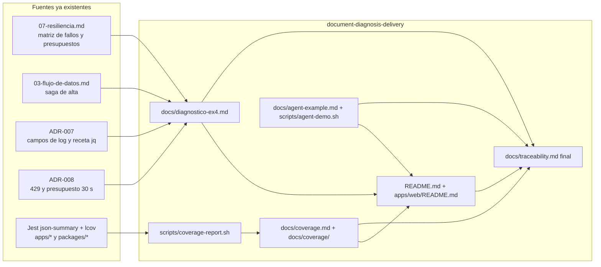

# Design — document-diagnosis-delivery

Contrato de arquitectura: `openspec/changes/archive/2026-10-20-design-architecture-docs/design.md` + ADR-001..010 + `docs/architecture/03-flujo-de-datos.md`, `04-docker-compose-diseno.md`, `07-resiliencia.md`, `08-integracion-ia-rag.md`. Este documento solo fija lo que este cambio decide o concreta. Documentación en español; encabezados estructurales exactos donde los gates los comprueban. Nada de IDs de modelo LLM ni precios; versiones de herramientas (Loki, Alloy, Grafana) `needs-verification`.

## Architecture decisions

| ID | Decisión | Justificación | Alternativa descartada |
|---|---|---|---|
| D1 | **El diagnóstico se ancla en ESTE sistema**, no en un manual genérico: cada hipótesis cita una arista de `07-resiliencia.md` (timeout, breaker, presupuesto), un campo de log de ADR-007 y un comando de verificación concreto | El PDF evalúa "uso adecuado de logs y herramientas" y "problemas específicos de microservicios"; un diagnóstico genérico no los demuestra y los documentos de diseño ya contienen las respuestas | Lista genérica de causas (no diferencia al candidato) |
| D2 | **Priorización con criterio explícito**: `prioridad = probabilidad × impacto ÷ costo de verificar`, expresada como P1/P2/P3 en una tabla con columnas categoría, síntoma que explica, evidencia a favor, prueba de descarte y arista afectada | El PDF evalúa "lógica del análisis y priorización de hipótesis" y "prioridad de acciones (qué verificar primero)"; lo barato y amplio va primero (cambio reciente, `/ready`, `docker compose ps`) | Orden arbitrario o por componente |
| D3 | **Marco de causa común**: se parte de que los tres síntomas (no se guarda, 500, IA lenta) pueden compartir causa (p. ej. degradación de user→role/auth) o ser independientes (proveedor LLM); se decide cruzando `correlationId` entre servicios. Cinco categorías: base de datos, comunicación entre servicios (incluye mensajería), red, agentes IA y configuración/despliegue (la quinta es la hipótesis "qué cambió", se declara como añadida respecto de las cuatro del PDF) | Evita diagnosticar tres incidentes por separado; el `correlationId` ya se propaga por REST y por el sobre del evento (ADR-004/005) | Tres diagnósticos aislados |
| D4 | **Número y umbrales ilustrativos**: los valores de timeouts, presupuestos y reintentos se citan de `07-resiliencia.md` ("por defecto de diseño, configurables"); el diagnóstico no inventa cifras de incidente | Honestidad: es un ejercicio analítico (sin reproducción real) | Cifras de incidente fabricadas |
| D5 | **Reporte de cobertura = script + artefactos versionados**: `scripts/coverage-report.sh` (bash POSIX + `node` inline) recoge `coverage/coverage-summary.json` y `coverage/lcov.info` de `apps/*` y `packages/*`, genera `docs/coverage/summary.json`, `docs/coverage/lcov.info` (fusionado con prefijo de ruta), `docs/coverage/<componente>.json` y `docs/coverage.md`; umbral `COVERAGE_MIN` (por defecto 70) sobre líneas; exit 1 si falta un componente esperado o queda bajo el umbral. **Las pruebas se ejecutan por componente** (`pnpm --filter "./<ruta>" test`, en bucle sobre los 10 componentes esperados) y no con una invocación de todo el monorepo, porque `agent-common.md` (política de cascada) y `scripts/sdd-cascade-cap.sh` prohíben las suites completas a mitad de wave; el filtro por ruta es scope-aware y produce los mismos artefactos | Bootstrap D4 ya activa reporters `json-summary` y `lcov` y el umbral; solo falta fusionar y dejar el artefacto (EX2-R18, EX0-R07, `[RIESGO]`). No se edita ninguna config de Jest | Depender solo del umbral en CI (no deja artefacto); herramienta externa de fusión (dependencia nueva) |
| D6 | **Ruta del reporte reconciliada**: la matriz de trazabilidad citaba `docs/coverage.md`; el brief pide `docs/coverage/`. Se entregan ambos: `docs/coverage.md` (resumen legible, enlaza a `docs/coverage/`) y la carpeta con los datos | Cumple ambas referencias sin cambiar filas ya aprobadas | Elegir solo una (rompe la otra referencia) |
| D7 | **Alcance de escritura del implementador**: `backend` acotado a `docs/**` más cuatro rutas explícitas: `README.md`, `apps/web/README.md`, `scripts/coverage-report.sh`, `scripts/agent-demo.sh` | La matriz asigna a este cambio el README raíz, el README web y el ejemplo del agente; el brief original acotaba a `docs/**`. Se declara la ampliación mínima para el 📋 | Mover estos artefactos a `docs/` (rompe filas EX2-R19, EX3-R19, EX5-R17 de la matriz) |
| D8 | **Dos documentos de ejecución separados** (`README.md` del sistema y `apps/web/README.md` del frontend) enlazados entre sí | EX2-R19 / EX3-R19 `[RIESGO]` | Un solo README |
| D9 | **Estados finales de la matriz verificados contra el disco**: `Implementado` (código) o `Entregado` (documento) solo si la ruta del artefacto existe; si no existe queda `Planeado` con nota. Se añade `## Estado final de entrega` con conteo por estado | La matriz no debe afirmar lo que no existe; el validador puede auditarla | Marcar todo como entregado sin comprobar |
| D10 | **Orden por dependencias**: Wave 0 (Ex4) no depende de código y se ejecuta justo tras el 📋; Wave 1 (cobertura) exige los cambios 3, 4, 6 y 7 implementados (8 recomendado, porque añade `evaluation/` y cambia la cobertura del agente); Wave 2 exige además 5 y 8 | El documento de Ex4 cubre el 100 % de su requisito con solo los documentos de diseño | Esperar al código para escribir Ex4 (riesgo de fecha) |

## Component diagram

## Data model

No hay modelo de datos de aplicación. Este cambio define la estructura de sus documentos y artefactos.

### `docs/diagnostico-ex4.md` — estructura requerida

| Sección (encabezado `##`) | Viñeta del PDF que cubre | Contenido mínimo |
|---|---|---|
| `## Resumen del incidente` | contexto | Los tres síntomas, alcance a confirmar, supuestos y qué se asume que no se sabe |
| `## Hipótesis` | formular hipótesis (BD, comunicación, red, agentes IA) | Tabla `H1…H11` con categoría, síntoma que explica, evidencia a favor, prueba de descarte, prioridad P1/P2/P3 y criterio de priorización (D2); subsección de causa común (D3) |
| `## Plan de diagnóstico` | plan sistemático con logs estructurados y herramientas de debugging | Fases: (0) triage y contención en minutos, (1) alcance y qué cambió, (2) verificación barata y amplia (`docker compose ps`, `GET /health` y `GET /ready` por servicio), (3) correlación por `correlationId`, (4) profundización por categoría, (5) mitigación y verificación; matriz síntoma → comando; criterio de salida por fase |
| `## Logs centralizados` | cómo usaría logs centralizados | Receta `docker compose logs <servicio> \| jq 'select(.correlationId=="<id>")'`; consultas agregadas (`statusCode >= 500` por `service`, `event=access.denied`, `event=audit.fallback`); perfil `observability` (Loki + Alloy + Grafana, `needs-verification`) con consultas LogQL de ejemplo; qué hacer si el perfil no está activo; campos de ADR-007 |
| `## Herramientas de debugging` | herramientas de debugging | `docker compose ps/logs/exec`, `curl` a `/health` y `/ready`, consola de RabbitMQ (`15672`) para colas y DLQ, `psql`/`mongosh`/`redis-cli`, `docker network inspect`, inspección del outbox (`outbox_events`) y usuarios `PENDING` |
| `## Microservicios y fallos en cascada` | problemas de microservicios | Cómo se propaga el fallo (user→role/auth, outbox, DLQ, tormenta de reintentos), cómo lo contienen timeout/backoff/breaker/presupuesto de 10 s, cómo detectar breaker abierto, reconciliación de `PENDING`, re-drive de DLQ, `audit.fallback` |
| `## Agentes IA` | alta latencia, costos de tokens, rate limiting | Descomposición de latencia (LLM 20 s, presupuesto 30 s, nginx 40 s, Qdrant, embeddings, herramienta user 3 s); 429 y `retry-after`; costo con `llm.tokensIn`/`llm.tokensOut` y `LLM_PRICE_INPUT_PER_MTOK`/`LLM_PRICE_OUTPUT_PER_MTOK` (sin valores); palancas (`max_tokens`, `ragHits`, chunks ≤256, prompt caching); degradación esperada; rate limit por usuario en Redis |
| `## Acciones inmediatas y mitigación` | prioridad de acciones | Acciones ordenadas por reversibilidad y riesgo (p. ej. reiniciar solo el servicio afectado, subir presupuesto o desactivar herramienta, activar proveedor degradado, re-drive tras corregir) |
| `## Comunicación a stakeholders` | comunicar avance | Audiencias, cadencia, canal, plantilla `Plantilla de actualización` con campos `Estado`, `Impacto`, `Causa conocida / hipótesis`, `Acciones en curso`, `Próxima actualización`, ejemplo de primer aviso y de cierre, lenguaje no técnico para negocio |
| `## Prevención y seguimiento` | cierre | Postmortem sin culpables, alertas (tasa de 5xx, breaker abierto, profundidad de DLQ, tokens por consulta), mejoras (Evolución declarada en ADRs) |

### Artefactos de cobertura

| Ruta | Origen | Contenido |
|---|---|---|
| `docs/coverage/<componente>.json` | copia de `coverage/coverage-summary.json` | Resumen Jest por componente (`<componente>` = nombre de carpeta: `auth-service`, `web`, `logger`, …) |
| `docs/coverage/summary.json` | fusión | `{ generatedAt, threshold, components: [{ name, lines, branches, statements, functions, status }] }` |
| `docs/coverage/lcov.info` | concatenación con `SF:` prefijado por `apps/<x>/` o `packages/<x>/` | Cobertura fusionada para cualquier visor lcov |
| `docs/coverage.md` | generado | `## Resumen` (tabla componente / líneas % / ramas % / umbral / estado), `## Cómo regenerar`, `## Notas` (ramas informativas, ADR-007) |

Componentes esperados: `auth-service`, `user-service`, `role-service`, `audit-service`, `ai-agent-service`, `web` y los paquetes `contracts`, `logger`, `jwt-guard`, `http-client`.

## Testing strategy

Cambio de documentación: no escribe código de aplicación, por lo que **presupuesto de pruebas = 0**. La verificación son gates `cmd:` de contenido (encabezados, términos requeridos, enlaces existentes) y, para `scripts/coverage-report.sh`, su propia ejecución (que falla si hay un componente ausente o bajo el umbral). `scripts/agent-demo.sh` se valida con `bash -n` y la ejecución en vivo contra el compose queda en el gate ✅ manual.

## Decisiones de implementación

| Decisión | Motivo | Evidencia |
|---|---|---|
| `docs/diagnostico-ex4.md` con 11 hipótesis (H1–H11) priorizadas y recetas `jq` por `correlationId` | Responder el Ejercicio 4 sobre los componentes reales del sistema | `docs/diagnostico-ex4.md` (`## Hipótesis`, `## Plan de diagnóstico`, `## Logs centralizados`) |
| `## Prevención y seguimiento` incluye un caso real: deriva de `@qdrant/js-client-rest` 1.19 que degradaba el agente en silencio, detectada por el e2e | Ilustrar con un incidente del propio sistema por qué alertar sobre respuestas degradadas y no tragarse errores | `docs/diagnostico-ex4.md`; `e2e/agent.spec.ts`; `apps/ai-agent-service/src/application/ask/ask-agent.use-case.ts` (`agent.degraded`) |
| El README raíz concentra ejecución, URLs, agente, pruebas, alcance por ejercicio y evolución | Un único punto de entrada para el evaluador | `README.md` |
| Cobertura: umbral de 70 % de líneas por componente en `jest.config.base.js`; resumen enlazado desde el README | Cada componente falla por sí mismo bajo el umbral | `jest.config.base.js` (`coverageThreshold`), `README.md` (enlace a `docs/coverage/README.md`) |
| El agente integrado se demuestra con `scripts/smoke.sh` y el e2e Playwright | Ambos corren contra el stack real en `:8080` | `scripts/smoke.sh` (`POST /api/agent/ask`), `e2e/agent.spec.ts` |
| `GET /ready` de auth-service responde sin comprobar dependencias | Alcance actual de auth-service; el plan de diagnóstico complementa `/ready` con comandos directos sobre Postgres, Redis y RabbitMQ | `apps/auth-service/src/interfaces/http/controllers.ts` (`ready()`); `README.md` (Evolución) |

## Risks

- **Dependencia entre cambios**: Wave 1 y 2 no pueden ejecutarse hasta que existan los cambios 3–8. Mitigación: Wave 0 es autónoma; el orquestador no despacha Wave 1 sin verificar que `apps/<servicio>/` y `apps/web/` existen.
- **Cobertura bajo el umbral en algún componente**: el script falla; la corrección corresponde al cambio dueño del componente, no a este (no se baja el umbral ni se excluyen archivos aquí).
- **Rutas y comandos de README/ejemplo del agente** dependen de lo implementado (nombres de scripts de `package.json`, rutas finales de los endpoints). Mitigación: el implementador los toma del disco (`docker-compose.yml`, `package.json`, controladores) y no inventa variantes; los placeholders de `AGENTS.md` → Commands no se copian.
- **Perfil `observability` opcional**: si no se activó en el cambio 5, `## Logs centralizados` presenta la receta con `jq` como camino base y el perfil como opción, coherente con ADR-007.
- **`needs-verification`**: etiquetas de imagen y sintaxis de LogQL/Alloy (context7 no consultado por el planner).
