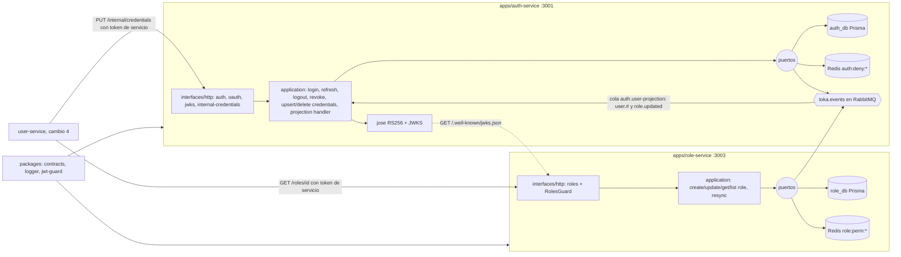

# Design — build-auth-role-services

Contrato de arquitectura: `openspec/changes/archive/2026-10-20-design-architecture-docs/design.md` + ADR-001..010 (accepted) + `docs/architecture/03-flujo-de-datos.md`, `06-seguridad-escalabilidad.md`, `07-resiliencia.md`. Este documento solo fija lo que este cambio decide o concreta. **Versiones**: Node 22, NestJS 11, Postgres 17, Redis 7, RabbitMQ 3.13, Jest vienen de `AGENTS.md`. Todo lo demás (Prisma, `@prisma/client`, `jose` v5, `@node-rs/argon2`, `amqplib`, `ioredis`, `class-validator`, `supertest`, tags de imagen base) queda **`needs-verification` — fijar al instalar** (context7 no disponible para este agente; no se inventan números de versión).

**Precondición de secuencia**: este cambio depende de `bootstrap-monorepo-platform` (cambio 2, en implementación). No se puede iniciar la tarea 1.1 hasta que existan `pnpm-workspace.yaml`, `jest.config.base.js`, `tsconfig.base.json` y los 4 paquetes `@toka/*` compilados (`dist`). Todo uso de una API de cambio 2 está marcado **"reconcile after change 2"** (tabla de supuestos al final).

## Architecture decisions

| ID | Decisión | Justificación | Alternativa descartada |
|---|---|---|---|
| D1 | **Clean Architecture por servicio** (`domain` → `application` → `infrastructure`/`interfaces`); casos de uso dependen de **puertos** (`CredentialRepository`, `RefreshTokenRepository`, `ProjectionRepository`, `DenylistWriter`, `TokenIssuer`, `PasswordHasher`, `EventPublisher`, `Clock`); Prisma, Redis, `jose`, argon2 y AMQP son adaptadores | ADR-006; permite pruebas con dobles en memoria sin red ni contenedores y alcanzar 70 % con pocas pruebas | Servicios Nest con lógica en controladores/repositorios (no probable sin infraestructura) |
| D2 | **Esqueletos + única instalación en la tarea 1.1** (manifiestos de ambos `apps/*` con TODAS las dependencias, `main.ts`, `app.module.ts`, `/ready`, `jest.config.js`, `tsconfig*.json`); las tareas 2.x **no ejecutan `pnpm add`** | Evita carreras sobre `pnpm-lock.yaml` y conflictos de `app.module.ts`; misma regla que el cambio 2 | Cada tarea añade sus dependencias (lockfile en conflicto) |
| D3 | **Secuencia intra-wave explícita en Wave 1**: 2.1 → 2.2, 2.1 → 2.3, 2.1 → 2.4 (las tres tocan `apps/auth-service`: `app.module.ts` y wiring comparten archivo); 2.5 (role-service) es independiente y puede ir en paralelo a cualquiera | Evita ediciones concurrentes del mismo archivo | Paralelizar las 4 tareas de auth (colisiones en `app.module.ts`) |
| D4 | **Prisma con `output` propio por servicio** (`apps/<svc>/src/generated/prisma`, ignorado por git) y `build` = `prisma generate` + `tsc` + copia de `src/generated` a `dist/generated` (script Node multiplataforma, no `cp`) | Dos esquemas en un mismo workspace pnpm compartirían `node_modules/.prisma/client` y el último `generate` pisaría al otro. `needs-verification`: sintaxis de `generator`/`output` según versión de Prisma (con Prisma ≥7 hay `prisma.config.ts` y otro generador) | Salida por defecto (cliente compartido y pisado) |
| D5 | **Prisma migrations versionadas** (`prisma/migrations/0001_init/migration.sql` + `migration_lock.toml`) generadas con `prisma migrate diff` desde cero (no requiere Postgres); aplicadas en el contenedor con `prisma migrate deploy` al arrancar (CMD del Dockerfile) | Reproducible y verificable sin BD en el gate de esquema; el smoke de la tarea 3.3 las aplica con el rol de servicio | `db push` (sin historial) |
| D6 | **`RolesGuard` + `@Roles(...)` en `interfaces/http/` de cada servicio** (copia pequeña en auth y en role); no se añade a `packages/jwt-guard` | El cambio 2 está construyendo `jwt-guard`; editarlo en paralelo crea conflicto. El guard lee `request.user.roles` (expuesto por `JwtAuthGuard`). **Seguimiento**: promover a paquete/`jwt-guard` en el cambio 4 si se duplica por tercera vez | Modificar `packages/jwt-guard` ahora |
| D7 | **Adaptador AMQP duplicado y pequeño** (`infrastructure/messaging/`) con `amqplib`: conexión, canal con confirmaciones, `assertExchange` de `EVENTS_EXCHANGE` (topic, durable) y `DLX_EXCHANGE` (direct, durable), publicación y, en auth, consumo. Fuera de la medición de cobertura (cableado); la lógica de reintento/DLQ y de fallback vive en `application/` y sí se mide | ADR-001 prohíbe dominio compartido; un paquete AMQP nuevo requiere tocar el cambio 2. Dos copias de ~60 líneas son aceptables | `@nestjs/microservices` (abstrae topología; no da control de colas `.retry`/`.dlq`) |
| D8 | **Tokens de servicio**: `POST /oauth/token` (`grant_type=client_credentials`, `client_id`, `client_secret`, `audience`) valida contra `SERVICE_CLIENTS` (variable de entorno `id:secret,id2:secret2`, comparación en tiempo constante) y emite JWT con `sub=client_id`, `roles=['service']`, `scope='svc:internal'`, `aud=<audience pedido>`. Los endpoints `/internal/*` exigen `roles` ∋ `service` | Evita depender de que `request.user` exponga `scope` (el contrato del cambio 2 no lo lista); mismo efecto que `scope: svc:internal` de 03 | Exigir `scope` en `request.user` (no garantizado) |
| D9 | **Autoverificación en auth**: `auth-service` valida sus propios tokens con un **resolvedor de claves en proceso** (clave pública derivada de la privada) y no con una llamada HTTP a su propio JWKS. `audience` aceptado = `['toka-api','auth-service']`; los `/internal/*` además exigen rol `service` | Sin salto de red ni dependencia circular en el arranque | `jwksUri` apuntando a sí mismo |
| D10 | **`role-service` acepta `audience` = `['toka-api','role-service']`** (tokens de usuario y de servicio de `user-service`) y obtiene el JWKS de `AUTH_JWKS_URL` | Cambio 4 llama `GET /roles/{id}` con token de servicio; ADR-003 define `aud` por servicio destino | Solo `toka-api` (rompería user→role) |
| D11 | **Claim de rol**: join `user_roles_projection` ↔ `role_names_projection` al emitir el token. Si no hay nombre resoluble, el token se emite con `roles: []` y `warn` (`event=role.unresolved`); el RBAC lo denegará | Login no debe fallar por consistencia eventual; la seguridad no se debilita (sin rol no hay acceso privilegiado) | Rechazar login (indisponibilidad por eventos retrasados) |
| D12 | **Cookie de refresh**: nombre `refresh_token`, `HttpOnly; SameSite=Strict; Path=/api/auth`, `Secure` según `COOKIE_SECURE` (por defecto `true`). El servicio expone `/auth/login|refresh|logout` (nginx del cambio 6 reescribe `/api/auth/` → `/auth/`). Refresh opaco de 32 bytes aleatorios; en BD solo `sha256(token)` | ADR-003; un volcado de BD no entrega refresh usables | Guardar el refresh en claro |
| D13 | **Revocación por usuario**: `RevokeUserSessions(userId)` escribe `auth:deny:user:{userId}` = epoch en **segundos** (`floor(now/1000)`) con `EX = ACCESS_TOKEN_TTL_SECONDS`, y revoca todos los refresh del usuario. Lo invocan `user.updated(DISABLED)` y `user.deleted` | Misma unidad que `iat` (contrato cerrado por el cambio 2); limitación conocida: un token emitido en el mismo segundo de la revocación no se rechaza (el login ya está bloqueado por estado) | Milisegundos (incompatible con `iat`) |
| D14 | **Reintentos/DLQ del consumidor**: cola `auth.user-projection` (bindings de `QueueBindings`), `auth.user-projection.retry` (TTL por mensaje según `x-retry-count`: por defecto 5 s, 30 s, 120 s; `RETRY_DELAYS_MS`; `x-dead-letter-exchange` = `DLX_EXCHANGE`, `x-dead-letter-routing-key` = nombre de la cola principal) y `auth.user-projection.dlq`. Error transitorio → retry con `x-retry-count + 1` hasta `MAX_RETRIES` (3) → DLQ; esquema inválido (`isEventEnvelope` falso) o tipo desconocido → DLQ directo. **Simplificación declarada**: una sola cola `.retry` con expiración por mensaje (el retardo se mide en la cabeza de la cola; con retardos crecientes puede haber bloqueo de cabeza; aceptable en este alcance, colas por nivel = Evolución) | 07-resiliencia; mínimo que cumple "reintentos con retardo antes de DLQ" | Una cola `.retry` por nivel (más topología que probar) |
| D15 | **Idempotencia del consumidor**: tabla `processed_events(event_id)` insertada en la **misma transacción** que el cambio de proyección; evento ya procesado → `ack` sin efecto. Orden: se aplica solo si `aggregateVersion > user_last_version` (eventos `user.*`) o `> last_version` (`role.updated`) | 03 → Garantías; ADR-003 | Solo versión (no deduplica eventos sin cambio de versión) |
| D16 | **Publicación directa con respaldo** (auth): `ResilientEventPublisher` (application) reintenta en memoria `PUBLISH_RETRIES` (3) con backoff corto; al agotarse escribe el sobre completo como log `event="audit.fallback"` y **no falla la petición** de login. role-service usa el mismo patrón con `event="role.publish.failed"` (sin `audit.fallback`, que es de auth) y se recupera con el re-sync | 07-resiliencia (riesgo aceptado) | Outbox (Evolución) |
| D17 | **Eventos de `role-service`**: toda `PUT /roles/{id}` incrementa `version` en 1 y emite `role.updated` (snapshot completo `{roleId,name,description,permissions}`); si cambió `permissions`, emite además `role.permissions.changed` con la misma `aggregateVersion` y distinto `eventId`. `POST` emite `role.created` (`aggregateVersion` 1) | `auth.user-projection` solo se enlaza a `role.updated` (nombre); `agent.ingest` a `role.#` (upsert idempotente por `docId`) | Un solo tipo de evento (pierde la semántica de permisos) |
| D18 | **Re-sync al arrancar** (`OnApplicationBootstrap`, no bloqueante): por cada rol emite `role.updated` con `actor='system'`, `reason='resync'`, `aggregateVersion = version` y `eventId = deterministicEventId(roleId, version)` (idempotente para consumidores). Si el broker no está disponible: `warn` y continúa | 03/ADR-004 (recuperación de publicación directa) | Bloquear el arranque hasta publicar |
| D19 | **Caché `role:perm:{roleId}`**: cache-aside con TTL `ROLE_CACHE_TTL_SECONDS` (300); guarda el DTO `{id,name,description,permissions,version}`; `PUT` invalida la clave; Redis caído → lectura directa de BD con `warn` (la caché no es crítica) | ADR-002 (role-service dueño de `role:*`) | Write-through (más acoplamiento) |
| D20 | **Anti-enumeración en login**: usuario inexistente, contraseña errónea, `PENDING` y `DISABLED` responden el mismo 401 (`invalid_credentials`); si no existe el usuario se verifica contra un hash ficticio para igualar tiempo | OWASP; el motivo real solo va en el log (`event=auth.login.failed`) y en el payload del evento | Mensajes distintos por causa |

### Decisiones diferidas y recortes (ver proposal → Out of scope)

`DELETE /roles/{id}`, rate limit de login, compose/env de los servicios, seed de admin y paquete AMQP compartido.

## Component diagram



## Data model

### Estructura de archivos (por servicio; entre paréntesis lo que solo existe en auth)

```
apps/<svc>/
  package.json  tsconfig.json  tsconfig.build.json  jest.config.js  Dockerfile  .eslintrc|eslint config heredada
  prisma/schema.prisma  prisma/migrations/0001_init/migration.sql  prisma/migrations/migration_lock.toml
  scripts/copy-generated.cjs
  src/main.ts  src/app.module.ts  src/config/  src/generated/prisma/ (ignorado por git)
  src/domain/            entidades, value objects, errores
  src/application/       casos de uso + ports/ (+ resilient-publisher.ts, retry-policy.ts)
  src/infrastructure/    persistence/ (Prisma), redis/, messaging/ (amqplib), (crypto/ argon2 + jose)
  src/interfaces/http/   controladores, DTO (class-validator), roles.guard.ts, roles.decorator.ts
```

### `auth_db` (Prisma, `@@map` a snake_case)

| Tabla | Columnas clave | Notas |
|---|---|---|
| `credentials` | `user_id` uuid PK, `email` único (minúsculas), `password_hash`, `status` enum `PENDING\|ACTIVE\|DISABLED`, `created_at`, `updated_at` | `PUT /internal/credentials` crea en `PENDING` |
| `user_roles_projection` | `user_id` PK, `role_id`, `user_last_version` int, `updated_at` | Sembrada por `PUT /internal/credentials` con `user_last_version = 0` |
| `role_names_projection` | `role_id` PK, `role_name`, `last_version` int | Sembrada por `PUT /internal/credentials` si trae `roleName`/`roleVersion`, por `user.role.assigned` y actualizada por `role.updated` |
| `refresh_tokens` | `id` uuid PK, `token_hash` único, `user_id`, `family_id`, `expires_at`, `rotated_at?`, `revoked_at?`, `created_at`; índices por `user_id` y `family_id` | Reutilizar uno con `rotated_at` revoca la familia |
| `processed_events` | `event_id` PK, `processed_at` | Idempotencia del consumidor |

### `role_db` (Prisma)

| Tabla | Columnas clave | Notas |
|---|---|---|
| `roles` | `id` uuid PK, `name` único, `description?`, `permissions` text[], `version` int default 1, `created_at`, `updated_at` | `version` = `aggregateVersion` del agregado `Role`; se incrementa de forma atómica en `PUT` |

### Redis

- Auth escribe `auth:deny:jti:{jti}` (valor `1`, `EX` = vida restante del access token) y `auth:deny:user:{userId}` (epoch segundos, `EX = ACCESS_TOKEN_TTL_SECONDS`). Role-service escribe `role:perm:{roleId}`. Sin otras claves en este cambio (`<svc>:jwks` queda sin usar, D9 del cambio 2; `auth:rl:login:*` diferido).

### Contratos HTTP (resumen; OpenAPI completo queda en el cambio 4/5)

| Servicio | Método y ruta | Autenticación | Respuesta clave |
|---|---|---|---|
| auth | `POST /auth/login` `{email,password}` | pública | 200 `{accessToken,expiresIn}` + cookie refresh; 401 `invalid_credentials` |
| auth | `POST /auth/refresh` | cookie `refresh_token` | 200 nuevo access + nueva cookie; 401 si reutilizado/expirado/no ACTIVE |
| auth | `POST /auth/logout` | Bearer (`aud` ∈ `toka-api`, `auth-service`) | 204; escribe `auth:deny:jti`; revoca la familia; borra cookie |
| auth | `GET /.well-known/jwks.json` | pública | `{keys:[{kty,n,e,alg:'RS256',use:'sig',kid}]}` solo clave pública |
| auth | `POST /oauth/token` | `client_id/client_secret` | 200 `{access_token,token_type:'Bearer',expires_in}`; 401 |
| auth | `PUT /internal/credentials/{userId}` `{email,password,roleId,roleName?,roleVersion?}` | Bearer con rol `service` | 200/201 idempotente por `userId` (misma contraseña no se vuelve a hashear si ya existe en `PENDING`; el rol/email se actualizan) |
| auth | `DELETE /internal/credentials/{userId}` | rol `service` | 204 (idempotente; borra credenciales y revoca refresh) |
| auth | `GET /ready` | pública | 200 `{status:'ok'}` |
| role | `POST /roles` / `PUT /roles/{id}` `{name,description?,permissions[]}` | `admin` | 201 / 200 DTO con `version`; 409 nombre duplicado; 404 |
| role | `GET /roles/{id}` | `admin` o `service` | DTO `{id,name,description,permissions,version}` |
| role | `GET /roles` | `admin` | lista |
| role | `GET /ready` | pública | 200 |

### Configuración (variables de entorno)

| Servicio | Variables |
|---|---|
| auth | `PORT` (3001), `DATABASE_URL`, `REDIS_URL`, `RABBITMQ_URL`, `JWT_PRIVATE_KEY_FILE`, `JWT_KID`, `JWT_ISSUER` (por defecto `toka-auth`), `ACCESS_TOKEN_TTL_SECONDS` (por defecto 600), `REFRESH_TOKEN_TTL_SECONDS` (604800), `SERVICE_TOKEN_TTL_SECONDS` (300), `COOKIE_SECURE` (`true`), `SERVICE_CLIENTS`, `RETRY_DELAYS_MS` (`5000,30000,120000`), `MAX_RETRIES` (3), `PUBLISH_RETRIES` (3), `LOG_LEVEL` |
| role | `PORT` (3003), `DATABASE_URL`, `REDIS_URL`, `RABBITMQ_URL`, `AUTH_JWKS_URL`, `JWT_ISSUER`, `ROLE_CACHE_TTL_SECONDS` (300), `LOG_LEVEL` |

Las variables nuevas (`JWT_ISSUER`, `REFRESH_TOKEN_TTL_SECONDS`, `SERVICE_TOKEN_TTL_SECONDS`, `SERVICE_CLIENTS`, `RETRY_DELAYS_MS`, `MAX_RETRIES`, `PUBLISH_RETRIES`, `ROLE_CACHE_TTL_SECONDS`) no están en las plantillas `infra/env/*.env.example` del cambio 2; **este cambio no las edita** (archivos del cambio 2): el cambio 5 las incorpora junto con compose. Todas tienen valor por defecto salvo las de conexión, clave, `SERVICE_CLIENTS` y `AUTH_JWKS_URL`, que son obligatorias (el servicio falla al arrancar con mensaje claro si faltan).

## Testing strategy

Presupuesto declarado (tope por tarea 6, por archivo 8, por cambio 30; este cambio planea **29**, con 1 de reserva; **no hay margen para pruebas "de redondeo"**):

| Tarea | Pruebas | Casos |
|---|---|---|
| 2.1 auth: login, JWT, JWKS, `/oauth/token`, publicación | 6 (tope por tarea, presupuestado) | hash argon2id verifica y rechaza; token trae `kid`/`aud`/`iss`/`roles`/`jti`/`exp` y el JWKS publica el mismo `kid` solo con clave pública; login ACTIVE devuelve access + cookie `HttpOnly` y publica `auth.login.succeeded`; login con contraseña errónea/`PENDING` responde igual 401 y publica `auth.login.failed`; `client_credentials` válido emite `aud` pedido y secreto erróneo da 401; publicador agota reintentos y escribe `audit.fallback` sin fallar |
| 2.2 auth: refresh, logout, revocación | 5 | refresh rota (mismo `family_id`, token distinto); reutilizar uno rotado revoca la familia y da 401; refresh de usuario no ACTIVE da 401; logout escribe `auth:deny:jti` con TTL restante y revoca la familia; `RevokeUserSessions` escribe epoch en segundos con TTL de acceso y revoca los refresh |
| 2.3 auth: credenciales internas | 3 | `PUT` crea `PENDING`, siembra proyección y es idempotente; `PUT`/`DELETE` sin rol `service` dan 403; `DELETE` borra credenciales y revoca |
| 2.4 auth: consumidor de proyecciones | 5 | `user.created` activa solo `PENDING` y un evento con versión ≤ almacenada se ignora; `user.updated(DISABLED)` marca `DISABLED` e invoca revocación; `role.updated` actualiza el nombre solo si la versión es mayor y `user.role.assigned` siembra el nombre faltante; sobre inválido va a DLQ sin reintentos; error transitorio va a retry con `x-retry-count+1` y, al superar el máximo, a DLQ |
| 2.5 role: CRUD, caché, eventos, RBAC | 6 (tope por tarea, presupuestado) | `POST` crea con `version` 1 y publica `role.created`; `PUT` incrementa `version`, invalida caché y publica `role.updated`; `PUT` que cambia permisos publica además `role.permissions.changed`; `GET /roles/{id}` cache miss llena y cache hit no toca BD; nombre duplicado 409; `RolesGuard`: no admin da 403 en escritura y `service` puede leer por id |
| 3.1 role: re-sync | 2 | emite `role.updated` por rol con `actor=system`, `reason=resync` y `eventId` determinista (dos ejecuciones = mismos ids); broker caído no impide el arranque (`warn`) |
| 3.4 integración contrato | 2 | token real de auth aceptado por `JwtAuthGuard` de `@toka/jwt-guard` (clave del JWKS, `aud`, `kid`); tras `RevokeUserSessions` el mismo token es rechazado (`iat` < marca) |
| **Total** | **29** | |

Reglas:

- **Prioridad de nivel**: pruebas **HTTP** con `@nestjs/testing` + `supertest` sobre el módulo real y **puertos reemplazados por dobles en memoria** (repositorios, Redis, publicador, reloj). Cada prueba recorre controlador + DTO + caso de uso + dominio, que es lo que permite ≥70 % de líneas con pocas pruebas. `JwtAuthGuard` se sustituye por un guard de prueba que fija `request.user` salvo en 3.4 (guard real).
- **`collectCoverageFrom`** de cada servicio hereda la base del cambio 2 (umbral `lines: 70`) y añade **solo estas exclusiones de cableado/generado**: `src/main.ts`, `src/**/*.module.ts`, `src/generated/**`, `src/infrastructure/persistence/**` (repositorios Prisma), `src/infrastructure/messaging/**` (adaptador amqplib) y `src/infrastructure/redis/**` (adaptadores ioredis finos). **No se excluyen** `domain`, `application`, `interfaces`, `infrastructure/crypto`, ni la lógica de reintento/fallback. Consecuencia declarada: los repositorios Prisma y el adaptador AMQP no tienen prueba unitaria; los cubre el smoke de migraciones (3.3) y la verificación manual del ✅ (riesgo 4).
- Si 70 % no se alcanza con el presupuesto, **no se añaden pruebas por encima del tope**: se amplían las aserciones de las existentes o se eleva un ❓ para ampliar el presupuesto; superar 30 pruebas es señal de re-dividir el cambio, no de seguir escribiendo.
- Sin snapshots; sin red ni contenedores en pruebas; reloj y aleatoriedad inyectables. `grep` de conteo en el gate 3.4 verifica ≤30 casos (`it(`/`test(`).

## Plan metadata (planner contract: V3–V5)

- **Waves**: Wave 0 (esqueletos y esquemas de datos, 3 tareas: 1.1–1.3), Wave 1 (lógica de servicios, 5 tareas: 2.1–2.5), Wave 2 (cierre, 5 tareas: 3.1–3.5). **13 tareas**, 4 specs (`auth-tokens`, `auth-credentials-projection`, `role-management`, `service-runtime`).
- **Orden database → backend**: la tarea 1.1 (backend) va primero dentro de Wave 0 solo porque instala `prisma` y fija el lockfile; los esquemas (1.2, 1.3, perfil `database`) preceden a toda la lógica de Wave 1, que depende de ellos (cliente Prisma generado). Wave 1 y 2 son `backend`, salvo 3.3 (`database`, migraciones bajo rol de servicio).
- **required_tools.per_agent**: `backend` — mcp: `[engram]`, skills: `[forge-implement, test-driven-development]`; `database` — mcp: `[engram]`, skills: `[forge-implement]`; `validator` — mcp: `[engram]`, skills: `[forge-verify]`. Sin figma (sin frontend) ni context7 (librerías `needs-verification`).
- **Domain Map**: `apps/**` se asume `backend_paths` y `apps/*/prisma/**` `database_paths`; `docs/**` y raíz son `config_paths`: el orquestador acota los envelopes (`database` → `apps/*/prisma/**`; `backend` → `apps/**` salvo `prisma/`, `.gitignore` en 1.1 y `docs/**` en 3.5).
- **contracts_review**: `stable_list: []`, `reviewed_at: 2026-10-20T00:00:00Z`. Nombres de exchange, routing keys, claves Redis, puertos y semántica de `auth:deny:*` del cambio 1/2 se tratan como contrato estable.
- **Desviaciones declaradas**: (a) CLI `opsx` y `scripts/validate-topic-key.sh` no ejecutados (sin Bash en el sub-agente); (b) no hay `openspec/config.yaml` → repo único, sin `Repo:`; (c) `engram` no disponible en el toolset de este agente: `[MEMORY] WARNING`, **`spec/build-auth-role-services` y `gate/plan-approved/build-auth-role-services` quedan pendientes: los guarda el orquestador**; (d) el planner no puede ejecutar los gates `cmd:`; (e) **V1 `max_files_modified: 25` excedido por naturaleza**: dos servicios completos con ~35–40 archivos cada uno; dividirlo contradice el plan de 9 cambios (auth y role comparten el contrato JWKS/eventos) — decisión del orquestador; (f) los gates con `docker` requieren Docker en el host del implementador/validador.

## Supuestos sobre APIs del cambio 2 (reconcile after change 2)

| # | Supuesto | Fuente en cambio 2 | Si difiere |
|---|---|---|---|
| S1 | `jest.config.base.js` exporta un objeto (`module.exports`) con `collectCoverage`, `coverageThreshold.global.lines: 70`, reporters `json-summary` y `collectCoverageFrom`/exclusiones de `index.ts` y `*.spec.ts`; los servicios lo extienden con spread y **añaden** (no reemplazan) exclusiones | design D4 | Ajustar `jest.config.js` de cada servicio en 1.1 |
| S2 | `tsconfig.base.json` (strict, ES2022, commonjs, decoradores, `declaration`) y config de eslint/prettier raíz se extienden desde `apps/*`; `pnpm install` raíz ya hecho; `apps/*` ya cubierto por `pnpm-workspace.yaml` | tarea 1.1 | Ajustar `tsconfig.json` por servicio |
| S3 | `@toka/contracts` exporta `EVENTS_EXCHANGE`, `DLX_EXCHANGE`, `RoutingKeys`, `QueueBindings` (`auth.user-projection`: `user.#`, `role.updated`), `EventEnvelope<T>`, `createEnvelope(...)` (rellena `eventId`, `occurredAt`, `version`), `isEventEnvelope`, `deterministicEventId(roleId, aggregateVersion)`, `UserRoleAssignedPayload`; la firma exacta de `createEnvelope` se consulta al implementar | design "contracts" | Adaptar llamadas; no tocar el paquete |
| S4 | `createEnvelope` acepta `aggregateVersion`; para eventos sin agregado (`auth.login.*`) se usa `0`; `actor` = `{userId, roles}` en éxito y `'system'` en fallo sin usuario resoluble | design "contracts" | Ajustar valor |
| S5 | Payloads `user.*` siguen siendo `Record<string, unknown>` hasta el cambio 4. Auth asume y **tolera campos extra**: `user.created` `{userId,email,roleId,status}`, `user.updated` `{userId,status?,roleId?}`, `user.deleted` `{userId}`, `user.role.assigned` `{userId,roleId,roleName,roleVersion}` (este último sí fijado por el cambio 2). El cambio 4 debe respetarlo (cambios solo aditivos) | design "contracts" + 03 | Reconciliar en el cambio 4 |
| S6 | `@toka/jwt-guard` exporta `JwtAuthGuard`, `DenylistReader`, `RedisDenylistReader` y sus opciones: `issuer`, `audience` (`string \| string[]`), `jwksUri` **o** resolvedor de claves (nombre exacto por confirmar), `denylistTimeoutMs`, `logger`, `metrics?`; `request.user = {sub, roles, jti, iat, exp, aud}` (sin `scope`, por eso D8); la forma de instanciarlo en Nest (proveedor/factory) se confirma al implementar | design "jwt-guard" + spec jwt-guard | Adaptar el cableado; si no hay resolvedor en proceso, usar `jwksUri` de sí mismo con `createRemoteJWKSet` |
| S7 | `@toka/logger` exporta `createLogger({service, level?})`, `correlationIdMiddleware`, `RequestLoggingInterceptor`, `getCorrelationId()`; el interceptor emite `event=access.denied` en 403 | design D7/"logger" | Adaptar nombres |
| S8 | `redact` del logger ya cubre `password`, `refreshToken`, `authorization`, `*.token`; auth no loguea secretos y el payload de `auth.login.failed` solo lleva el identificador intentado (`email`), motivo e IP | design "logger" | Añadir redacción local |
| S9 | `DLX_EXCHANGE` es de tipo `direct` y `EVENTS_EXCHANGE` `topic` (los consumidores del cambio 2 los afirman idempotentemente; D6 del cambio 2 no fija el tipo del DLX) | design D6 | Declarar el tipo que ya exista (un `assertExchange` con tipo distinto falla) |
| S10 | Postgres: `auth_db`/`role_db` se crean con **`OWNER` = el rol del servicio** (`auth_user`/`role_user`) o ese rol tiene `CREATE` sobre el esquema `public`. Postgres ≥15 revoca `CREATE` en `public` a no propietarios; si `01-roles-and-databases.sh` solo concede `CONNECT`, las migraciones fallan | tarea 1.3 de cambio 2 (solo `GRANT CONNECT` documentado) | La tarea 3.3 lo detecta; corregir `infra/postgres/init/**` es del cambio 2/5, no de este |
| S11 | Redis exige contraseña: `REDIS_URL` (`redis://:<pass>@redis:6379`) la incluye; RabbitMQ `RABBITMQ_URL` con usuario/contraseña por defecto del cambio 2 | design infra | Solo cambia el valor de la URL |
| S12 | `secrets/jwt_private.pem` es RSA 2048 PEM (PKCS#8 o PKCS#1); auth acepta ambos | tarea 1.2 de cambio 2 (`openssl genrsa`/`rsa -check`) | Ajustar importación en `jose` (`importPKCS8` vs. `createPrivateKey`) |

## Risks

1. **Cambio 2 inconcluso al iniciar 1.1** (precondición). Mitigación: gate de 1.1 verifica que existan los paquetes y la base de Jest; si falta algo, `BLOCKED [CONTEXT]`.
2. **Prisma y pnpm** (D4): el cliente generado fuera de `node_modules` exige copiar a `dist` y gestionar el motor en la imagen (`openssl` en `node:22-slim`). `needs-verification` por versión de Prisma; el gate de 3.2 comprueba que `dist/app.module.js` carga dentro de la imagen.
3. **argon2 nativo en Windows/Docker**: se elige `@node-rs/argon2` (binarios prebuilt, sin `node-gyp`) y una imagen base glibc; si no hay prebuilt para la plataforma, alternativa `argon2` (`needs-verification`).
4. **Cobertura sin pruebas de repositorios/AMQP** (Testing strategy): riesgo de bug en Prisma/amqplib no detectado por Jest. Mitigación: smoke de migraciones (3.3) + ✅ manual del orquestador contra compose; verificación funcional completa llega en el cambio 5.
5. **Permisos de Postgres** (S10): migraciones pueden fallar con el rol de servicio. El smoke de 3.3 lo prueba sin tocar infraestructura del cambio 2; si falla, `BLOCKED` y enmienda en cambio 2/5.
6. **Primer administrador**: sin seed no se puede crear el primer rol/usuario por API; el ✅ manual usará `PUT /internal/credentials` con token de servicio y un `INSERT` manual de rol, hasta que el cambio 4/5 entregue el seed. Declarado en proposal.
7. **Bloqueo de cabeza en `.retry`** (D14) y **mismo segundo en `auth:deny:user`** (D13): simplificaciones documentadas, no bloqueantes.
8. **Fan-out de contratos de eventos**: los payloads de `user.*` los fija el cambio 4 (S5); si cambian de forma no aditiva se rompe el consumidor. Mitigación: handler tolerante (ignora campos desconocidos, trata faltantes como error permanente → DLQ).
9. **Límite de 29 pruebas** (Testing strategy): sin holgura. Mitigación: tests HTTP con alto alcance de líneas; si falta cobertura, ampliar aserciones, no casos.
