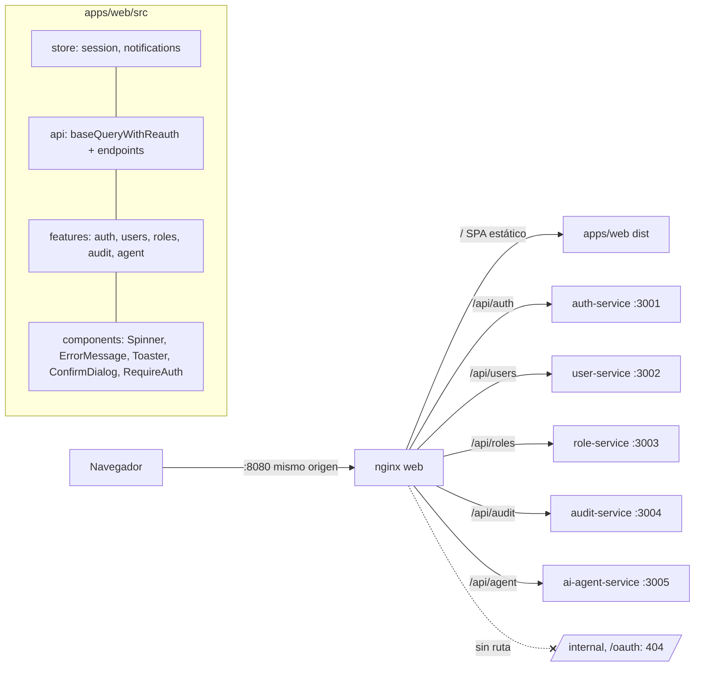

# Design — build-frontend-user-console

Contrato de arquitectura: ADR-010 (accepted), ADR-003 (JWT/refresh), `docs/architecture/03-flujo-de-datos.md`, `04-docker-compose-diseno.md` y `06-seguridad-escalabilidad.md`. Este documento solo fija lo que este cambio decide o concreta. **Versiones**: React 18, Vite, TypeScript y Jest (30 según el orquestador; en Jest 30 `--testPathPattern` pasó a `--testPathPatterns`, por eso los gates usan el patrón posicional) vienen de `AGENTS.md`; todo lo demás (RTK, react-router, react-hook-form, zod, RTL, `whatwg-fetch`, tags de imagen nginx/node, versión de pnpm) queda **`needs-verification` — fijar al instalar** (context7 no disponible; no se inventan números).

## Plan metadata

`forge:propose`, el CLI `opsx` y `scripts/validate-topic-key.sh` no son invocables desde este sub-agente; los artefactos se redactaron al esquema. Únicos topic_keys referenciados: `spec/build-frontend-user-console` y `gate/plan-approved/build-frontend-user-console` (este último se guarda tras la aprobación del 📋). Frontend sin Figma: todas las tareas llevan `mockup_ref: n/a` (UI funcional, sin mockup disponible).

## Architecture decisions

| ID | Decisión | Justificación | Alternativa descartada |
|---|---|---|---|
| D1 | App en `apps/web`, paquete pnpm llamado exactamente **`web`** (no `@toka/web`) | Los gates usan `pnpm --filter web`; el nombre del paquete y el filtro coinciden por construcción. El alcance `@toka/*` es para librerías compartidas; `web` es una app hoja que no se importa | `@toka/web` (obliga a verificar que `--filter web` lo resuelva) |
| D2 | **RTK Query sobre `fetchBaseQuery`** (Fetch API) con `baseQueryWithReauth`: adjunta `Authorization: Bearer`, ante 401 hace **un** refresh (promesa compartida/mutex), reintenta una vez y, si el refresh falla, despacha `logout` | ADR-010 #1, #4, #5. El mutex evita N refreshes concurrentes (rotación de refresh token de una familia: un segundo refresh con el token viejo revocaría la familia) | Axios + interceptores (más dependencias; EX3-R13 ya cita Fetch) |
| D3 | **Token de acceso en el slice `session` de Redux** (memoria); sin `localStorage`/`sessionStorage`. `credentials: 'include'` en las llamadas a `/api/auth/*` para la cookie HttpOnly. Al montar `App`, `bootstrapSession` llama a `POST /api/auth/refresh` una vez; mientras tanto se muestra un estado de carga (no se redirige a login) | ADR-010 #4–#5; el token se pierde al recargar y se recupera con el refresh | Persistir en storage (XSS) |
| D3b | **Usuario de sesión decodificado del JWT** (login y refresh devuelven solo `{accessToken, expiresIn}` + cookie): `src/api/jwt.ts` decodifica el payload (base64url, sin verificar firma: la verificación es de los servicios) y extrae `sub` y `roles[]`; `setSession` guarda `{id: sub, roles}`. Se aplica en `login` y en `bootstrapSession` | El backend no devuelve `user` | Endpoint `/auth/me` (no existe) |
| D4 | **`config.ts` único** que lee `import.meta.env` (`VITE_API_BASE_URL`, por defecto `/api`). Alias `@/` → `src/`; solo `@/config` toca `import.meta`. En Jest, `moduleNameMapper` mapea `^@/config$` → `test/configMock.ts`, de modo que el archivo real **nunca se compila** (ts-jest en commonjs no soporta `import.meta`) | ADR-010 #2 | `babel-plugin-transform-vite-meta-env` (otra toolchain) |
| D5 | **Jest en `jsdom`** con `ts-jest` y un `tsconfig` de la app que extiende `tsconfig.base.json` pero sobrescribe `module: ESNext`/`moduleResolution: bundler`, `jsx: react-jsx`, `lib: [ES2022, DOM, DOM.Iterable]`, sin decoradores. `jest.config.js` extiende `jest.config.base.js` y sobrescribe `testEnvironment`, `testMatch` (`src/**/__tests__/**/*.test.tsx`; la base usa `*.spec.ts` en entorno node), `setupFilesAfterEnv` (`test/setup.ts`) con `@testing-library/jest-dom` y `whatwg-fetch` (jsdom no expone `fetch`/`Request`/`Response`, que `fetchBaseQuery` necesita), `moduleNameMapper` de CSS e `@/`, y `collectCoverageFrom` (`src/**/*.{ts,tsx}` menos `main.tsx`, `config.ts`, `*.d.ts`, `__tests__`). ts-jest usa `isolatedModules`/`diagnostics` del tsconfig de la app (el override de módulo va en el tsconfig de pruebas `tsconfig.jest.json` si `module: ESNext` rompe ts-jest: `needs-verification`, plan B `module: commonjs` en ese archivo) | Ajuste mínimo sobre la base del cambio 2 | Vitest (prohibido por el PDF) |
| D6 | **Servicio `web` en `docker-compose.yml` aquí** (EX3-R09/R20/R28), con `build: {context: ., dockerfile: apps/web/Dockerfile}`, `ports: ["8080:8080"]`, redes `public` + `edge`, `environment` `*_UPSTREAM` y healthcheck `wget /healthz`, **sin `depends_on`**. El cambio 5 añade `depends_on: service_healthy`, cabeceras de seguridad y `Secure` por entorno | `depends_on` hacia servicios que aún no existen rompería `docker compose config`. Diverge de 04 (`build: ./apps/web`): el contexto es la raíz porque el workspace tiene un único `pnpm-lock.yaml` | Dejar `web` al cambio 5 (contradice la trazabilidad EX3-R09) |
| D7 | **nginx por plantilla** `apps/web/nginx/default.conf.template` + `envsubst` de la imagen oficial (`/etc/nginx/templates/`), con `resolver 127.0.0.11 valid=10s` y `set $upstream ${X_UPSTREAM}` + `rewrite ^/api/(.*)$ /$1 break` + `proxy_pass $upstream`. Así nginx **arranca aunque los backends no existan** (con `proxy_pass` fijo fallaría con "host not found in upstream") y retira el prefijo `/api` (`/api/users` → `/users`, como en 03). `ENV` por defecto en el Dockerfile (`AUTH_UPSTREAM=http://auth-service:3001`, …) para que `docker run … nginx -t` funcione | Coincide con el bloque `environment` de 04 | `proxy_pass` con hostnames fijos |
| D8 | **Rutas nginx**: `/healthz` (200), `/api/auth/` → auth, `/api/users` → user, `/api/roles` → role, `/api/audit` → audit, `/api/agent` → agent, `location = /api/auth/login` con `limit_req` (zona `login`, 5 r/s, `burst=10`, `nodelay`; ajustable; `limit_req_status 429`). Imagen final `nginx:*-alpine` (trae `wget` para el healthcheck; tag `needs-verification`), `location ^~ /internal/` y `^~ /oauth/` → 404 explícito (si no, `try_files` devolvería el SPA con 200), `/` con `try_files $uri /index.html`, assets con caché larga y `index.html` sin caché. `client_max_body_size 64k` | ADR-010 #3, #6; 06 (límite de cuerpo) | — |
| D9 | **Pruebas con `fetch` simulado** (`jest.fn` sobre `globalThis.fetch` + helper `mockFetchRoutes` en `apps/web/test/`) y `renderWithProviders` (store nuevo + `MemoryRouter`); sin MSW | MSW v2 en jsdom exige polyfills extra (`TextEncoder`, streams): riesgo de tiempo con entrega a las 17:30 | MSW (más realista, más frágil de configurar) |
| D10 | **Formularios con react-hook-form + zod** (`zodResolver`); esquemas junto a cada feature. Mensajes de validación en español | ADR-010 #1; EX3-R06 | Validación manual |
| D11 | **Componentes compartidos** en `src/components/`: `Spinner`, `ErrorMessage` (recibe el error RTK y extrae `message` NestJS o un texto por defecto), `Toaster` + slice `notifications` (éxito/error con auto-cierre), `ConfirmDialog`, `RequireAuth`, `Layout` con navegación. Las pantallas los reutilizan: son el cumplimiento de EX3-R04/R05/R07 | Un solo lugar de UX; menos pruebas duplicadas | Estados ad hoc por pantalla |
| D12 | **Rol en UI**: la navegación y acciones de escritura (crear/editar/borrar/asignar rol) se muestran solo si `session.user.roles` incluye `admin`; `GET /roles` es solo admin: para un no admin la pantalla de roles muestra el mensaje del 403 vía `ErrorMessage` y la lista de usuarios degrada a mostrar `roleId` sin nombre (sin error). El backend sigue siendo la autoridad | RBAC real en servicio (ADR-003); la UI solo evita acciones inútiles. Nombre del rol `admin` = `needs-verification` | Sin distinción de rol |
| D13 | **Lint**: `apps/web` define `lint` = `eslint src test` con config propia (parser TS, `react`, `react-hooks`) que extiende la config compartida del cambio 2; así `pnpm -r lint` no se rompe | Comando canónico de AGENTS.md | Omitir lint en web |
| D14 | **Proxy de desarrollo**: `vite.config.ts` con `server.proxy['/api']` → `http://localhost:8080`; solo para `pnpm --filter web dev` | Mismo origen en dev | CORS en backends |

### Supuestos de forma de API (todos `needs-verification`; los mocks y los tipos de `src/api/types.ts` los reflejan)

Prefijo público `/api` (nginx lo retira). Errores NestJS: `{statusCode, message | string[], error}`.

| Endpoint (público) | Petición | Respuesta |
|---|---|---|
| `POST /api/auth/login` | `{email, password}` | `200 {accessToken, expiresIn}` + cookie refresh (sin `user`: `sub` y `roles` se decodifican del JWT, D3b); `401` credenciales; `429` límite |
| `POST /api/auth/refresh` | sin cuerpo (cookie) | `200 {accessToken, expiresIn}`; `401` si cookie ausente/expirada |
| `POST /api/auth/logout` | sin cuerpo | `204`; limpia cookie |
| `GET /api/users?page&limit` | — | `{items:[{id, name, email, roleId, status}], page, limit, total}` (el nombre del rol se resuelve con la lista de roles; sin ella se muestra `roleId`); `status` ∈ `PENDING\|ACTIVE\|DISABLED` |
| `POST /api/users` | `{name, email, password, roleId}` (`roleId` obligatorio) | `201` usuario con `status=PENDING` |
| `PATCH /api/users/{id}` | `{name?, email?, status?}` | `200` usuario |
| `DELETE /api/users/{id}` | — | `204` |
| `PUT /api/users/{id}/role` | `{roleId}` | `200` usuario (solo admin) |
| `GET /api/roles` | — | `[{id, name, permissions:string[], version}]`; **solo admin** (`403` para el resto) |
| `GET /api/audit/events?actor&type&from&to&page&limit` | — | `{items:[{eventId, type, actorUserId, occurredAt, correlationId, payload?}], total, page, limit}` |
| `POST /api/agent/ask` | `{question}` | `{answer, degraded:boolean, sources:[{docId, source, score}], meta:{...}}` (`degraded=true`: solo fragmentos, presupuesto agotado en 03; `meta` se ignora en la UI) |

Cualquier divergencia se corrige en `src/api/types.ts` y en los mocks de las pruebas (un solo lugar por recurso); el cambio 8/9 las reconcilia al integrar.

## Component diagram



## Data model

### Estructura de archivos

```
apps/web/
  package.json  tsconfig.json  tsconfig.jest.json  jest.config.js  vite.config.ts  index.html
  eslint.config.js (o .eslintrc.cjs)  Dockerfile  .dockerignore
  nginx/default.conf.template
  test/{setup.ts, configMock.ts, mockFetch.ts, renderWithProviders.tsx}
  src/
    main.tsx  App.tsx  config.ts  vite-env.d.ts
    store/{index.ts, session.ts, notifications.ts, hooks.ts}
    api/{baseQuery.ts, api.ts, types.ts, auth.ts, users.ts, roles.ts, audit.ts, agent.ts}
    components/{Spinner, ErrorMessage, Toaster, ConfirmDialog, RequireAuth, Layout}.tsx
    features/{auth, users, roles, audit, agent}/  (páginas + esquemas zod)
    **/__tests__/*.test.tsx
```

### Estado Redux

- `session`: `{status: 'unknown'|'authenticated'|'anonymous', accessToken: string|null, user: {id,roles}|null}` (decodificado del JWT); acciones `setSession`, `clearSession`.
- `notifications`: `{items: [{id, kind:'success'|'error', message}]}`; acciones `notify`, `dismiss`.
- RTK Query `api` (`reducerPath: 'api'`, `tagTypes: ['User','Role','Audit']`): mutaciones de usuario invalidan `User`.

## Testing strategy

Presupuesto declarado (tope por cambio: 30; objetivo de cobertura: ≥70 % de líneas con `collectCoverageFrom` indicado). `users` queda en el tope por tarea (6). Cobertura: las pantallas ejercen componentes compartidos y `api/*`, así que unas pocas pruebas por feature bastan; si el umbral falla, la tarea 3.1 añade como máximo 1–2 pruebas de los archivos menos cubiertos sin superar 30.

| Tarea | Archivo de pruebas | Pruebas | Qué cubren |
|---|---|---|---|
| 1.1 | `src/__tests__/app.test.tsx` | 1 | `App` renderiza (humo) con `config` mockeado |
| 1.2 | `src/store/__tests__/session.test.tsx`, `src/api/__tests__/baseQuery.test.tsx` | 4 | `setSession`/`clearSession`; Bearer en la petición; 401 → refresh → reintento; refresh fallido → logout; token no en storage |
| 1.3 | `src/components/__tests__/feedback.test.tsx` | 2 | `ErrorMessage` (mensaje NestJS y por defecto) y `Toaster`/`Spinner` |
| 2.1 | `src/features/auth/__tests__/` | 4 | validación; login correcto; 401 con mensaje; `RequireAuth` redirige y bootstrap con refresh |
| 2.2 | `src/features/users/__tests__/` | 6 | carga y filas; error; validación de alta; alta con toast; borrado con confirmación; asignación de rol |
| 2.3 | `src/features/roles/__tests__/` | 2 | lista con permisos; carga/error |
| 2.4 | `src/features/audit/__tests__/` | 3 | lista; filtro envía parámetros; error |
| 2.5 | `src/features/agent/__tests__/` | 3 | pregunta/respuesta; carga; error y `degraded=true` |
| **Total** | | **25** | ≤30 (techo del cambio) |

Reglas: sin snapshots; sin defensivas para entradas imposibles; red siempre simulada con `jest.fn`.

## Riesgos

1. **ts-jest y `module: ESNext`** (D5): si falla, plan B declarado (`tsconfig.jest.json` en commonjs).
2. **`whatwg-fetch` + `fetchBaseQuery`** (D5/D9): si `Request`/`AbortSignal` chocan en jsdom, alternativa `jest-fixed-jsdom` (`needs-verification`).
3. **Formas de API supuestas** (tabla): riesgo de desajuste con cambios 3, 4, 7; contenido en `types.ts` y mocks.
4. **Puerto 8080 ocupado** en el smoke de 3.1: el gate falla por entorno, no por código.
5. **Cookie `Secure`** sobre HTTP: el refresh falla salvo `localhost`; documentado en ADR-010, `Secure` por entorno es del cambio 5.
6. **Cobertura 70 %** con 25 pruebas: ver Testing strategy.
