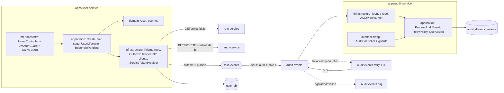

# Design — build-user-audit-services

Contrato de arquitectura: `openspec/changes/archive/2026-10-20-design-architecture-docs/design.md` + ADR-001..010 + `docs/architecture/03-flujo-de-datos.md` y `07-resiliencia.md`. Este documento solo fija lo que este cambio decide o concreta. **Versiones**: Node 22, NestJS 11, Postgres 17, Mongo 7, RabbitMQ 3.13, Jest vienen de `AGENTS.md`; `prisma`, `@prisma/client`, `mongoose`, `amqplib`, `ioredis`, `class-validator`, `class-transformer`, `supertest` y la imagen base de Node quedan **`needs-verification` — fijar al instalar** (context7 no disponible para este agente; no se inventan números).

## Supuestos sobre otros cambios (reconciliar tras los cambios 2 y 3)

| # | Supuesto | Origen | Impacto si difiere |
|---|---|---|---|
| A1 | `createHttpClient({baseUrl, timeoutMs, retry:{retries, backoffMs[], jitter, budgetMs?}, breaker:{failureThreshold, resetTimeoutMs}, fetchImpl?})` y un método de petición que acepta `{method, path, body?, headers?, idempotent?}` y devuelve `{status, body}` o lanza `HttpTimeoutError` / `CircuitOpenError` / `HttpStatusError` (4xx incluidos) | Cambio 2 (`design.md` D1; la firma del método no está fijada) | Solo cambian los 3 adaptadores `infrastructure/http/*`; los puertos de `application` no se tocan |
| A2 | `@toka/contracts` exporta `EVENTS_EXCHANGE`, `DLX_EXCHANGE`, `RoutingKeys`, `QueueBindings`, `EventEnvelope<T>`, `createEnvelope(...)`, `isEventEnvelope(x)`, `UserRoleAssignedPayload`, cabeceras `x-correlation-id`/`x-retry-count` | Cambio 2 (D6, `Data model`) | Nombres de constantes de cabecera: si difieren, se importan con el nombre real |
| A3 | `@toka/jwt-guard` exporta `JwtAuthGuard`, `RedisDenylistReader`, opciones `{jwksUrl, issuer, audience, denylistReader, logger, denylistTimeoutMs}` y deja `request.user = {sub, roles, jti, iat, exp, aud}`; el guard de roles (`@Roles`) **no** viene en el paquete | Cambio 2 (`jwt-guard.md`) | Cada servicio trae un `RolesGuard` local de ~20 líneas (D8); si el cambio 3 lo publica compartido, se sustituye |
| A4 | `@toka/logger` exporta `createLogger({service})`, `correlationIdMiddleware`, `RequestLoggingInterceptor` | Cambio 2 (D7) | Solo el cableado de `main.ts`/módulo |
| A5 | Auth emite JWT de servicio con `POST /oauth/token` (`grant_type=client_credentials`, `client_id`, `client_secret`, parámetro `audience` por destino; scope `svc:internal`) y responde `{access_token, expires_in}` | Cambio 3 (contrato del cambio 1: 03 y ADR-003; el parámetro `audience` no está fijado) | Solo `ServiceTokenProvider` |
| A6 | auth: `PUT /internal/credentials/{userId}` con cuerpo `{email, password, roleId}` → 2xx idempotente; `409` si el email ya existe; `DELETE /internal/credentials/{userId}` idempotente (2xx/204, y 404 se trata como éxito) | Cambio 3 (03 y 07) | Solo `AuthCredentialsClient` |
| A7 | role: `GET /roles/{id}` responde `{id, name, version, ...}` con JWT de servicio; `404` si no existe | Cambio 3 (03: "devuelve `version`") | Solo `RoleClient` |
| A8 | Los servicios reciben su configuración de `infra/env/<service>.env` (cambio 2); las variables que falten se añaden a los `.example` en la tarea 3.1 | Cambio 2 (`infra/env/*`) | Ajuste menor de plantillas |
| A9 | Rutas sin prefijo `/api` en los servicios (`/users`, `/audit/events`, `/health`, `/ready`); nginx (cambio 5) quita `/api/<svc>` | Cambio 1 (03) | Prefijo global en `main.ts` |

## Architecture decisions

| ID | Decisión | Justificación | Alternativa descartada |
|---|---|---|---|
| D1 | **Saga en un caso de uso (`CreateUser`) con puertos** (`UserRepository`, `RoleClient`, `AuthCredentialsClient`, `Clock`, `IdGenerator`); la atomicidad "estado + outbox" vive en métodos del repositorio (`persistWithOutbox`, `deleteWithOutbox`) implementados con `prisma.$transaction` | Prueba unitaria sin BD ni red; la transacción queda en infraestructura (ADR-006) | Orquestador con `@nestjs/cqrs`/sagas (dependencia y ceremonia sin beneficio en 2 pasos) |
| D2 | **`users.version` es el `aggregateVersion`**: nace `PENDING` con 1; la activación lo sube a 2 y emite `user.created` con `aggregateVersion=2`; cada `user.updated`/`user.role.assigned` suma 1; `user.deleted` usa `version+1` | Monotónico por agregado, sin tabla extra; auth ignora `aggregateVersion <= user_last_version` y `PUT credentials` inicializa su versión en 1 (A6, reconciliar) | Contador separado (estado duplicado) |
| D3 | **La contraseña nunca se persiste ni se loguea** en user-service: vive solo en memoria durante la saga. Consecuencia: la reconciliación **solo compensa** (nunca completa un `PENDING` huérfano) | Cumple 03/07 ("la contraseña inicial no se guarda en otro sitio"); evita decidir entre reintentar y deshacer | Cifrar la contraseña en `user_db` para reanudar (amplía superficie sensible) |
| D4 | **Presupuesto con `Deadline`** (helper en `application`): `SIGNUP_BUDGET_MS=10000`; cada llamada recibe `budgetMs = deadline.remaining()` y, si es <=0, no se intenta (ni se reintenta) y se pasa a compensar. Timeouts de arista por env: `ROLE_TIMEOUT_MS=2000` (2 reintentos: 200/400 ms), `AUTH_TIMEOUT_MS=3000` (3 reintentos: 250/500/1000 ms) | 07: los reintentos cuentan contra el presupuesto; permite probarlo con reloj falso | Confiar solo en timeouts por arista (suman 2x2+3x4 > 10 s) |
| D5 | **Compensación**: `DELETE credentials` (idempotente, con el mismo cliente resiliente) primero; solo si responde 2xx/404 → `deletePending`. Si falla → el usuario queda `PENDING`, se responde 503 y el barrido reintenta. Un `409` de auth (email) → compensar y responder `409`. Email duplicado local (índice único) → `409` antes de llamar a nadie | 07 ("Compensación del alta") | Borrar `PENDING` primero (bloquea el email con credenciales huérfanas) |
| D6 | **Reconciliación**: `ReconcilePending` busca `PENDING` con `createdAt < now - RECONCILE_GRACE_MS` (por defecto 60 000, debe ser >10 000), hace `DELETE credentials` y solo al confirmarse borra el usuario; se dispara con un intervalo (`RECONCILE_INTERVAL_MS`, 30 000) desde un proveedor de ciclo de vida, y es invocable en pruebas. Una iteración fallida no aborta las demás | 07 ("Reconciliación con período de gracia") | `@nestjs/schedule` (dependencia para un `setInterval`) |
| D7 | **Outbox**: tabla `outbox_events` (`seq` autoincremental, `envelope` JSON completo, `published_at` nulo hasta publicar). `OutboxPublisher` lee lotes con `SELECT ... FOR UPDATE SKIP LOCKED` ordenados por `seq`, publica con canal de confirmación (`persistent: true`, `messageId=eventId`, cabecera `x-correlation-id`) y marca `published_at`; si el broker falla, deja la fila y reintenta en el siguiente ciclo (`OUTBOX_POLL_MS=1000`, `OUTBOX_BATCH=50`). At-least-once: el consumidor es idempotente | 07 ("RabbitMQ caído (publicación desde user-service)") | `LISTEN/NOTIFY` o Debezium (excede el alcance) |
| D8 | **`RolesGuard` local** en cada servicio (decorador `@Roles('admin')`, lee `request.user.roles`, 403 y delega el log `access.denied` al `RequestLoggingInterceptor` de `@toka/logger`) | `@Roles` no está en el cambio 2 (A3) y 20 líneas no justifican un paquete | Paquete compartido nuevo (ADR-001: evitar paquetes de dominio; excede el alcance del cambio) |
| D9 | **Quién puede qué**: `POST /users`, `PATCH`, `DELETE`, `PUT /users/{id}/role`, `GET /users*` y `GET /audit/events` exigen rol `admin` (03: gestión de usuarios solo admin; el agente reenvía el JWT del llamante, así que `GET /users` seguirá limitado al admin salvo que el cambio 7 lo amplíe) | Mínimo privilegio con el contrato vigente | Lectura abierta a cualquier autenticado (expone PII) |
| D10 | **Topología del consumidor en audit-service** (la declara el propio consumidor, cambio 2 D6): `assertExchange` de `toka.events` (topic, durable) y `toka.events.dlx` (direct, durable); `audit.events` (durable, `x-dead-letter-exchange=toka.events.dlx`, `x-dead-letter-routing-key=audit.events.dlq`) con los bindings de `QueueBindings`; `audit.events.retry` (durable, `x-message-ttl=AUDIT_RETRY_TTL_MS`, `x-dead-letter-exchange=toka.events.dlx`, `x-dead-letter-routing-key=audit.events`); `audit.events.dlq` (durable). Enlaces en el DLX: `audit.events`→cola principal, `audit.events.retry`→retry, `audit.events.dlq`→dlq | Reintento sin reencolado directo (07): ante un fallo transitorio el consumidor publica una copia al DLX con clave `audit.events.retry` y `x-retry-count+1`, y hace `ack` del original; al expirar el TTL, la cola retry devuelve el mensaje a la principal por el DLX | `x-delivery-limit` con quorum queues (no da retardo) |
| D11 | **Retardo fijo y configurable** (`AUDIT_RETRY_TTL_MS`, por defecto 5000) en una sola cola `.retry` con TTL de cola; el escalonado 5 s/30 s/2 min de 07 queda como Evolución. Máximo `AUDIT_MAX_RETRIES=3`; agotado o error permanente (JSON o sobre inválido según `isEventEnvelope`) → copia a `audit.events.dlq` con cabeceras `x-error`, `x-failed-at` y log con `correlationId`/`eventId` | TTL por mensaje en una cola mezclada produce bloqueo de cabeza de línea; TTL de cola evita ese problema con 1 cola | Una cola retry por retardo (3 colas, más topología) |
| D12 | **Filtro de re-sync**: el caso de uso de audit **no inserta** eventos con `envelope.reason === 'resync'` (hace `ack` y registra `debug` con `eventId`). El `eventId` determinista de role-service evitaría duplicados, pero un re-sync no es un cambio real y contaminaría la auditoría (handoff del cambio 1, seguimiento 2) | Decisión cerrada del cambio 1 | Guardarlos con una marca `resync: true` (ruido y volumen sin valor) |
| D13 | **Idempotencia**: índice único `eventId` en `audit_events`; el repositorio traduce el error de clave duplicada (código 11000) a `'duplicate'` y el caso de uso lo trata como éxito | 03 (Garantías) | Consultar antes de insertar (carrera) |
| D14 | **`amqplib` directo** (sin `@nestjs/microservices`): consumidor con `prefetch` configurable (por defecto 10), `ack` manual, reconexión con espera exponencial acotada, proveedor de ciclo de vida (`OnModuleInit`/`OnModuleDestroy`). Publicador de outbox con `ConfirmChannel` | Control explícito de cabeceras `x-retry-count` y del DLX; menos magia | `@nestjs/microservices` RMQ (oculta cabeceras y topología) |
| D15 | **Cobertura**: ambos servicios extienden `jest.config.base.js` (umbral 70 en líneas) y solo añaden exclusiones de **cableado declarativo**: `src/main.ts`, `**/*.module.ts`, `**/dto/**`, `**/*.schema.ts`, cliente Prisma generado. La lógica (casos de uso, repositorios, adaptadores HTTP/AMQP, guards, controladores) SÍ se mide. Si el 70 % no se alcanza, se añaden pruebas dentro del presupuesto o se reabre el plan; **no** se amplían las exclusiones | ADR-007: 70 % real, no maquillado | Excluir `infrastructure/**` completa (esconde la lógica de outbox/DLQ) |
| D16 | **Dockerfile multi-etapa por servicio** (contexto = raíz del repo, `-f apps/<svc>/Dockerfile`): etapa `build` con pnpm (versión de `packageManager`, vía corepack) que instala el workspace filtrado, compila `@toka/*` y el servicio (y `prisma generate` en user-service); etapa final con `node` slim, `USER node`, `NODE_ENV=production`, `HEALTHCHECK` con `fetch` a `/health`, `CMD ["node","dist/main.js"]`. No se añaden al compose (cambio 5) | EX2-R07 pide Dockerfile por servicio; el compose lo endurece el cambio 5 | Un solo Dockerfile con `ARG SERVICE` (acopla imágenes) |

## Component diagram



## Data model

### user-service (Prisma, `user_db`)

```prisma
enum UserStatus { PENDING ACTIVE DISABLED }

model User {
  id        String     @id @default(uuid()) @db.Uuid
  email     String     @unique
  name      String
  roleId    String     @map("role_id")
  status    UserStatus @default(PENDING)
  version   Int        @default(1)
  createdAt DateTime   @default(now()) @map("created_at")
  updatedAt DateTime   @updatedAt @map("updated_at")
  @@index([status, createdAt])
  @@map("users")
}

model OutboxEvent {
  seq              BigInt    @id @default(autoincrement())
  eventId          String    @unique @map("event_id") @db.Uuid
  type             String
  aggregateId      String    @map("aggregate_id")
  aggregateVersion Int       @map("aggregate_version")
  envelope         Json
  occurredAt       DateTime  @map("occurred_at")
  publishedAt      DateTime? @map("published_at")
  attempts         Int       @default(0)
  @@index([publishedAt, seq])
  @@map("outbox_events")
}
```

Sin columna de contraseña (D3). La migración SQL se genera sin BD con `prisma migrate diff --from-empty --to-schema-datamodel` (nombre de índice por defecto `users_email_key`).

### Eventos publicados (sobre `EventEnvelope<T>` de `@toka/contracts`)

| `type` | `aggregateVersion` | `payload` | Notas |
|---|---|---|---|
| `user.created` | 2 | `{userId, email, name, roleId, status:'ACTIVE'}` | Se emite en la activación; `actor` = admin llamante |
| `user.updated` | n+1 | `{userId, changes:{name?, email?, status?}, status}` | `status=DISABLED` lo propaga auth (revoca refresh) |
| `user.deleted` | n+1 | `{userId}` | Borrado duro tras escribir el evento en la misma transacción |
| `user.role.assigned` | n+1 | `{userId, roleId, roleName, roleVersion}` | `roleName`/`roleVersion` salen de `GET /roles/{id}` (A7) |

Nunca incluyen contraseñas ni hashes. `correlationId` = `x-correlation-id` de la petición. Los tipos se añaden a `@toka/contracts` (solo aditivo).

### audit-service (Mongoose, `audit_db.audit_events`, append-only)

```
{ eventId (string, unique), type, version, aggregateVersion, occurredAt (Date),
  receivedAt (Date), correlationId, actorUserId?, actorRoles[], actorIsSystem (bool),
  routingKey, payload (Mixed) }
```

Índices: `{eventId:1}` único; `{occurredAt:-1}`; `{type:1, occurredAt:-1}`; `{actorUserId:1, occurredAt:-1}`. Sin operaciones de actualización ni borrado en el repositorio (append-only).

### API de consulta

`GET /audit/events?actor=<userId>&type=<routingKey>&from=<ISO>&to=<ISO>&page=<n>&limit=<1..100>` → `{items, page, limit, total}`, orden `occurredAt` descendente; `limit` por defecto 20; `from>to` o fechas inválidas → 400; solo `admin`; si Mongo falla → 503.

## Testing strategy

Presupuesto declarado (tope por tarea 6, por archivo 8, por cambio 30; este cambio planea **28**, margen 2):

| Tarea | Pruebas | Casos |
|---|---|---|
| 1.3 `CreateUser` | 5 | camino feliz (orden: `PENDING` → rol → credenciales → `ACTIVE` + outbox `user.created` con `aggregateVersion=2`, contraseña no persistida); rol falla → `DELETE` credenciales antes de `deletePending` y 503; `DELETE` falla → usuario sigue `PENDING`; `409` de auth → compensa y `409`; presupuesto agotado (reloj falso) → no reintenta y compensa |
| 1.4 ciclo de vida | 5 | `PATCH status=DISABLED` suma versión y emite `user.updated`; `DELETE` emite `user.deleted`; asignar rol emite `{userId, roleId, roleName, roleVersion}`; rol inexistente → 404 sin evento; reconciliación solo toca `PENDING` vencidos y no borra si `DELETE` falla |
| 2.1 adaptadores user | 4 | `ServiceTokenProvider` cachea hasta `exp` por audiencia; `PrismaUserRepository.persistWithOutbox` usa una sola transacción (doble de Prisma); `OutboxPublisher` publica en orden, marca publicadas y deja pendiente si el broker falla; `RoleClient` mapea 404 → `RoleNotFound` y 5xx/timeout → `RoleUnavailable` |
| 2.2 controladores user | 3 | `POST /users` 201 con `admin`; 403 con rol no admin; `SignupFailed` → 503 (filtro de excepciones) |
| 2.3 aplicación audit | 5 | inserta y mapea actor; duplicado → éxito sin segundo insert; `reason=resync` → no inserta; sobre inválido → DLQ directo; política de reintentos por tabla (0-2 → retry, 3 → DLQ) |
| 2.4 infraestructura audit | 3 | repositorio: 11000 → `'duplicate'` y filtros/paginación de consulta; consumidor: fallo transitorio republica a `.retry` con `x-retry-count+1` y hace `ack`; con contador 3 publica a `.dlq` |
| 2.5 controlador audit | 3 | `GET /audit/events` 200 para `admin` con filtros; 403 para no admin; 400 por `limit>100` o fecha inválida |
| 1.1, 1.2, 3.1–3.3 | 0 | Gates `cmd:` (Prisma validate/migración, `tsc`, `docker build`, script de humo, cobertura) |

Reglas: sin snapshots; `fetch`/http-client, Prisma, Mongoose, amqplib, Redis y reloj con dobles y `fake timers`; sin red ni contenedores en pruebas unitarias (la integración real la ejerce el script de humo 3.2). TDD: cada tarea 1.3–2.5 escribe primero la prueba. Si una tarea supera 6 pruebas → `[TEST-CAP]` y se recorta, no se negocia.

## Plan metadata (planner contract)

- **Waves**: Wave 0 (persistencia y núcleo de user-service, 4 tareas: 1.1–1.4), Wave 1 (adaptadores/HTTP de user-service y todo audit-service, 5 tareas: 2.1–2.5), Wave 2 (empaquetado, humo y cierre, 3 tareas: 3.1–3.3). **12 tareas, 5 specs**.
- **Paralelismo**: pista user (1.3→1.4→2.1→2.2) y pista audit (1.2→2.3→2.4→2.5) son independientes tras 1.1.
- **Dominios** (Domain Map): `database` → `apps/user-service/prisma/**` y `apps/*/src/infrastructure/mongo/*.schema.ts` y los manifiestos de las dos apps (1.1, 1.2); `backend` → resto de `apps/user-service/**`, `apps/audit-service/**`, `packages/contracts/**` (solo tipos, 1.3), `infra/env/*.example`, `scripts/**` y `docs/**` (3.3). El orquestador debe acotar los envelopes.
- **required_tools.per_agent**: `database` — mcp `[engram]`, skills `[forge-implement]`; `backend` — mcp `[engram]`, skills `[forge-implement, test-driven-development]`; `validator` — mcp `[engram]`, skills `[forge-verify]`. Sin figma ni context7.
- **Desviaciones declaradas**: (a) CLI `opsx` y `validate-topic-key.sh` no ejecutados (sub-agente sin esas herramientas); (b) no hay `openspec/config.yaml` → repo único, sin `Repo:`; (c) los gates `cmd:` no se ejecutaron en planificación; (d) las tareas 2.1 y 3.2 son las más densas: si exceden la jornada, el orquestador puede diferir 3.2 (humo) como cambio de seguimiento sin tocar el resto; (e) ningún topic_key referenciado en tareas: solo se guardan `spec/build-user-audit-services` y `gate/plan-approved/build-user-audit-services` (herramienta `mem_save` no disponible para este sub-agente: **[MEMORY] WARNING**, el orquestador debe guardarlos).

## Risks

1. **Contratos de los cambios 2 y 3 aún en movimiento** (A1–A7): aislados detrás de puertos; una discrepancia toca 1 archivo de adaptador.
2. **70 % sin sobrepasar 28 pruebas**: la lógica está concentrada en casos de uso pequeños; los adaptadores se miden con dobles. Si falla la cobertura, se compacta cableado fuera de la lógica, no se amplían exclusiones (D15).
3. **Prisma 7 vs 6**: la configuración de conexión cambió entre mayores (`prisma.config.ts`); `needs-verification`; la tarea 1.1 fija la versión y ajusta `prisma validate`/`generate`.
4. **`docker build` en el workspace pnpm** (3.1): el lockfile y el filtrado dependen de la versión de pnpm; se fija con `packageManager`. Riesgo: tiempo de build en Windows.
5. **Script de humo (3.2)**: depende de `rabbitmqadmin` en `rabbitmq:3.13-management` (`needs-verification`) y de las variables de `infra/env/audit-service.env`; mitigación: usar `docker compose exec -T` y esperas con tope; si `rabbitmqadmin` no existe, publicar con `node` dentro de la imagen de audit (que ya trae `amqplib`).
6. **Pérdida de orden por la cola retry**: aceptada (07); la idempotencia por `eventId` y `aggregateVersion` lo compensan en consumidores de proyección (audit no proyecta; solo inserta).
7. **Entrega por la tarde (17:30)**: alcance deliberadamente mínimo (sin escalonado de retardos, sin integración Jest con contenedores, sin compose).
