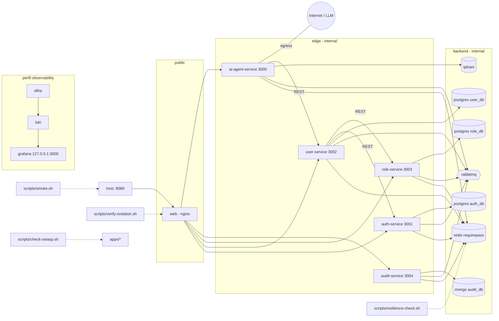

# Design — harden-compose-resilience-security

Contrato de arquitectura: `openspec/changes/archive/2026-10-20-design-architecture-docs/design.md` + ADR-001..010 (accepted) + `docs/architecture/04-docker-compose-diseno.md` (diseño del compose), `06-seguridad-escalabilidad.md` (tabla OWASP) y `07-resiliencia.md` (timeouts y presupuestos). Este documento solo fija lo que este cambio decide o concreta. Los nombres de servicio, puertos `3001`–`3005`/`8080`, redes, claves de Redis y exchanges son **contrato estable** y no se modifican. **Versiones**: etiquetas de imagen de los servicios nuevos (`grafana/loki`, `grafana/alloy`, `grafana/grafana`, `nginx`) y la sintaxis exacta de Alloy son `needs-verification` — fijar al implementar (context7 no disponible para este agente; no se inventan números).

## Architecture decisions

| ID | Decisión | Justificación | Alternativa descartada |
|---|---|---|---|
| D1 | **El compose real parte del bloque de `04`** y lo reconcilia (tarea 3.3 actualiza `04` si algo cambia: etiquetas, healthchecks, comandos). Un único archivo `docker-compose.yml` ampliado sobre el de infra del cambio 2 | `04` ya fija redes, `depends_on`, un `env_file` por servicio y secretos; reimplementar el diseño desde cero introduciría deriva | Compose por entorno / override files (más superficie y más gates) |
| D2 | **Migrate-on-start por `command` en compose**, solo para `auth-service`, `user-service` y `role-service` (Prisma): `sh -c "<prisma migrate deploy> && exec <comando de arranque del Dockerfile>"`. `audit-service` (Mongo) y `ai-agent-service` (Qdrant) no migran; la colección de Qdrant la crea el agente al arrancar. El `healthcheck` con `start_period: 20s` cubre la migración | No toca los Dockerfiles de 3/4 (otro cambio); `migrate deploy` es idempotente y no interactivo; si falla, el contenedor sale ≠0 y `depends_on` impide arrancar a los dependientes. El rol de BD es propietario de su base, por lo que puede migrar | Servicio `*-migrate` one-shot por servicio (3 servicios más y `service_completed_successfully`; más ruido); migrar en el `main.ts` (acopla la app al CLI y a carreras entre réplicas) |
| D3 | **Nginx: verificar y completar, no reescribir.** El cambio 6 crea la plantilla nginx de `apps/web` con `*_UPSTREAM`; este cambio añade/ajusta solo: `limit_req_zone`/`limit_req` en `/api/auth/login` (`rate=10r/m`, `burst=5 nodelay`, `limit_req_status 429`), `proxy_read_timeout 40s` en `/api/agent/` (30 s en el resto, `proxy_connect_timeout 5s`), `client_max_body_size 1m`, `server_tokens off`, `/healthz` y cabeceras de seguridad | El cambio 6 es dueño de la UI y del servidor estático; este es dueño de la política de borde (07/06). `limit_req_zone` va al inicio del archivo de `conf.d` (se incluye en el contexto `http`) | Reescribir la plantilla (pisa trabajo de 6); `limit_req` solo en auth-service (la primera barrera debe ser el borde, `06`) |
| D4 | **Cabeceras de seguridad por `include` de un snippet en cada `location`** (`add_header ... always`): `X-Content-Type-Options: nosniff`, `X-Frame-Options: DENY`, `Referrer-Policy: no-referrer`, `Permissions-Policy` restrictiva y `Content-Security-Policy` con `default-src 'self'` (los orígenes de `style-src`/`connect-src` se ajustan a la SPA de 6, `needs-verification`). Sin HSTS (HTTP local; TLS = Evolución) | `add_header` en un `location` anula los heredados del `server`; el snippet evita cabeceras perdidas en `/api/agent/` o en la SPA | Declarar solo a nivel `server` (se pierden en cuanto un `location` añade una cabecera) |
| D5 | **Aislamiento verificado en ejecución**, no solo declarado: `scripts/verify-isolation.sh` comprueba (a) `user-service` sin salida: `docker compose exec -T user-service node -e "fetch('https://example.com',{signal:AbortSignal.timeout(5000)}).then(()=>process.exit(1),()=>process.exit(0))"` sale 0 (el `fetch` falla); (b) solo `8080` publicado (`docker compose ps --format json` y `docker compose config`); (c) `web` no alcanza Postgres/Mongo/Redis; (d) `GET /internal/credentials/x` y `POST /oauth/token` vía `web` devuelven `404`; (e) ráfaga a `/api/auth/login` produce `429`; (f) cabeceras de D4 presentes. Sigue el seguimiento (1) del `handoff.md` de `design-architecture-docs` | Convierte los controles "normativos" de `04` en comprobaciones repetibles (EX2-R29/R31) | Verificación solo manual (no repetible, no gate) |
| D6 | **OWASP: verificar contra código con un comprobador estático** `scripts/check-owasp.sh` + `docs/security/owasp-checklist.md` (una fila por riesgo de `06`: control, archivo(s), comprobación, estado). El script aplica `grep -rE` sobre rutas reales y sale ≠0 si falta evidencia. Comprobaciones: `ValidationPipe` con `whitelist: true` y `forbidNonWhitelisted: true` en los 5 `main.ts`; `helmet` en los 5 servicios; sin `$queryRawUnsafe`/`$executeRawUnsafe` en `apps/`; saneamiento de operadores `$` en `audit-service` (filtros de `GET /audit/events`); `argon2` (id) solo en `auth-service`; `auth:rl:login` en auth y `agent:rl:` en el agente; `JwtAuthGuard` de `@toka/jwt-guard` en los 5 servicios; `@toka/logger` con `access.denied`; `USER` no root en cada Dockerfile; `.gitignore` con `.env`/`secrets/`; `pnpm-lock.yaml` presente. **Brecha detectada → corrección mínima en el servicio dueño** (cableado, no rediseño), con 1 prueba de regresión y anotada en el checklist. `pnpm audit` se ejecuta como informativo (no gate: depende de red) | EX2-R31 [RIESGO] exige OWASP mapeado a código, no a texto; `grep` es barato y repetible en Git Bash | Escáner SAST/DAST (ZAP, Semgrep): fuera del plazo y del PDF; lo deja en Evolución |
| D7 | **Dureza de contenedor de aplicación** en `x-service-defaults`: `security_opt: [no-new-privileges:true]` y `cap_drop: [ALL]` para los 5 servicios Node (puertos >1024). `web` (nginx) no se restringe más allá de lo que haga su Dockerfile; `read_only` rootfs = Evolución | Mitiga "configuración insegura" (06) a coste de dos líneas; si un servicio falla por esto, se retira para ese servicio y se registra | Perfiles seccomp/AppArmor personalizados (fuera de alcance) |
| D8 | **Smoke como contrato E2E**: `scripts/smoke.sh` solo usa `curl` y `node -e` para JSON (sin `jq`, que no existe por defecto en Git Bash). Flujo: `POST /api/auth/login` (admin semilla de 3) → `GET /api/roles` (obtener un `roleId`) → `POST /api/users` con email único → sondeo (≤30 s, cada 2 s) de `GET /api/audit/events` hasta ver `user.created` con el `correlationId` o `userId` creado → `POST /api/agent/ask` (proveedor `mock`) con respuesta no vacía. Parámetros por variable (`BASE_URL` por defecto `http://localhost:8080`, `SMOKE_ADMIN_EMAIL`, `SMOKE_ADMIN_PASSWORD`; por defecto se leen de `infra/env/auth-service.env`). Formas exactas de cuerpo/ruta: `needs-verification` frente a los controladores reales | Es el criterio de aceptación de extremo a extremo; el sondeo absorbe la consistencia eventual del evento (ADR-004) | `sleep` fijo (frágil); Playwright (no pedido) |
| D9 | **Sondas de resiliencia** `scripts/resilience-check.sh`: (a) `docker compose stop redis` → `GET /api/roles` autenticado devuelve 2xx en ≤5 s (fail-open del denylist + caché con degradación) y se restaura con `docker compose up -d --wait redis`; (b) `docker compose stop role-service` → `POST /api/users` válido devuelve `503` en ≤15 s (presupuesto del alta ≤10 s + margen) y el email creado **no** aparece `ACTIVE`; se restaura role-service. Cada sonda restaura el servicio con `trap` aunque falle, y tras restaurar reinicia `web` (nginx resuelve upstreams al arrancar; si role-service cambia de IP, `web` daría 502). Alternativa mejor a largo plazo (`resolver 127.0.0.11 valid=10s` + `proxy_pass` con variable) = Evolución, toca la plantilla del cambio 6. Los umbrales concretos del breaker son los de los cambios 3/4; aquí solo se **observa** el comportamiento de `07` | Demuestra la matriz de fallos de `07` sobre el sistema integrado | Reimplementar timeouts/breaker aquí (ya viven en `@toka/http-client`, cambio 2) |
| D10 | **Perfil `observability`** (Loki + Grafana Alloy + Grafana) según `04`: servicios con `profiles: [observability]`; red `grafana-ui`; Grafana publica solo `127.0.0.1:3000`; `infra/observability/config.alloy` descubre contenedores del proyecto `toka` por la etiqueta `com.docker.compose.project` y envía a Loki; datasource de Loki aprovisionado en `infra/observability/grafana/datasources.yml`. `GRAFANA_ADMIN_PASSWORD` se añade a `.env.example` y lo genera `bootstrap-env.sh` (idempotente). Sin el perfil no se crea ningún contenedor adicional. Loki y Alloy quedan **exentos de `healthcheck`** (imágenes sin shell/`wget`, `needs-verification`); Grafana lleva healthcheck. Riesgo del socket de Docker declarado como en `04` (solo desarrollo) | Es Evolución opcional ya decidida (ADR-007); tarea corta y aislada | Promtail (deprecado); reenvío directo vía driver Loki (requiere plugin del daemon) |
| D11 | **Orden de arranque** = `depends_on: service_healthy` de `04`: `web` ← 5 servicios; `user-service` ← postgres, redis, rabbitmq, auth-service, role-service; `ai-agent-service` ← qdrant, redis, rabbitmq, user-service; `audit-service` ← mongo, redis, rabbitmq. Sin ciclos. `docker compose up -d --build --wait --wait-timeout 300` es el comando canónico de los gates (la construcción de imágenes no cuenta para el timeout de espera) | Reproduce el arranque ordenado de `07` ("Arranque en frío") | Reintentos de conexión en cada app como único mecanismo (no demuestra el orden) |
| D12 | **Gates que levantan el stack se serializan**: comparten `name: toka` y los mismos puertos/volúmenes; cada gate termina con `docker compose down -v`. Las tareas 2.1, 2.2, 2.4 y 3.3 no se ejecutan en paralelo (ver `tasks.md`) | Evita carreras entre implementadores/validadores en la misma máquina | Nombres de proyecto distintos por gate (rompe `name: toka` normativo y el puerto 8080 único) |

### Supuestos de contrato con otros cambios (cerrar al implementar; desajuste → `BLOCKED [CONTRACT]`)

1. Cada `apps/<svc>/Dockerfile` existe, usa contexto de raíz (`context: .`, `dockerfile: apps/<svc>/Dockerfile`), termina con `USER` no root y expone el puerto de `04`; el servicio responde `GET /health` y `GET /ready`.
2. Las imágenes de `auth`, `user` y `role` incluyen la CLI de Prisma y el esquema (`prisma/migrations`) para `migrate deploy`; el comando de arranque en producción es el `CMD` del Dockerfile (se lee para construir `command`).
3. `auth-service` crea un administrador semilla (variables en `infra/env/auth-service.env`, nombres `needs-verification`, p. ej. `SEED_ADMIN_EMAIL`/`SEED_ADMIN_PASSWORD`; `bootstrap-env.sh` debe generar la contraseña). Si no existe, la tarea 2.1 lo reporta y se corrige en el cambio 3.
4. `apps/web` contiene una plantilla nginx (`default.conf.template` o equivalente, ruta `needs-verification`) con `AUTH_UPSTREAM`…`AGENT_UPSTREAM`; `web` escucha en `8080` y sirve `/healthz`.
5. `ai-agent-service` arranca con proveedor `mock` si `LLM_PROVIDER`/`ANTHROPIC_API_KEY` están vacíos y expone `POST /agent/ask`.
6. `audit-service` expone `GET /audit/events` (JWT admin) y registra `user.created`.

## Component diagram



## Data model

No hay modelo de datos nuevo (sin esquema ni eventos nuevos). Artefactos y su forma:

### Estructura de archivos (nuevos o modificados)

```
docker-compose.yml                         (modificado: + web, 5 servicios, redes, secreto, perfil observability)
.env.example  scripts/bootstrap-env.sh     (modificados: + GRAFANA_ADMIN_PASSWORD)
infra/observability/config.alloy
infra/observability/grafana/datasources.yml
apps/web/<plantilla nginx>                 (modificado por 1.3; ruta definida por el cambio 6)
scripts/smoke.sh  scripts/verify-isolation.sh  scripts/check-owasp.sh  scripts/resilience-check.sh
docs/security/owasp-checklist.md
docs/architecture/09-ddd-clean-aplicado.md
docs/architecture/04-docker-compose-diseno.md   (reconciliación)
docs/traceability.md                       (estado)
README.md                                  (sección de ejecución)
```

### Matriz de servicios del compose (resultado esperado)

| Servicio | Redes | Puertos al host | `depends_on` (service_healthy) | `env_file` / secretos | Healthcheck |
|---|---|---|---|---|---|
| `web` | `public`, `edge` | `8080:8080` | los 5 servicios | `environment` `*_UPSTREAM` | `wget -qO- http://localhost:8080/healthz` |
| `auth-service` | `edge`, `backend` | ninguno (`expose 3001`) | postgres, redis, rabbitmq | `infra/env/auth-service.env`; secreto `jwt_private_key` | `fetch /ready`, `start_period 20s` |
| `user-service` | `edge`, `backend` | ninguno (`3002`) | postgres, redis, rabbitmq, auth-service, role-service | `infra/env/user-service.env` | `fetch /ready` |
| `role-service` | `edge`, `backend` | ninguno (`3003`) | postgres, redis, rabbitmq | `infra/env/role-service.env` | `fetch /ready` |
| `audit-service` | `edge`, `backend` | ninguno (`3004`) | mongo, redis, rabbitmq | `infra/env/audit-service.env` | `fetch /ready` |
| `ai-agent-service` | `edge`, `backend`, `egress` | ninguno (`3005`) | qdrant, redis, rabbitmq, user-service | `infra/env/ai-agent-service.env` | `fetch /ready`, `start_period 40s` |
| `loki`, `alloy`, `grafana` (perfil) | `backend` (+ `grafana-ui` en grafana) | solo `127.0.0.1:3000` (grafana) | `alloy`/`grafana` ← loki | `GRAFANA_ADMIN_PASSWORD` | solo grafana |

Reglas verificables del compose: ningún servicio salvo `web` (y `grafana` en loopback con perfil) declara `ports`; solo `ai-agent-service` está en `egress`; `user-service` no está en `egress` ni en `public`; ningún servicio carga el `.env` raíz (`env_file` solo `infra/env/<svc>.env`).

### Tabla de límites de borde (nginx)

| Ruta | Destino | `limit_req` | Timeout lectura | Notas |
|---|---|---|---|---|
| `/api/auth/login` | auth-service | `10r/m` burst 5 | 30 s | `429` al exceder |
| `/api/auth/`, `/api/users`, `/api/roles`, `/api/audit` | servicio correspondiente | no | 30 s | |
| `/api/agent/` | ai-agent-service | no | **40 s** | mayor que el presupuesto del agente (30 s) |
| `/internal/*`, `/oauth/*` | — | — | — | sin `location`: `404` |
| `/healthz`, `/` | local (SPA) | — | — | |

## Testing strategy

Este cambio es de **integración y verificación**: no introduce lógica de dominio nueva, por lo que su presupuesto de pruebas unitarias es pequeño y declarado (tope por tarea 6, por archivo 8, por cambio 30; este cambio planea **≤6**).

| Alcance | Pruebas | Casos |
|---|---|---|
| Brechas OWASP (solo si `check-owasp.sh` detecta alguna; tarea 2.3) | ≤4 | una prueba de regresión por brecha corregida en el servicio dueño (p. ej. `ValidationPipe` rechaza campo extra; filtro de audit descarta clave `$`) |
| Correcciones de integración surgidas en 2.1/2.4 | ≤2 | una por defecto de código descubierto (no de configuración) |
| Compose, nginx, scripts, docs | 0 unitarias | verificación por gates `cmd:` (compose `config`, `up --wait`, `smoke.sh`, `verify-isolation.sh`, `check-owasp.sh`, `resilience-check.sh`) |

Reglas: sin snapshots; las pruebas de regresión van junto al código del servicio dueño y respetan el umbral de 70 % líneas de `jest.config.base.js`. Los scripts shell son **POSIX/Git Bash**, salen ≠0 al primer fallo (`set -eu`), imprimen una línea `OK:`/`FAIL:` por comprobación y limpian lo que cambian (`trap`).

## Plan metadata (planner contract: V3–V5)

- **Waves**: Wave 0 (compose integrado y borde, 4 tareas: 1.1–1.4), Wave 1 (verificación de seguridad y resiliencia, 4 tareas: 2.1–2.4), Wave 2 (documentación y cierre, 3 tareas: 3.1–3.3). 11 tareas, 5 specs (`compose-orchestration`, `edge-gateway-hardening`, `system-verification`, `owasp-security-verification`, `observability-and-docs`).
- **Paralelismo**: Wave 0 — 1.1 y 1.3 independientes; 1.2 y 1.4 editan `docker-compose.yml` y van después de 1.1 en secuencia (1.2 → 1.4). Wave 1 — redacción de scripts paralelizable; **ejecución de gates serializada** (D12). Wave 2 — 3.1 y 3.2 paralelas; 3.3 al final.
- **required_tools.per_agent**: `backend` — mcp: `[engram]`, skills: `[forge-implement, test-driven-development]` (compose, scripts, correcciones mínimas en `apps/*`, docs); `frontend` — mcp: `[engram]`, skills: `[forge-implement]`, **solo** para el archivo nginx de `apps/web` en 1.3 (sin cambio visual; `mockup_ref: n/a`); `validator` — mcp: `[engram]`, skills: `[forge-verify]`. Sin figma ni context7.
- **contracts_review**: `stable_list: [exchange toka.events/toka.events.dlx, routing keys, claves auth:deny:*, puertos 3001-3005/8080, nombres de servicio y redes de 04]`, `reviewed_at: 2026-10-20T00:00:00Z`.
- **Desviaciones declaradas**: (a) CLI `opsx` y `scripts/validate-topic-key.sh` no ejecutados (sin Bash en el sub-agente); los `topic_key` usados (`spec/harden-compose-resilience-security`, `gate/plan-approved/harden-compose-resilience-security`) siguen `schemas/memory-topics.md` (el orquestador los guarda); (b) no existe `openspec/config.yaml` → repo único, sin `Repo:`; (c) el planner no puede ejecutar los gates `cmd:`; (d) **`AGENTS.md` recibido por este agente muestra el Domain Map con marcadores `<list>`**: el orquestador acota los envelopes explícitamente (`backend` → `docker-compose.yml`, `scripts/**`, `infra/observability/**`, `docs/**`, `README.md`, y `apps/*/src` solo para correcciones mínimas de 2.3/2.1; `frontend` → solo el archivo nginx de `apps/web` en 1.3); (e) slugs de los cambios 6 y 7 son supuestos (`build-frontend-web`, `build-ai-agent-service`); (f) la tarea 3.3 edita `docs/traceability.md` y `04` tras aprobar el 📋.

## Risks

1. **Dependencia dura de 3, 4, 6, 7**: sin sus servicios y Dockerfiles este cambio no se verifica. Mitigación: el orquestador no lo despacha hasta que los cuatro estén `verified`; los desajustes de contrato se devuelven como `BLOCKED [CONTRACT]` al cambio dueño (no se parchea aquí salvo brecha mínima de D6).
2. **Migrate-on-start**: la imagen puede no incluir la CLI de Prisma (devDependency podada). Mitigación: supuesto 2; si falla, el cambio 3/4 ajusta su Dockerfile (la corrección mínima la hace el implementador del servicio, no se cambia el diseño).
3. **Tiempo de arranque en frío** (`ai-agent-service` con modelo ONNX, `start_period 40s`): el gate usa `--wait-timeout 300`; si se excede se ajustan `start_period`/`retries` (ilustrativos en `04`) sin tocar el contrato "todo con healthcheck".
4. **Estado contaminado entre gates** (volúmenes, breaker abierto): cada gate termina con `down -v`; `resilience-check.sh` corre después del smoke y restaura servicios con `trap`.
5. **Windows / Git Bash**: CRLF en scripts `.sh` (mitigado por `.gitattributes` del cambio 2), rutas del socket de Docker en `alloy` (Docker Desktop lo expone; `needs-verification`), `curl` y `node` disponibles; sin `jq`.
6. **`limit_req` interfiere con los scripts**: `10r/m` + burst 5 permite el login del smoke y de la resiliencia, pero la ráfaga de `verify-isolation.sh` agota el cupo ~1 min; por eso corre en su propia ejecución (`up` → sondas → `down -v`) y, dentro del script, la ráfaga es la última comprobación.
7. **Cuerpos y rutas de la API sin congelar**: `smoke.sh` depende de contratos de 3/4/7 (`needs-verification`); el implementador lee los controladores/OpenAPI reales y alinea el script, no los servicios.
8. **Plazo (17:30)**: alcance deliberadamente mínimo; observabilidad (1.4) y `pnpm audit` son los primeros candidatos a recortar a Evolución si el tiempo aprieta (1.4 no bloquea nada).
